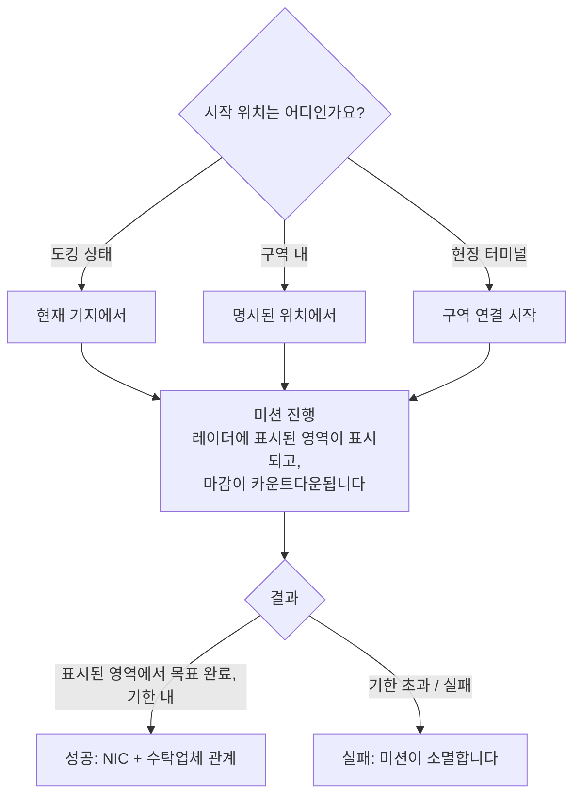

# 미션

**미션**은 구역에서 수행하는 구조화된 목표입니다 — 아이템 납품, 목표 타격, 구조물 사용. 미션은 진행, 보상 획득, 그리고 많은 구역 콘텐츠(경보, 키오스크, 일부 PBS/운송 연결 요소)를 구동하는 방법입니다.

> UI 위치는 [클라이언트 UI 개요](/ko/features/ui/)를 따릅니다. 아래 메커니즘은 서버 기준으로 확인되었습니다.

## 미션 시작

**카테고리**와 **레벨**(레벨은 유효 범위로 제한됩니다)을 선택하고 **위치**를 지정하여 미션을 시작합니다:

- **도킹 상태**라면, 현재 기지의 위치에서 미션이 시작됩니다.
- **구역 내**라면, 위치를 명시적으로 지정합니다.
- 미션은 **구역에서** 직접 시작(구역 연결 시작)하거나 **현장 터미널에서** 시작할 수도 있습니다.

모든 카테고리/레벨이 모든 곳에서 이용 가능한 것은 아닙니다 — 가용성은 콘텐츠에 따라 결정됩니다. 미션 전체 목록(유형, 카테고리, 레벨, 소요 시간, 보상 수수료, 보상 아이템)은 [미션](/content/missions/)에서 생성됩니다.

## 미션의 목적

미션은 동시에 두 가지 목적을 수행합니다: NIC를 지급하고, 발주(수탁) 기업과의 **관계**를 형성합니다. 더 좋은 관계는 해당 기업의 터미널에서 **더 높은 시설 비율**을 얻는 핵심 요인입니다 — 생산 및 기타 시설 작업이 더 저렴하고 빨라집니다. 관계는 *하락*할 수도 있습니다: 일부 미션은 다른 기업의 이익과 충돌하며, 브리프는 그것이 평판에 비용을 부과하는 경우를 명시합니다.

- **훈련 미션** — 쉬우며 초보자에게 강조 표시됩니다. 전부 수행해 보세요, 보상이 초기에 좋은 도움이 됩니다.
- **일반 미션**은 세 가지 유형이 있습니다:
  - *전투* — 정찰(적 로봇 스캔), 수배(표시된 원 안의 목표 처치), 파괴 및 회수(처치 + 회수 + 납품), 정찰 및 회수, 특수 수배(접근이 어려운 목표).
  - *산업* — 지질학(적절한 전하를 가진 광물 스캔), 채굴, 광물 개발, 숙련 개발(경비된 채굴 지점 — 무장한 도움을 데려오세요).
  - *물류* — 운송(터미널 간 패키지 납품) 및 회수(위험 지역을 통과하는 대형 패키지 — 호위하세요).
- **안전한 미션**이라는 것은 없습니다: 경로에서 적을 보고 자기를 방어할 장비를 갖추지 못했다면, 모든 것을 잃기 전에 도움을 요청하세요.
- **목표는 표시된 영역에서만 인정됩니다** — 미션 맵은 레이더에 빨간 원으로 표시합니다. 다른 곳에서의 처치와 스캔은 무효입니다. 기한을 넘기면 미션이 즉시 실패합니다.
- **개인 운송 계약** — Syndicate가 운영하는 시스템(미션 창 두 번째 탭)으로, 플레이어가 컨테이너를 등록하면 다른 플레이어가 터미널 간에 운반하며, 정해진 보상과 운반자가 담보로 걸는 **담보금**이 있습니다(성공 시 환불, 컨테이너 파괴 시 몰수; 중단 시 절반만 환불). 실제로 누군가가 운반할 수 있을 만큼 컨테이너를 작게 유지하세요.

## 미션 데이터 및 옵션

- **미션 데이터** — 미션의 세부 정보.
- **미션 옵션** — 미션에서 선택할 수 있는 선택지/변형.
- **미션 보급품** — 미션에 포함된 보급품.
- **시작 아이템** — 미션 시작 시 보유한 아이템.

## 미션 진행

- **진행 중인 미션 목록** — 현재 수행 중인 내용.
- **중단** — 진행 중인 미션을 취소합니다.
- **참가자 추가** — 다른 캐릭터를 미션에 참여시킵니다(멀티플레이어 미션).
- **미션 로그** — 미션의 이벤트 로그.

## 납품

- **납품** — 납품 목표를 완료합니다. 미션에 따라 **도킹 상태**(기지) 또는 **구역 내**(특정 위치/eid)에서 수행할 수 있습니다.

## 에이전트

- **에이전트 목록** — 이용 가능한 미션 에이전트(미션을 발주하는 NPC/파벌).

## 현장 터미널

- **현장 터미널 정보** — 구역 내 현장 터미널을 검사합니다(미션을 시작하거나 지원하는 구조물).

## 실무 참고

- **미션은 연결 고리입니다** — 경보, 키오스크, 일부 구조물은 미션 객체입니다([채집](/ko/features/gathering/) 및 [전투](/ko/features/combat/) 참조).
- **멀티플레이어** — 참가자를 추가하여 미션을 협력 수행할 수 있습니다.
- **납품 조건이 중요합니다** — 일부 납품은 도킹 상태가 필요하고, 일부는 구역 위치가 필요합니다.
- **레벨은 제한됩니다** — 범위를 벗어난 레벨을 요청하면 오류가 아니라 수정됩니다.
- **중단은 탈출구입니다** — 미션이 악화되면 중단하세요.

## 미션 구조물

미션은 구역에서 **구조물**에 의해 고정됩니다. 서버는 다음 유형을 구현합니다:

| 구조물 | 기능 |
|---|---|
| **단순 스위치** | 즉시 상호작용 — 접근하면 미션 목표가 완료됩니다 |
| **경보 스위치** | 시간 기반 작업 — 일정 기간(미션 옵션에서) 범위 내에 머무릅니다. 2초마다 확인됩니다 |
| **아이템 보급** | 경보 스위치처럼 시간 기반이며, 이후 **로봇 컨테이너에 아이템을 생성합니다** |
| **키오스크** | **아이템 제출** 지점 — 미션에 필요한 아이템을 전달합니다 |

<!-- TODO: 전체 미션 목록, 카테고리, 레벨 범위 및 보상은
     /content/missions/에서 생성됩니다. 확인됨: 미션 구조물 유형
     (MissionEngine/MissionStructures: SimpleSwitch, AlarmSwitch, ItemSupply, Kiosk);
     미션 UI 확인 필요.
     개발자 노트: Missions/MissionStart.cs (카테고리, 레벨 제한, 도킹 vs 구역
     위치), Missions/MissionDeliver.cs (도킹 vs 구역 납품), MissionAbort.cs,
     MissionData.cs / MissionGetOptions.cs / MissionGetSupply.cs / MissionStartItems.cs,
     MissionListRunning.cs / MissionListAgents.cs / MissionLogList.cs,
     MissionPlayerAddsParticipant.cs, FieldTerminalInfo.cs, MissionStartFromZone.cs;
     Services/MissionEngine/* (MissionProcessor, AlarmSwitch, Kiosk를 포함한 미션 구조물). -->