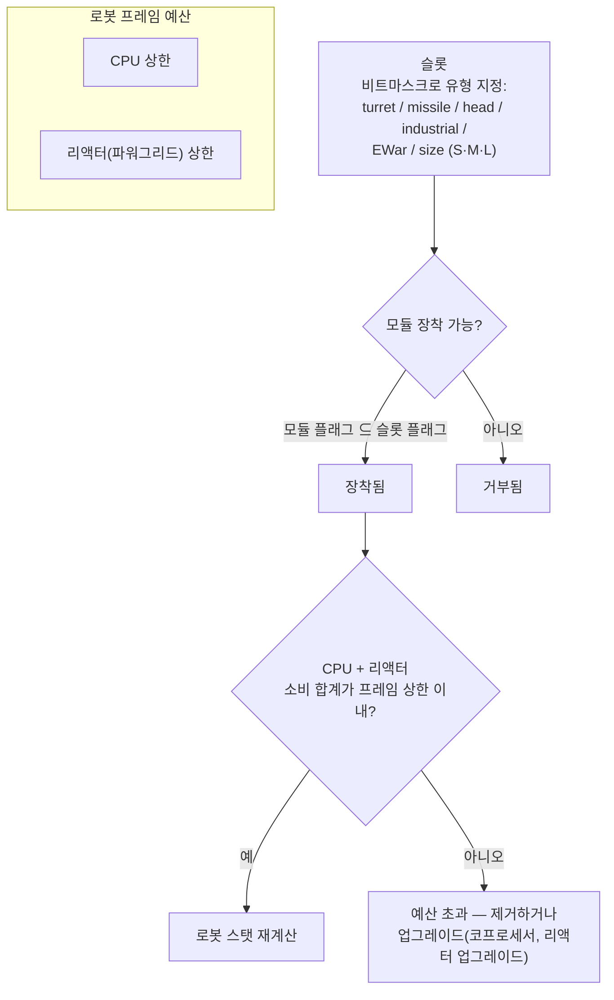

# 모듈 & 피팅

“로봇을 구매하면 차체만 얻게 됩니다.” 모듈로 장비하는 과정이 로봇을 필요한 모습으로 만듭니다. *피팅*은 모듈 로드아웃("내 피팅을 보내줘")과 그것이 소모하는 CPU/리액터 예산을 모두 의미합니다.

## 슬롯 & 자원

로봇의 프레임에는 차체에 의해 정의된 고정된 **슬롯** 집합이 있습니다. 각 슬롯은
비트마스크로 유형이 지정됩니다 — 터렛, 미사일 발사기, 헤드, 산업, EWar/엔지니어링,
크기(소형 / 중형 / 대형) — 그리고 모듈은 자신의 유형 마스크가 슬롯의 부분집합일 때만
슬롯에 장착됩니다. 따라서 캐스터의 터렛 슬롯은 소형,
중형 *또는* 대형 터렛 모듈을 수용하지만, 미사일 발사기는 절대 터렛 슬롯에 들어갈 수
없습니다. 헤드 모듈(코프로세서, 튜닝 모듈)과 차체/다리 모듈
(플레이트, 프레임)은 각각 전용 슬롯을 사용합니다.

모든 모듈은 프레임에서 **CPU**와 **리액터**(파워그리드)를 소모합니다 — 장착된 모든 것의
합은 두 한계 아래에 머물러야 하며, 일부 모듈은 사이클마다 **축전기**
(코어)도 소모합니다. 남은 용량은 피팅 창에 표시되는 *사용 가능 출력*입니다.
차체 규모 대략적 수치(T1/T2/T3 예시):

| 프레임 등급 | CPU | 리액터 | 예시 |
|---|---:|---:|---|
| 소형 크롤러 | ~250 | ~140 | Castel |
| 경량 메크 | ~480 | ~300 | Waspish |
| 중량 메크 | ~1 100 | ~1 000 | Tyrannos |
| 워커 | ~3 200+ | ~1 100+ | Gropho |

용량이 부족할 때: **CPU** — 코프로세서 모듈(예: T3 코프로세서는 +20% CPU 제공) 또는
T2 모듈 변형(소모 감소). **리액터** — 리액터 업그레이드(예: T3는 +20% 리액터 출력
제공) 또는 리액터 밀봉(방사선 감소, EnWar로부터도 보호 — 아래 참조).

## 모듈 계열

모델별 수치는 [아이템 카탈로그](/content/)와 [포맷 참조](/ko/formats/)에 있으며,
여기는 계열 지도입니다.

### 무기 & 탄약

네 가지 무기 기술, 각각 고유한 탄약과 거리 프로파일을 가집니다:

| 무기 | 탄약 | 거리 프로파일 | 비고 |
|---|---|---|---|
| **화기** | 탄환 | 최적 사거리 짧음, 큰 페일오프 | *절대 빗나가지 않는* 투사체이지만, “정확도”는 영역 반경으로 작동하므로 넓은 스프레이에서는 소형 표적도 여전히 감소된 데미지를 입습니다. |
| **자기(레일건)** | 슬러그 | 중거리, 급격한 페일오프 | 높은 충격 속도; 에너지 소모 큼. |
| **레이저** | 에너지 셀 | 장거리 | 에너지 소모가 가장 큼; 집중 빔. |
| **미사일** | 미사일 | 장거리 | 명중/빗나감은 *로봇의* 명중 확률 스탯으로 결정되며, 거리가 아닙니다. 데미지는 폭발 반경 대비 표적 크기에 따라 스케일링됩니다 — 소형 표적에 대형 미사일을 사용하면 훨씬 적은 데미지가 됩니다. |

데미지는 거리가 멀어질수록 매끄러운 코사인 곡선으로 감소합니다: 최적 사거리에서
전체 데미지, 최적 + 페일오프에서 0 (참조: [데미지 페일오프](/ko/features/combat/#pihae-yuhyeong)).

탄약은 데미지를 조정하는 부분입니다: 1차 + 2차 데미지 유형으로 표적에 맞춘 미세
조정이 가능하지만(참조: [데미지 유형](/ko/features/combat/#pihae-yuhyeong)),
순수 1차 데미지 탄약보다 총 데미지가 약간 줄어듭니다.

터렛은 소형/중형/대형이 있습니다. **크기를 로봇에 맞게 맞추세요**(소형 봇은 소형
모듈, 메크와 헤비는 중형/대형).

### 방어

- **방어 플레이트** — 주요 히트포인트 풀; 방어구가 0이 되면 로봇이 폭발합니다.
  **LWF**(경량 프레임) 플레이트는 내구성을 속도로 교환합니다: T2 LWF 플레이트는
  방어구를 약 0.73배로 줄이지만 +19% 속도, −0.2 시그니처, −0.2 질량을 제공합니다.
- **실드 생성기** — 축전기로 공급되는 장벽으로 방어구보다 먼저 데미지를 흡수합니다.
  실드는 *자기 코어*를 소모하여 흡수합니다: 2× 실드에서 100 데미지를 줄 공격은
  100 방어구 대신 50 코어를 소모합니다. 실드가 활성화된 동안 자기 무기는 발사할
  수 없습니다. 흡수 품질은 시그니처 대비 실드 반경에 따라 스케일링됩니다 —
  소형 프레임에 대형 실드가 가장 효과적입니다.
- **방어구 수리** — 능동 수리 모듈(소형/중형/대형); **원격 방어구 수리**은
  잠금된 표적(동맹 또는 PBS)에 도달하지만 사거리가 짧고 사이클이 깁니다.
- **방어구 강화기** — 데미지 유형별 수동 저항 포인트(화학 / 운동 / 열 / 폭발
  변형).
- **적응 합금** — 입은 데미지 구성을 *학습*하고, 가장 많이 맞은 데미지 유형으로
  고정된 저항 포인트 풀을 재분배하는 수동 모듈입니다.
- **기동성 / 회피** — 시그니처 감소 모듈과 NEXUS(아래)는 표적을 작게 만듭니다:
  영역 효과 데미지가 줄고 잠금이 어려워집니다.

### 에너지

- **리액터** — 지속 출력 한계; 리액터 업그레이드로 높이고, 리액터 밀봉으로
  방사선을 낮춥니다(EnWar 데미지 감소, 리액터 소모는 약간 증가).
- **축전기(코어)** — 모듈 사이클을 구동하는 버스트 에너지 예비. 시간 경과에 따라
  재충전됩니다(차체 `core_recharge_time`, T1 크롤러 기준 약 120 ms);
  **축전기 재충전기**는 재충전을 빠르게 합니다.
- **에너지 주입기(코어 부스터)** — 전하를 소모하여 축전기를 즉시 채웁니다.
- **에너지 전달기** — 자기 로봇에서 잠금된 동맹으로 코어를 빔 전송합니다
  (플레이어는 NPC에게 빔 전송할 수 없음).

### 전자

- **센서 부스터** — 수동, 자기: 잠금 시간을 줄이고 잠금 사거리를 늘립니다.
- **원격 센서 부스터** — 능동, 표적: 동일한 부스트를 잠금된 동맹에게 약 10.5초간
  적용합니다.
- **코프로세서** — 프레임의 CPU 한계를 높입니다(T1 +10% … T3 +20%).
- **무기 안정화기** — 무기 정확도를 개선하고(유효 영역 반경 감소) 질량을 약간
  줄입니다.
- **튜닝 모듈**(헤드 슬롯) — 특정 계열에 대한 고정 보너스: 데미지 모드(T3에서
  무기 계열별 +25% 데미지), 채굴 업그레이드(T3에서 채굴 및 수확 +10%),
  방어구 수리업그레이드(T3에서 수리 +16%, 사이클 −8%).

### 전자전(EWar)

적의 시야와 감지를 차단합니다:

- **센서 감쇠기** — 원거리 디버프: 표적의 잠금 시간을 늘리고 잠금 사거리를
  약 5.5초간 줄입니다. 자신의 ECM 강도가 표적의(무작위화된) 센서 강도를 이길
  때만 적용됩니다.
- **센서 재머** — 즉시: ECM 판정 성공 시 표적의 *모든* 잠금을 초기화합니다.
- **ECCM** — 20초 자기 버프: 센서 강도와 잠금 저항을 높이고, ECM 취약 디버프
  (감쇠기, 웹)를 *해제*합니다.
- **뉴럴라이저** — 약 1.65 km 내 **모든** 플레이어의 잠금을 초기화합니다.
  패닉 버튼입니다.

대응: 센서 강도(차체), ECCM, 거리 유지.

### 스텔스 & 탐지

- **스텔스 모듈** — 약 10.5초 스텔스; 소모량은 시그니처 반경에 따라
  스케일링됩니다(프레임이 클수록 코어 소모가 빠름).
- **타겟 페인터** — 표적의 스텔스 강도를 제거하는 약 10.5초 디버프.
- **탐지 모듈** — 탐지 강도를 수동으로 높입니다.

탐지 강도와 스텔스 강도의 대결은 클로킹된 표적을 아예 볼 수 있는지(잠금할 수
있는지)를 결정합니다 — [탐지 & 마스킹](/ko/features/combat/#tamji-maseuking-mic-sogdo)
참조.

### 에너지전(EnWar)

적의 에너지를 빼앗거나 차단합니다:

- **드레이너(에너지 뱀파이어)** — 잠금된 표적의 코어를 흡수하여 자기 축전기에
  추가합니다.
- **뉴트럴라이저** — 동일하지만, 흡수된 코어가 소멸합니다.
- 둘 다 표적의 **리액터 방사선**에 의해 약화됩니다 — 밀봉은 실질적인 대응입니다.
- **데모빌라이저(웹)** — 표적에게 약 5.5초 속도 감소; 효과는 표적의 질량에 따라
  스케일링됩니다(중량 프레임은 더 적게 감속)이며, 모듈의 최적 사거리 밖 표적에는
  실패합니다.
- **스코처** — 최대 5개 표적으로 *체인*되는 전기 무기로, 실드와 방어구에 관통
  데미지를 입힙니다.

### 산업

- **드릴**(소형 / 대형)과 **하베스터**(소형 / 대형) — 채집 모듈; 수확량,
  사이클 시간, 축전기 사용량이 중요한 스탯입니다. 채굴은 EP를 지급합니다
  (일일 상한 및 액체 패널티).
- **지질 스캐너** — 탐침의 정확도로 주변 광물 지대를 스캔합니다; 결과는 지면
  아래에 무엇이 있는지도입니다(참조: [채집](/ko/features/gathering/)).
- **엑스카베이터** — 오라 모듈: 주변 유닛의 채굴/수확 수확량을 높입니다
  (T3: +50%) 대신 스텔스를 희생합니다.
- **테라포밍**(감마 존) — 지형을 올리고, 낮추거나 평탄화하는 지형 잠금
  (최대 반경 5 m)과 벽 식물 성장; [존 섹션](/zones/zone-gamma-z106/) 참조.
- **원격 컨트롤러** — 리드에 묶인 터렛과 드론: 각 컨트롤러 모듈은 대역폭(수),
  작동 사거리, 드론 수명(티어별 5–10분)을 가집니다. 변형: 전술(데미지/사이클),
  강습(데미지), 지원(원격 수리), 산업(채굴/수확 드론), 헌터.
  **원격 명령 변환기** 모듈은 드론 데미지, 방어구, 채굴 수확량, 수리 출력을
  증폭합니다(T3: 각 +7.5%) 그리고 컨트롤러의 대역폭을 늘릴 수 있습니다.

### NEXUS

Networked Extension Utilization Systems: **스쿼드 버프**. NEXUS 모듈은 자기 로봇
주위에 오라를 방출하여 오라 반경 내 **갱 멤버**(그들의 터렛/드론 포함)를 버프합니다
— 기본 10 m, 10초마다 갱신 가능. 규칙:

- 로봇은 최대 **3개의 NEXUS 오라**를 장착할 수 있으며, 각 유형은 최대 **1개**입니다;
- 오라는 **갱**에 속한 유닛에만 도달하며, 무작위 동맹에는 도달하지 않습니다.

T3 유형 목록(13): 속도, 방어구, 실드, 팟락(잠금 사거리), 잠금 부스터(잠금 시간),
크리티컬 히트, 강습(무기 사이클), EW(EWar 사거리), 회피(시그니처), 수리업,
산업(채집 중 축전기 사용), 빠른 추출기(채집 사이클), 재충전기(코어 재충전).
각 T3 모듈은 해당 스탯의 약 +7.5%를 제공합니다; 예: 속도 NEXUS는 10 m 안에
서 있는 모든 갱 멤버의 최대 속도를 1.075배로 만듭니다.

### NOX

컬티스트 등급의 카운터: 반경 내 적 모듈을 *무효화*하는 **네게이터** 모듈 —
**실드 네게이터**(실드 흡수량을 약 90% 감소), **수리 네게이터**(수리 출력 감소),
**텔레포트 네게이터**(텔레포트 차단). 각 활성화는 화물에서 **플라즈마**를
소모하며, 오픈(비훈련) 존에서 사용하면 **캐릭터에 PvP 플래그**가 부여됩니다.

### 특수 목적

- **시즈 해킹 모듈** — 능동 SAP 도구: 5초 사이클, 3 m 사거리(참조:
  [아웃포스트](/ko/features/outposts/)).
- **자폭** — 8초 카운트다운을 설정합니다; 빔은 600 m까지 보입니다. 최후의
  정리 수단.
- **지뢰 탐지기** — 프레임의 지뢰 탐지 사거리를 늘립니다.
- **블롭 에미터** — 블롭 필드를 확산하는 에미터를 배치합니다; 방출 조절기
  모듈이 필드를 조정합니다(참조: [전투](/ko/features/combat/)).
- **PBS 건설** — 감마 존에 PBS 구조물을 배치하는 데 사용되는 모듈.

## 기본 원칙

1. **무기를 섞지 마세요.** 한 봇에 자기 + 레이저 + 미사일을 섞으면 보통 세
   가지 모두보다 성능이 떨어집니다; 단거리와 장거리를 섞는 것은 거의 좋은
   결과로 끝나지 않습니다.
2. **질량을 신경 쓰세요.** 모든 플레이트와 실드 모듈은 질량과 시그니처를
   증가시킵니다 — 때로는 방어보다 속도가 더 중요합니다.
3. **모든 것을 하려 하지 마세요.** 채굴, 스캔, 사격을 모두 하는 봇은 전문
   봇보다 어느 하나도 잘하지 못합니다.
4. **모듈 크기를 로봇에 맞게 맞추고**, 빌드가 실제로 작동하게 하는 튜닝
   모듈을 위해 CPU/리액터 여유를 조금 남겨 두세요.
5. …그리고 네, 일부 니치 피팅은 위 모든 규칙을 깨뜨리고도 여전히 작동합니다.
   다만 조금만 생각하세요.

<!--
개발자 노트: 2026년 백엔드 소스에서 재작성; 커뮤니티 위키 텍스트 재사용 없음.
검증 대상:
- src/Perpetuum/Robots/RobotComponent.cs (슬롯 비트마스크 피팅: moduleFlagMask & slotFlagMask)
- src/Perpetuum/Modules/SlotFlags.cs (12개 슬롯 플래그 비트)
- src/Perpetuum/Modules/Weapons/WeaponModule.cs + FirearmWeaponModule.cs +
  MissileWeaponModule.cs (정확도: 화기는 절대 빗나가지 않음, Accuracy에서 폭발 반경;
  미사일은 ParentRobot.MissileHitChance 사용)
- src/Perpetuum/Modules/Weapons/Damage.cs (코사인 페일오프, 크리티컬 1.75x +/-10%,
  폭발 스케일링 signature/explosionRadius [0,1] 클램프)
- src/Perpetuum/Units/Unit.cs GetResistByDamageType (resist/(resist+100))
- src/Perpetuum/Zones/DamageProcessors/DamageProcessor.cs (실드는 코어 소모,
  전기 = 관통)
- src/Perpetuum/Modules/EffectModules/ShieldGeneratorModule.cs (흡수
  수정자 = shieldRadius 비율 / shieldAbsorbtion; WeaponModule.cs:112는
  HasShieldEffect 동안 발사 차단)
- src/Perpetuum/Modules/EffectModules/{Webber,SensorDampener,SensorBooster,
  Stealth,TargetPainter,Eccm,Detection,AdaptiveAlloy}.cs (effects 테이블에서
  지속시간: dampener/web 5.5s, stealth/paint/remote-boost 10.5s, ECCM 20s)
- src/Perpetuum/Modules/SensorJammerModule.cs + Neuralyzer.cs (잠금 초기화,
  NEURALYZER_RANGE=1650)
- src/Perpetuum/Modules/{EnergyVampire,EnergyNeutralizer,Scorcher,
  CoreBooster,EnergyTransferer}.cs (EnWar, 리액터 방사선 수정자, 체인)
- src/Perpetuum/Modules/GangModule.cs + Zones/Effects/GangEffect.cs +
  EntitiesModule.cs:532-544 (13개 오라 유형, 갱 멤버 전용, effects 테이블
  auraradius=10)
- src/Perpetuum/Modules/NoxModule.cs (플라즈마 소모, PvP 플래그)
- src/Perpetuum/Modules/RemoteControl/* (대역폭/사거리/수명, 변환기 증폭)
- entitydefaults 행: named1-3 방어 플레이트/강화기, 실드 생성기
  (absorbtion 2.0-2.3, radius 5-33), LWF (mass_reductor), cpu/powergrid
  업그레이드, 데미지/채굴/수리업 튜닝, NEXUS named3 값, NOX 컬티스트
  값, 시즈 해킹 (5s/3m), 차체 core_max/powergrid_max.
수집된 페이지 대비 수정: NEXUS 오라는 갱 멤버에만 도달함("모든
우호 유닛"이 아님); "코-리액터" 모듈은 존재하지 않음(리액터 업그레이드/밀봉이
그 역할을 함); 데모빌라이저 효과는 표적 질량에 따라 스케일링되며 "저항 스탯"이
없음; 센서 서프레서 = 센서 감쇠기 (5.5s 디버프).
-->