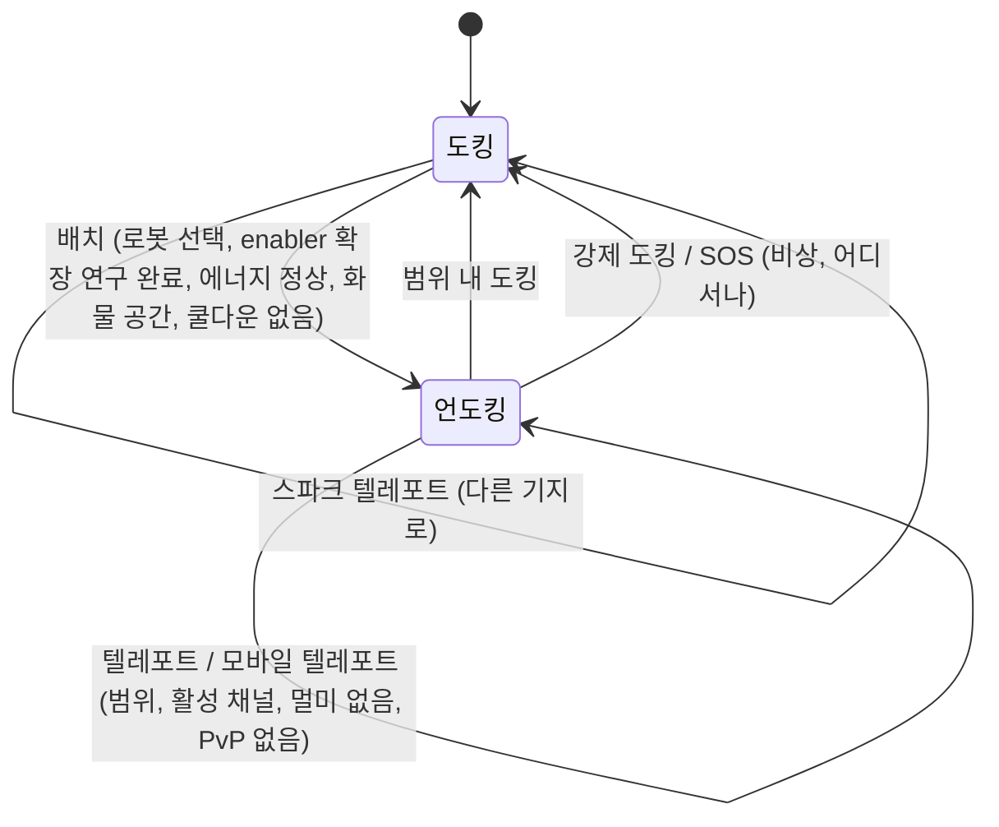

# 이동과 구역

항상 두 상태 중 하나에 있습니다: 기지에 **도킹**되어 있거나, 구역에서 **언도킹**되어
활성 로봇을 원격으로 조종하는 상태입니다. 이 페이지의 모든 내용은 두 상태 사이와
구역 사이를 이동하는 방법에 관한 것입니다.

> UI 위치는 [클라이언트 UI 개요](/ko/features/ui/)를 따릅니다: **배치/도킹 버튼**은
> 상단 바 중앙의 토글입니다. 아래 메커니즘은 서버 기준으로 확인되었습니다.

## 도킹과 언도킹

- **도킹** — 기지에 있습니다. 로봇과 아이템은 컨테이너에 있습니다. 로봇을 조종하거나,
  텔레포트를 사용하거나, 스캔할 수는 없지만 제작, 거래, 연구, 기지 시설 사용은 가능합니다.
- **언도킹** — 구역에 있으며 활성 로봇을 조종하고 있습니다. 이동, 스캔, 전투,
  구역 객체와의 상호작용은 가능하지만 대부분의 기지 전용 활동은 잠겨 있습니다.

## 언도킹

**배치**를 누릅니다(상단 바 중앙). 서버는 다음 모든 항목을 확인합니다:

1. **활성 로봇이 선택**되어 있습니다.
2. 해당 로봇 클래스에 필요한 **enabler 확장**이 캐릭터에 연구되어 있습니다
   ([연구](/ko/features/research/) 참조).
3. 로봇의 **에너지 시스템이 손상되지 않았습니다**.
4. 로봇의 **컨테이너에 여유 용량**이 있습니다.
5. **언도킹 쿨다운** 안에 있지 않습니다(특정 이벤트 후 짧은 타이머).

어떤 항목이라도 실패하면 언도킹이 거부됩니다.

## 다시 도킹

- 기지의 도킹 범위 안에 있을 때 **도킹**합니다.
- **강제 도킹**은 비상 조치입니다: 전투 중이더라도 즉시 구역을 빠져나와 메인 기지(TMA)에
  도킹합니다. 전투에서 지고 있을 때 사용하세요.
- **SOS** — 현재 기지에 도킹하고 사고를 표시하는 구역 지원 조치입니다.

## 구역 입장 대기열

일부 구역은 혼잡하여 **도킹 해제/입장** 시 **입장 대기열**을 사용합니다:

- 대기열 상태를 확인합니다(`zoneGetQueueInfo`).
- 원하는 대기열 길이를 설정합니다(`zoneSetQueueLength`).
- 마음을 바꿨다면 대기 중 취소를 할 수 있습니다(`zoneCancelEnterQueue`).

## 텔레포트

**텔레포트**는 구역 내부의 구조물입니다. 사용하려면:

- 텔레포트의 **범위 안에** 있어야 합니다.
- **채널**(목적지)이 **활성** 상태이고 유효해야 합니다.
- *텔레포트 멀미* 상태가 아니어야 합니다 — 텔레포트 후 짧은 쿨다운으로, 이 동안
  다시 텔레포트할 수 없습니다.
- 특정 효과(예: *Nox* 무효화)나 **PvP 전투 중**이면 텔레포트가 차단될 수 있습니다.

텔레포트 채널은 세 가지 유형이 있습니다:

| 유형 | 효과 |
|---|---|
| **구역 내** | 같은 구역의 무작위 지점으로 이동합니다 |
| **다른 구역** | 다른 구역의 무작위 지점으로 이동합니다 |
| **훈련 종료** | 훈련 구역을 종료합니다(보상 레벨 옵션 포함) |

**모바일 텔레포트**는 *소유*된 텔레포트 아이템입니다(예: 모바일 스트롱홀드/월드 텔레포트).
추가 규칙이 적용됩니다:

- **소유자 또는 소유자의 갱 멤버**만 사용할 수 있습니다.
- **PvP 중에는 사용할 수 없습니다**.
- 사용 시 해당 텔레포트에 **쿨다운**이 적용됩니다.

텔레포트와 채널을 나열하고, 월드 전체 채널을 조회할 수 있습니다.

## 스파크 텔레포트

**스파크 텔레포트**는 기지 간 빠른 이동 시스템입니다:

- 한 기지에서 스파크 목적지를 **설정**한 뒤, **사용**하면(도킹 중) 즉시 다른 기지로
  이동합니다.
- 스파크 텔레포트를 **나열, 설정, 사용, 삭제**할 수 있습니다.
- 대상 기지가 사용자에게 **도킹을 허용**해야 합니다.
- 도착 시 서버가 적합한 로봇을 선택합니다(연구한 enabler 확장이 있는 로봇).
- 보유할 수 있는 **스파크 텔레포트 수**는 확장으로 제한됩니다
  ([연구](/ko/features/research/) 참조); 초과 시 거부됩니다.

## 게이트

**게이트**는 어디서나 사용할 수 있는 구역 구조물입니다(텔레포트처럼 범위 제한이 없음).
기지 소유자는 게이트 이름을 **변경**할 수 있습니다.

## 기지 정보

모든 기지를 확인할 수 있습니다:

- **정보** — 무엇이고 어디에 있는지.
- **소유권** — 누가 소유하고 있는지.
- **시설** — 무엇을 제공하는지(생산, 시장, 상점, …).
- **내 아이템** — 해당 기지에 저장된 내 아이템.
- **도킹 권한** — 기지 소유자는 누가 그곳에 도킹할 수 있는지 설정할 수 있습니다.

## 문제 발생 가능성

| 증상 | 가능한 원인 |
|---|---|
| 언도킹 거부 | 활성 로봇 없음, enabler 확장 미연구, 에너지 시스템 손상, 로봇 컨테이너 가득 참, 또는 언도킹 쿨다운 |
| 텔레포트 거부 | 범위 밖, 채널 비활성, 텔레포트 멀미, Nox 효과, 또는 PvP 중 |
| 모바일 텔레포트 거부 | 소유자/갱 멤버가 아니거나, PvP 중 |
| 스파크 텔레포트 거부 | 대상 기지 도킹 금지, 선택할 유효한 로봇 없음, 또는 스파크 텔레포트 제한 도달 |
| 구역 입장 시 막힘 | 구역 대기열 — 대기열 상태를 확인하거나 취소 |

<!-- TODO(Phase 1): 클라이언트 UI 흐름 확인(도킹/언도킹 버튼, 텔레포트 화면).
     개발자 노트: Dock.cs / Undock.cs / ForceDock.cs (TMA = baseEid 561) /
     ZoneSOS.cs; Zone/TeleportUse.cs (TeleportPlayerValidator, 세 가지
     TeleportDescriptionType 전략, 모바일 텔레포트 갱/PVP 규칙);
     Sparks/SparkTeleportUse.cs (도킹 전용, 확장 수 제한);
     Zone/ZoneCancelEnterQueue.cs + ZoneEnterQueueService; GateSetName.cs. -->