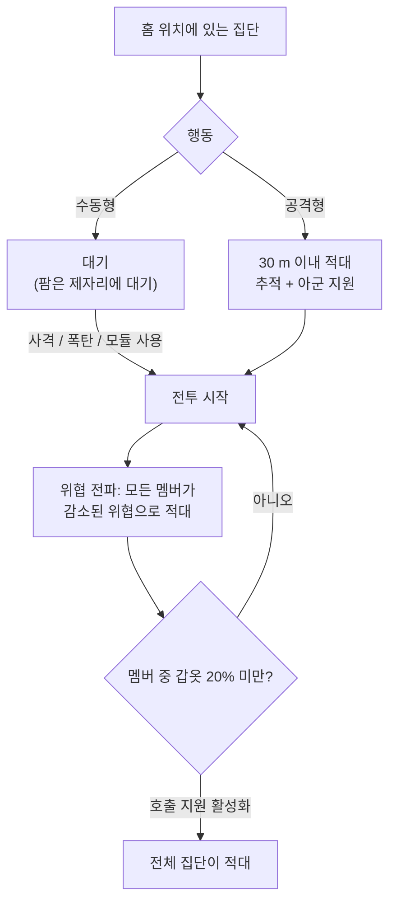

# NPC 및 PvE 사냥

NPC는 게임의 주요 [리액터 플라즈마](/content/ores/), [커널](/ko/features/research/) 및 모듈 공급원이자, 모든 레벨에서 확장 포인트를 안정적으로 얻는 방법입니다. 그들은 **집단**으로 존재합니다: 홈 위치, 홈 범위, 리스폰 시간, 행동을 공유하는 그룹입니다.

## 등장하는 NPC

NPC는 네 종족 — **Nuimqol, Pelistal, Thelodica, Industrial** — 로 나뉘며, 각 종족에는 여러 로봇 클래스(러너, 크롤러, 메크, 헤비 메크)와 스탯과 드롭이 상승하는 랭크 1~5가 있습니다. 일반 랭크 외에도:

- **고블린** — 보호 섬의 EWar 경비병입니다. 체력이 약하지만 잠금 수정치가 극단적으로 높습니다(보통보다 약 5배 빠르게, 약 2배 먼 거리에서 잠금): 고블린 캠프 근처에서는 전투나 채굴이 매우 고통스럽습니다.
- **엘리트** — 랭크 NPC의 희귀 변형으로, 기본 스탯이 약 2배이고 드롭도 좋습니다.
- **옵저버** — 로밍하는 공격형 NPC입니다(Arbalest, Baphomet, Waspish, Tyrannos, Artemis, Kain, Gropho, Sequer, Seth, Mesmer…). 섬의 넓은 지역을 순찰하며, 같은 클래스의 랭크 NPC보다 훨씬 강력합니다 — 보호 섬의 *그랜드* 옵저버와 오픈 섬 변형은 존재하는 가장 강력한 정규 사냥감입니다.
- **보스** — 희귀하고 개별 설정된 NPC입니다. 도망치지 않으며 서버 전체에 자신의 존재를 알릴 수 있고, 일부는 아웃포스트와 연결되어 있습니다(처치하면 [아웃포스트 안정도](/ko/features/outposts/)가 변동) 또는 처치 시 유물 균열을 생성합니다. 약한 보스는 보호 섬에서 솔로 처치가 가능하지만, 가장 강력한 보스는 전용 파티가 필요합니다.
- **신디케이트 스폰** — 자체 명명된 NPC를 가진 특수 세력(신디케이트)으로, 주로 보호 섬과 얕은 오픈 섬에서 자체 정적 팜을 운영합니다.

## 수동형 대 공격형

- **수동형 집단**은 스스로 공격하지 않습니다 — 먼저 사격, 폭탄, 또는 능동 모듈을 사용해야 합니다. 대부분의 클래식 정적 팜은 수동형입니다.
- **공격형 집단**은 **30 m** 이내로 접근하면 스스로 적대하며, 추격하고 전투 중인 아군을 지원합니다. 모든 옵저버, 대부분의 로밍 스폰, 아웃포스트 수호자/침입자는 공격형입니다.

전투가 시작되면 **위협이 집단 전체로 전파**됩니다: 모든 멤버가 감소된 위협으로 적대하며, 멤버 중 하나라도 갑옷이 **20%** 미만으로 떨어지면 전체 집단이 당신을 공격합니다(호출 지원이 활성화된 집단의 경우). 첫 번째 봇이 발사하는 순간부터 전체 스폰과 싸우고 있다고 가정하세요.

## 스폰과 리스폰

- **정적 스폰**은 고정된 홈 위치와 홈 범위를 가지며, 멤버는 **개별적으로** 자체 타이머에 따라 리스폰됩니다. 강하게 사냥된 집단은 더 빨리 리스폰되고, 새로 생긴 집단은 더 느리게 리스폰됩니다.
- **로밍 스폰**은 섬을 돌아다니며 — 옵저버와 컨보이형 집단이며, 보통 공격형입니다.
- **채굴장 증원** — 자원 노드에서 작업하는 Industrial NPC에는 사전 설정된 증원 웨이브가 있습니다: 전투가 길어질수록 추가 웨이브가 노드에 도착합니다. 보스도 피해를 입으면 증원을 호출합니다. 따라서 "로봇 한 마리" 팜이 집단 전투가 될 수 있으니, 개입 전에 주변을 확인하세요.

## 드롭되는 것

드롭은 NPC 유형별로 설정됩니다: **섬 종족의 리액터 플라즈마**, **커널**(일반, 하이테크, 산업, 종족 전용), 모듈 부품, 그리고 덜 자주 패키지 모듈. 높은 랭크와 특수 유형은 더 많이 드롭합니다.

모든 처치마다 **확장 포인트**가 지급되며, NPC 유형별로 설정됩니다 — 오픈(베타 티어) 섬에서는 2배입니다.

## 존 티어 혜택

섬은 3가지 티어로 나뉩니다 — 보호(알파), 오픈 PvE(베타), 오픈 PvP(감마). 더 깊은 지역으로 갈수록 사냥은 더 위험해지지만 보상도 더 큽니다:

- **사망 폭발** — 보호 섬에서는 로봇이 사망해도 *폭발하지* 않습니다. 오픈 섬(베타와 감마)에서는 파괴된 모든 로봇 — 플레이어든 NPC든 — 폭발하며 범위 피해를 줍니다. 연쇄 폭발은 사냥을 빠르게 하고 갱킹 포인트를 더 치명적으로 만듭니다.
- **2배 EP** — 베타 티어 섬에서는 모든 활동의 기본 EP 보상이 2배입니다.
- **더 좋은 미션** — 높은 미션 레벨은 오픈 섬에 있으며, 미션 EP도 2배입니다.
- **세력 미션 코인** — 오픈 섬의 미션은 보편 코인 대신 해당 종족의 미션 코인(Nuimqol / Pelistal / Thelodica 코인)을 지급합니다. 세력 코인은 오픈 섬 터미널에서 직접 판매되기도 하며, 세력 코인을 구매할 수 없는 곳에서는 보편 코인을 구매할 수 있습니다.

## 실전 팁

- **개입 전에 집단을 확인하세요** — 멤버 수를 세고, 랭크와 스폰이 공격형인지 확인하세요; 우연히 들어온 수동 팜도 봇 5마리일 수 있습니다.
- **사거리 밖에서 싸우세요** — 정적 스폰은 홈 범위에 머무릅니다; 먼 거리에서 명확한 사격을 위한 포지셔닝이 보통 가장 저렴한 승리 방법입니다.
- **자원 지점은 함정입니다** — 채굴장 증원이 있다는 것은 전투가 길어질수록 상대가 더 많아진다는 뜻입니다.
- **이동 중인 옵저버** — 탐험, 유물 수집, 장거리 이동 중이라면 경로 위의 공격형 옵저버는 전투나 우회입니다.

<!--
서버 백엔드를 기준으로 2026-09-27에 처음부터 작성:
Zones/NpcSystem/Flocks/ (Flock.cs, NormalFlock.cs — 그룹 리스폰, 적응형
리스폰 배율), AI/Behaviors/ (수동형 대 공격형; SmartCreature.cs에서 50% 위협 전파,
갑옷 20%에서 호출 지원), AI/BodyPullThreatHelper.cs
(30 m 적대 범위, 공격형 전용 시체 끌기), Reinforcements/ + npcreinforcements
(HP 임계값에서의 채굴장 및 보스 웨이브), NpcSpecialType + npcbossinfo
(보스 리스폰 노이즈, 아웃포스트 안정도 연결, 서버 전체 알림),
entitydefaults (rank1-5 + dps/interceptor/scout/miniboss/elite 변형, ~2x 수정치를 가진
30개 엘리트 정의; 13개 def_npc_roaming_* 옵저버; 5x 잠금 시간 / 2x 잠금 범위 수정치를 가진
고블린 랜서/샤크),
npcloot (26k 행: 종족 플라즈마, 일반/하이테크/산업/종족 커널,
모듈), NpcEp.cs + GetNpcKillEp (NPC별 EP, 베타에서 2배),
Unit.DoExplosion (보호 구역에서는 사망 AoE 억제, 베타/감마에서 활성화;
반경은 시그니처에서, 피해는 남은 코어에서),
MissionLocation.cs (종족 전용 미션 코인; 보호 구역에서는 보편 코인),
ZoneConfiguration (IsAlpha/IsBeta/IsGamma).
이 페이지의 이전 버전은 Open Perpetuum 커뮤니티 위키(perpetuum.miraheze.org)에서
적응되었으나 백엔드 소스를 기준으로 완전히 다시 작성되었습니다; 텍스트를 재사용하지 않았습니다.
수집된 "TAP" 섹션은 삭제되었습니다: 이 백엔드에는 텔레포트-어트랙터 개념이 존재하지
않습니다(정의, 코드, 테이블 모두 없음).
-->