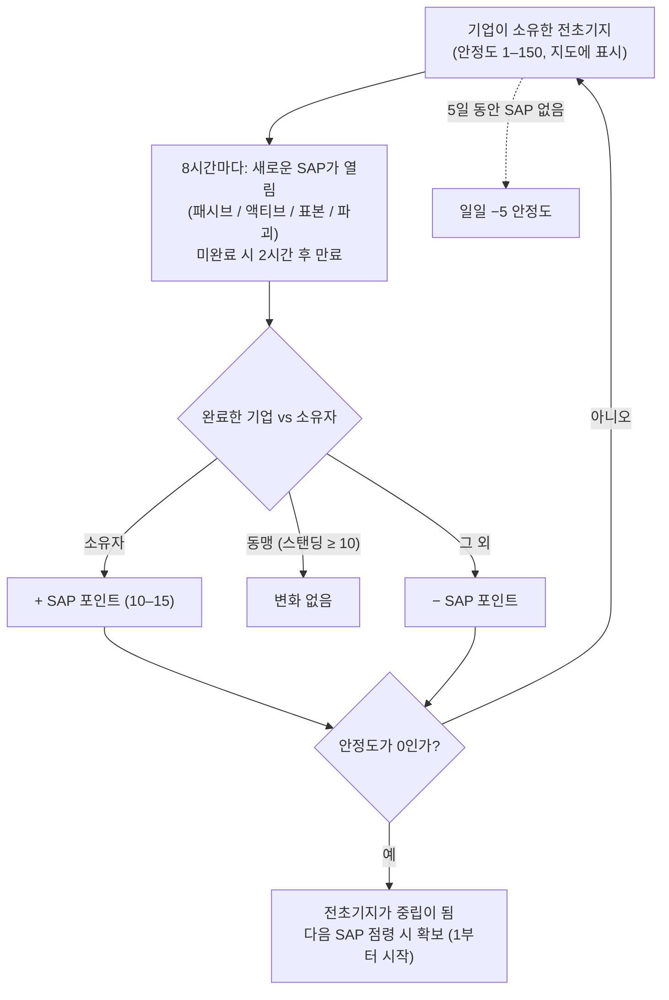

# 전초기지 & SAP

오픈 PvP 섬에서는 **전초기지를 플레이어 기업이 소유할 수 있습니다**.
제어는 지도 보기에서 전초기지 위에 표시되는 **안정도** 게이지(0–150)로 측정됩니다. 그 게이지가 움직이는 방식, 그리고 전초기지가 주인을 바꾸는 방식은 **SAP**(서비스 접근 지점) 시스템입니다.

## 규칙

- **소유** 기업이 SAP를 완료하면, SAP의 포인트 값만큼 안정도가 **상승**합니다.
- **소유자와 동맹인 기업**(상호 스탠딩이 +10 이상)이 완료하면, 안정도는 **변동하지 않습니다**.
- **그 외**가 완료하면, 같은 양만큼 안정도가 **하락**합니다.
- **0**이 되면, 전초기지는 소유권을 잃고 중립이 됩니다. 중립 전초기지에서는 어떤 SAP를 완료해도 **점령**할 수 있으며(완료한 기업이 소유자가 되고, 안정도 1부터 시작합니다).
- **감쇠**: **5일** 동안 SAP가 완료되지 않으면, 완료될 때까지(또는 잃을 때까지) **일일 5 안정도**를 잃기 시작합니다.

## 4가지 SAP 유형

8시간마다 전초기지에 새로운 SAP가 열립니다 — 4가지 유형 중 하나입니다. 각 유형은 고유한 포인트 값과 완료 방법을 가집니다:

| 유형 | 수행 방법 | 포인트 | 보상 특징 |
|---|---|---|---|
| **패시브** | SAP 빔 안에 **8분** 동안 서 있음. 진행도는 개인 단위(각 플레이어의 빔 내 연속 체류 시간)이며, 가장 높은 개인 진행도가 완료합니다. | +10 | 팩션 플라즈마(안정도에 따라 증가), 연구 키트, EP 부스터. |
| **액티브** | SAP를 표적으로 지정하고 **SAP 해킹 모듈**을 계속 가동 — 약 120회 모듈 사이클(각 5초), 즉 약 10분. 중단하거나 이탈해도 진행도가 유지되며, 개인 단위입니다. | +15 | 플라즈마, 커널, 연구 키트, **리액터 코어**(로봇 생산). |
| **표본** | **표본 아이템**을 SAP(7m 이내)로 가져가서 요청하는 5–6개를 제출. 제출마다 90초 쿨다운이 있으며, 진행도는 개인 단위입니다. | +15 | 플라즈마, 커널, 연구 키트. |
| **파괴** | 파괴: **30,000 아머** 및 **4가지 피해 유형 모두에 대한 150 저항**(60% 감소), **6m 시그니처** — 소형 무기가 가장 효과적입니다. 피해 진행도는 **기업 단위이며 개인 단위가 아니므로** 함대 전체가 동시에 깎을 수 있으며, 파괴 시 가장 많은 피해를 입힌 기업이 결과를 적용합니다. | ±15 | 팩션 **PvP 탄약**, 플라즈마, 커널. |

4가지 SAP 모두 현재 최고 점수자(상위 10명)를 주변 모든 사람에게 전파하며, 완료되지 않으면 2시간 후 만료됩니다.

### 적 차단

파괴 진행도는 기업 단위이고, 안정도 변화 방향은 누가 이기느냐에 따라 달라지기 때문에, 일반적인 전술은 **리더보드 1위를 차지할 만큼은 피해를 주되 SAP를 완료할 만큼은 주지 않는 것**입니다. 이후 소유자 자신의 크루가 완료하면, *당신의* 기업이 여전히 승자가 되어 안정도 변화가 소유자에게 적용됩니다.

## 관찰 및 예측

- 지오스캐너의 **침입 스캐너 차지**를 전초기지 근처에서 활성화하면, 범위 내 전초기지에 대해 **다음 SAP까지 남은 시간**을 보고합니다(오픈 PvP 섬에서는 같은 차지가 NPC 증원 상태를 대신 보고합니다).
- SAP는 열리기 직전에 주변 플레이어에게 알림을 보냅니다.
- SAP의 최고 점수자 전파 덕분에 **경쟁 중인 SAP를 실시간으로 관찰**하고, 도전할지 결정할 수 있습니다.

## 안정도가 변하는 다른 방법

- **SAP 유물** — 전초기지에서 90–350m 거리에 생성되는 유물 오브젝트(4시간 리스폰, 최대 12시간 경과). 하나를 터뜨리면 **±1 안정도가 즉시** 적용되며(당신의 기업에), PvP 플래그가 걸리고 EP와 플라즈마 컨테이너를 지급합니다.
- **가디언과 침입자** — 전초기지의 NPC 보스:
  - **가드** NPC는 전초기지 근처(~35m)에서 대기합니다. 누가 처치하든 하나를 처치하면 안정도가 **항상 3 감소**하며, 약 6시간 후 리스폰됩니다.
  - **침입자** NPC는 약 300m까지 순찰합니다. 하나를 처치하면 처치한 기업의 안정도가 **2 증가**하며, 약 6시간 후 리스폰됩니다.

## 전초기지가 중요한 이유

전초기지를 소유하면 기업에 보너스(생산, 방어 시설, 효과)가 부여되며, 오픈 PvP 영토 플레이의 핵심입니다 — 전초기지를 실제 작전 기지로 만드는 구조물에 대해서는 [PBS](/ko/features/pbs/)를 참고하세요.

<!--
서버 백엔드를 기준으로 처음부터 작성됨, 2026-09-27:
Zones/Intrusion/Outpost.cs (안정도 0-150, 1에서 점령, 동맹 임계값
+10, 참가자에게 EP), OutpostDecay.cs (5일 유예, 일일 -5), SAP.cs +
PassiveHackingSAP.cs / ActiveHackingSAP.cs / SpecimenProcessingSAP.cs /
DestructionSAP.cs (8분 패시브, 120x5초 액티브, 90초 쿨다운이 있는 표본
아이템 5-6개, 기업 단위 파괴 점수, 2시간 만료, 상위 10명 전파),
entitydefaults 옵션(#increase=n10/n15), siegeitems(def_specimen_sap_item
2-3 x 5-6), def_sap_destruction 스탯(30k 아머, 전 유형 150 저항, 6m
시그니처), def_siege_hack_module(5초 사이클), intrusionsitestabilitythreshold
+ intrusionsaps, intrusionloot(안정도 티어별 플라즈마/커널/연구 키트/코어/PvP
탄약), npcbossinfo + npcflock(가드 -3 @ ~35m, 침입자 +2 @
~300m, 6시간 리스폰), OutpostRelicManager.cs + SAPRelic.cs(90-350m 생성,
4시간 리스폰, 12시간 수명, +1 안정도, PvP 플래그), Scanner.Intrusion.cs
(다음 SAP까지 시간 스캔), EntitiesModule.cs(8시간 SAP 간격).
이 페이지의 이전 버전은 Open Perpetuum 커뮤니티 위키(perpetuum.miraheze.org)에서
가져와서 백엔드 소스를 기준으로 완전히 다시 작성했으며, 텍스트를 재사용하지
않았습니다.
참고: 수집된 텍스트에는 이 서버와 모순되는 여러 수치가 있었습니다(3일
감쇠 vs 5일, 10분 패시브 vs 8분, "저항 없음" vs 전 유형 150,
3km 침입자 범위 vs 300m).
-->