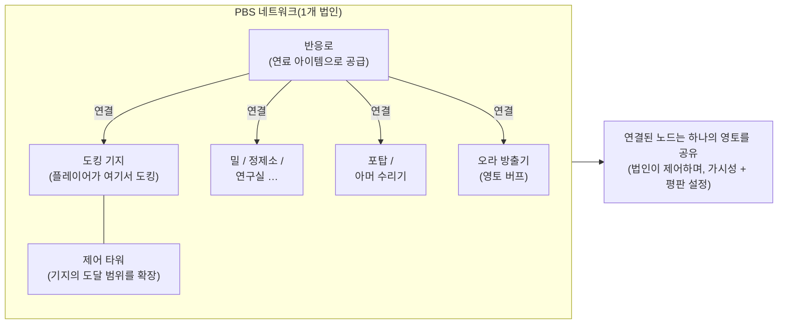
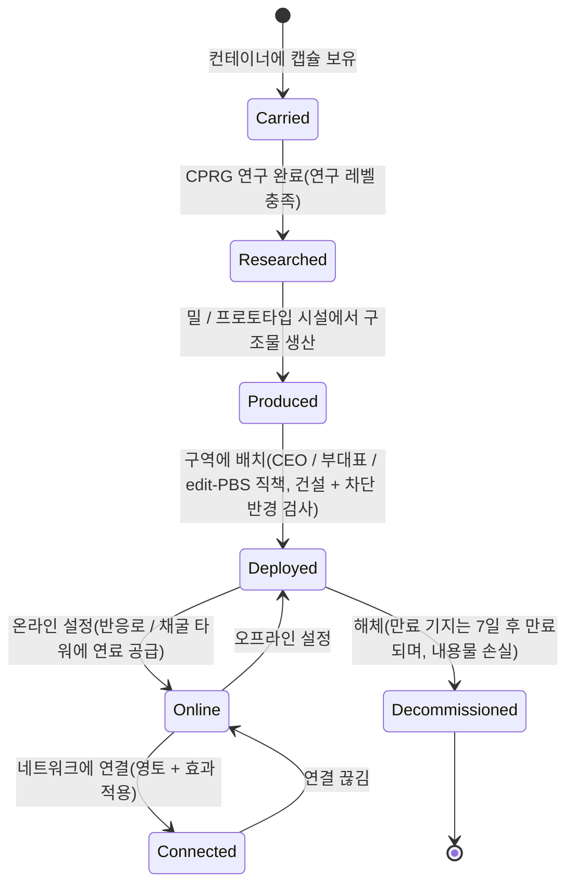

# 전력 기지(PBS)

**PBS**(Power Base Station)는 구역에 배치할 수 있는 구조물입니다. PBS 객체는 **네트워크**로 **연결**할 수 있으며, 이를 통해 **영토**를 정의하고 **효과**를 활성화할 수 있습니다. 이는 법인/구조물 관련 활동이며, 대부분의 작업에는 적절한 법인 직책이 필요합니다.

> UI 위치는 [클라이언트 UI 개요](/ko/features/ui/)를 따릅니다. 클라이언트 내 "PBS" 명칭은 확인이 필요합니다. 아래 메커니즘은 서버 기준으로 확인되었습니다.

## PBS의 역할

- PBS **네트워크**의 **노드**입니다.
- 연결된 노드는 소유 법인이 제어하는 공유 **영토**를 형성합니다.
- 네트워크는 자신의 영토에 **효과**(버프/제어)를 적용할 수 있습니다.
- 일부 PBS 구조물은 작동하기 위해 아이템(연료)을 **공급**받을 수 있습니다.

## 구조물 계열

모든 PBS 구조물은 **소형 / 중형 / 대형** 등급으로 나뉩니다. **캡슐**을 소지하고 아이템(CPRG)을 연구한 뒤 객체를 **배치**합니다. 배치는 권한에 따라 제한됩니다(아래 참조). 계열은 다음과 같습니다:

| 계열 | 구조물 | 역할 |
|---|---|---|
| 전력 | 반응로, 에너지 우물, 코어 배터리, 코어 송신기 | 모든 시스템의 구동 기반인 **코어 에너지**를 생성, 저장, 분배합니다 |
| 도킹 | 도킹 기지, 만료 도킹 기지, 제어 타워 | 플레이어가 도킹하는 위치. 제어 타워는 기지의 도달 범위를 확장합니다 |
| 생산 | 밀, 정제소, 재가공기, 수리, 프로토타이퍼, 연구실, 캘리브레이션(CPRG) 포지, 연구 키트 포지, 생산 업그레이드 | [생산](/ko/features/production/) 시설을 홈 베이스가 아닌 구역에 배치합니다 |
| 방어 | 포탑(레이저 / 레일 / 미사일 / 전자전), 아머 수리기 | 영토의 자동 방어 |
| 효과 | 오라 방출기, 효과 공급기, maskertower, 채굴 타워 | 영토의 효과 보너스를 적용합니다. 채굴 타워는 광물을 자동으로 추출합니다 |
| 수송 | 하이웨이 노드 | 구역의 **하이웨이**(고속 이동선)와 연결합니다 |
| 건설 | 건설 모듈 | 다른 구조물을 배치하는 건설기 |

### 오라 방출기 효과

오라 방출기는 주요 영토 버프입니다. 각 등급은 세 가지 **레벨별 기본 보너스** 중 하나를 적용합니다:

- **소형** — 센서 lvl1 / 엔지니어링 lvl1 / 산업 lvl1
- **중형** — 동일한 세 가지 lvl2
- **대형** — 동일한 세 가지 lvl3

센서는 스캐닝/정찰 범위를 확장하고, 엔지니어링은 건설 속도를, 산업은 생산 속도를 높입니다.

### 만료 도킹 기지

고정된 **7일 수명**(콘텐츠 내 168시간)이 있는 특수 PBS 기지입니다. **해체할 수 없으며**, **만료되거나 파괴**됩니다. 남은 수명은 게임 내 공지(기지 채널 토픽, 메일, MOTD)로 안내되며, 수명이 끝나면 기지가 제거되고 내부 물품이 손실됩니다. 이는 PBS 도킹의 "임대" 모델입니다. 임대료를 내는 것이 아니라 시간 제한을 부여받습니다.

## 배치

- **배치 검사** — 배치 전에 해당 위치에 PBS를 배치할 수 있는지 확인합니다(경사, 차단, 권한 검사). 이는 법인 직책(**CEO / 부대표 / edit-PBS**)이 필요합니다.
- 배치는 구조물의 **건설 반경**과 **차단 반경**을 사용합니다.

## 네트워크 및 연결

- **네트워크 조회** — 소속된 PBS 네트워크를 확인합니다.
- **노드 정보** — PBS 노드의 세부 정보입니다.
- **노드 이름 변경**.
- **연결 생성** — 두 PBS 노드를 연결합니다. (이미 도킹 기지가 있는 네트워크에 연결하면 특정 소유권 이전 사례가 발생합니다.)
- **연결 해제** — 두 노드의 연결을 끊습니다.
- **연결 가중치 설정** — 연결의 강도/우선순위를 조정합니다.

## 제어 및 상태

- **온라인 설정** — 노드를 온라인/오프라인으로 전환합니다.
- **효과 설정** — 노드가 적용할 효과를 설정합니다.
- **기지 해체 설정** — 기지를 해체 대상으로 표시합니다.

## 영토

- **영토 조회** — 네트워크가 제어하는 영토 목록을 확인합니다.
- **영토 가시성 설정** — 영토가 다른 사용자에게 보이는지 제어합니다.
- **평판 제한 설정** — 평판에 따라 접근을 제한합니다.
- **강화 오프셋 설정** — 강화 동작을 조정합니다.

## 연료 공급

- **공급 가능 정보** — PBS에 필요한 항목과 현재 공급 상태를 확인합니다.
- **아이템 공급** — PBS를 구동/작동시키기 위해 아이템을 제출합니다.

공급 가능한 구조물은 **반응로**와 **채굴 타워**입니다. 연료 공급은 에너지 가치가 있는 아이템(개당 `corecalories`)을 노드의 코어 에너지 버퍼로 변환하며, 최대치까지 가능합니다. 범위 내 모든 플레이어가 노드에 공급할 수 있습니다. 소각할 수 있는 항목:

| 연료 | 개당 코어 |
|---|---|
| 반응로 부스터 C등급 | 8,000,000 |
| 반응로 부스터 B등급 | 4,000,000 |
| 반응로 부스터 A등급 | 2,000,000 |
| SAP 표본(침입) | 600,000(플럭스 변형: 28,000) |
| 감마 에너지 블록 | 2,000 |
| 코어 부스터 탄약 | 1,000 |
| 원광(espitium) | 400 |
| 원광(vitricyl / prilumium / chollonin) | 300 |
| 원광(axicol) | 40 |

부스터는 효율적인 연료이며, 원광은 저렴한 대안입니다.

## 비용 정산

- **정산 정보 조회/설정** — PBS 관련 비용의 정산을 설정합니다.

## 로그

- **PBS 로그** — PBS 활동(연결, 배치 등)을 검토합니다.

## 실무 참고

- **이는 임원 활동입니다** — 배치와 대부분의 제어에는 법인 직책이 필요합니다.
- **연결이 영토를 정의합니다** — 구축한 네트워크가 제어 대상입니다.
- **먼저 배치 검사를 수행하세요** — 확정 전에 배치 실패 원인(경사, 차단, 권한)을 알려줍니다.
- **연료 공급이 작동을 유지합니다** — 반응로와 채굴 타워는 코어 버퍼를 유지하기 위해 연료 아이템(부스터 또는 원광)을 소각합니다.
- **만료 기지는 시간 제한입니다** — 7일, 해체 불가. 제거를 계획하세요.
- **영토 가시성 및 평판**으로 구역을 다른 사용자에게 열거나 닫을 수 있습니다.

## 방어 포탑

플레이어가 직접 조작할 수 없으며, PBS 방어 구조물로 배치됩니다. 포탑은 다른 로봇과 마찬가지로 부품으로 조립되지만, PBS 패드에 고정되어 조종할 수 없습니다.

| 포탑 | 역할 |
|---|---|
| PBS 포탑 | 일반 PBS 방어 |
| PBS EW 포탑 | 에너지전(실드/아머 교란) |
| PBS 레이저 포탑 | 빔 무기 방어 |
| PBS 미사일 포탑 | 미사일 방어 |
| PBS 레일 포탑 | 투사체(EM) 방어 |
| 경찰 경비 타워 | 구역 NPC 경찰 방어 |

부품 단위 세부 사항은 [로봇 참고 자료](/content/robots/)를 참조하세요.

<!-- TODO: PBS의 클라이언트 내 명칭과 UI만 남음(구조물 목록, 네트워크
     에디터, 연료 공급 화면).
     확인됨: def_pbs_* 정의 416개, capsule/cprg/pr/object 변형이 있는 S/M/L 등급; 오라 방출기 #effect=N93..101 = pbs 센서/엔지니어링/산업 lvl1-3
     (EffectType 열거형); feedable = reactor + mining tower (IPBSFeedable), fuel =
     definitionconfig.corecalories (boosters A/B/C 2/4/8M, SAP 600k/28k, gamma block
     2k, ore espitium 400 / vitricyl+prilumium+chollonin 300 / axicol 40);
     ExpiringPBSDockingBase: definitionconfig.lifetime의 수명 168시간, 해체 불가,
     공지 채널 토픽 + 메일, 만료 시 제거. -->
     개발자 노트: Zone/PBS/PBSCheckDeployment.cs (건설/차단 반경,
     CEO/deputy/editPBS 직책), PBSMakeConnection.cs / PBSBreakConnection.cs,
     PBSSetConnectionWeight.cs, PBSSetOnline.cs, PBSSetEffect.cs, PBSSetBaseDeconstruct.cs,
     PBSGetNetwork.cs, PBSNodeInfo.cs, PBSRenameNode.cs, PBSGetTerritories.cs,
     PBSSetTerritoryVisibility.cs, PBSSetStandingLimit.cs, PBSSetReinforceOffset.cs,
     PBSFeedableInfo.cs / PBSFeedItemsHander.cs, PBSGetReimburseInfo.cs /
     PBSSetReimburseInfo.cs, PbsGetLog.cs; Zones/PBS/* (IPBSObject, ConnectionHandler). -->