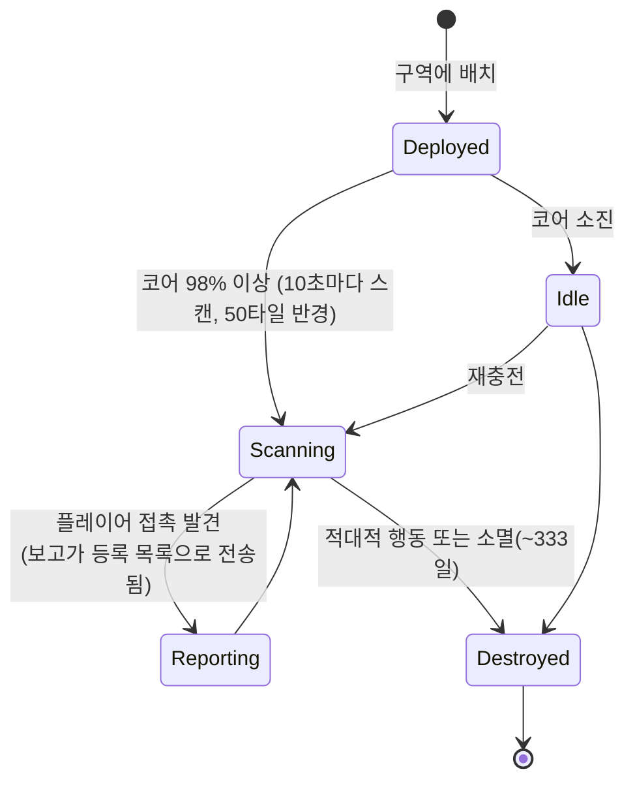

# 근접 탐침

탐침은 두 가지 계열이 있습니다:

- **가시성(근접) 탐침** — 구역에 배치하여 **관찰 영역**을 감시하는 소형 장치입니다. 전원이 공급되는 동안 주변 플레이어 유닛을 스캔하고, 등록한 캐릭터로 보고를 전송합니다. 이는 감시/정찰 도구입니다.
- **채굴 탐침** — 로봇에 장착하는 **모듈**(*noob*부터 *standard*, *industrial*, *named*, *elite*를 거쳐 *artifact*까지의 등급)과 **광종별 탐침 탄약**(각 광물에 대한 타일 / 방향 / 영역 변형)으로 구성됩니다. 발사하면 해당 구역의 해당 광물에 대한 스캔 결과가 생성되며, 캐릭터별로 저장됩니다([채굴 → 스캔](/ko/features/gathering/) 참조).

> UI 위치는 [클라이언트 UI 개요](/ko/features/ui/)를 따릅니다. 아래 메커니즘은 서버 기준으로 확인되었습니다.

## 탐침 관리

- **목록** — 보유 중인 탐침을 확인합니다.
- **등록 정보** — 탐침의 등록 상태/정보입니다.
- **등록 설정** — 캐릭터를 탐침의 보고 목록에 연결합니다.
- **이름 설정** — 탐침에 라벨을 부여합니다.
- **제거** — (구역에서) 탐침의 등록을 해제합니다 — 감시를 중지하거나 지웁니다.

### 가시성 탐침 작동 방식

- **코어 구동**: 코어가 거의 가득 찼을 때(`core_max`의 98% 이상)에만 스캔하며, 비어 있는 탐침은 대기 상태로 유지됩니다.
- 활성 상태에서는 **10초마다** **감지 반경(50타일)** 내의 플레이어 로봇을 스캔하고, 보고(각 접촉 대상의 캐릭터 ID와 위치)를 등록 목록의 모든 사람에게 전송합니다.
- **등록**은 기업 활동입니다: **본인 기업의 멤버**만 등록할 수 있으며, **CEO와 부대표는 항상 목록에** 자동으로 포함됩니다. 목록에는 최대 크기가 있습니다.
- **수명**: 배치된 탐침은 콘텐츠에서 정의된 `despawn_time`(가시성 탐침은 약 333일로 설정됨)이 지나면 소멸하거나 파괴됩니다.

## 라이프사이클 이벤트

서버는 탐침 라이프사이클 이벤트가 발생하는 대로 보고합니다:
- **created**, **updated**, **dead** — 탐침이 배치되거나, 보고하거나, 파괴됩니다.

이것들은 푸시로 수신됩니다. 사용자가 전송하는 것이 아니라, 반응합니다.

## 실무 참고

- **읽기 전에 등록** — 탐침은 등록된 캐릭터에게만 보고합니다.
- **탐침은 사망할 수 있습니다** — 적대적 행동 또는 만료로 탐침이 파괴될 수 있습니다. 라이프사이클 이벤트를 확인하세요.
- **이름을 붙이세요** — 현장에 여러 탐침이 있을 때 라벨이 혼란을 방지합니다.
- **정찰이지 전투가 아닙니다** — 탐침은 정보를 수집할 뿐, 전투하지 않습니다.

<!-- TODO: UI만 남음(탐침 목록, 등록 선택기).
     확인됨: 가시성 탐침(def_visibility_probe): core_max 50, core>98%일 때만 활성,
     10초 스캔 간격(ProximityDevice.cs _probingInterval), blob_emission 10 / blob_emission_radius 50으로 감지,
     보고 = 접촉 대상별 characterID + x/y를 등록된 캐릭터로 전송(ProximityProbe.OnUnitsFound);
     등록 = 본인 기업 멤버만, CEO+Deputy 항상 포함, 최대 개수
     (ProximityProbeRegisterSet.cs); 캡슐의 despawn_time 28,800,000초(약 333일);
     stealth_strength 275 / detection_strength 45. 채굴 탐침: 등급별 모듈
     (noob/standard/industrial1-2/named1-3/elite t2-t4/artifact) + 광종별 타일/
     방향/영역 탄약(def_*probe* 정의 79개).
     개발자 노트: ProximityProbeList.cs / ProximityProbeGetRegistrationInfo.cs /
     ProximityProbeRegisterSet.cs / ProximityProbeSetName.cs; Zone/ProximityProbeRemove.cs;
     Zones/ProximityProbes/ProximityProbe.cs + ProximityProbeDeployer.cs +
     ProximityDevice.cs; Zones/Blobs/* (blob 발산/스텔스); 라이프사이클 이벤트는
     ProximityProbeCreated/Update/Dead/Info 명령을 통해. -->
     개발자 노트: ProximityProbeList.cs / ProximityProbeGetRegistrationInfo.cs /
     ProximityProbeRegisterSet.cs / ProximityProbeSetName.cs; Zone/ProximityProbeRemove.cs;
     Zones/ProximityProbes/ProximityProbe.cs + ProximityProbeDeployer.cs; 라이프사이클
     이벤트는 ProximityProbeCreated/Update/Dead/Info 명령을 통해. -->