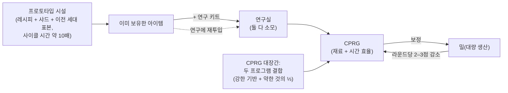

# 생산

생산은 원자재와 컴포넌트를 사용 가능한 아이템으로 전환하는 방법입니다. 이것은 도킹된 베이스의
**생산 시설**(밀)에서 이루어집니다. 여기의 모든 것은 **도킹 전용**입니다.

> UI 위치는 [클라이언트 UI 개요](/ko/features/ui/)(상단 바의 **정제소 / 재활용 / 수리 /
> 보험** 카테고리)를 따릅니다. 아래 메커니즘은 서버 기준으로 확인되었습니다.

## 생산 라인

**생산 라인**은 저장된 레시피입니다: 무엇을, 무엇으로부터 생산할지 정의합니다.
모든 제작 가능 아이템의 전체 컴포넌트 목록(연구 레벨 포함)은
[레시피](/content/recipes/)에서 생성됩니다. 라인을 특정 수의 **라운드** 동안 실행합니다.

- **라인 목록** — 사용 가능한 라인을 확인합니다.
- **라인 시작** — 시설에서 선택한 라운드 수(최소 1)만큼 실행합니다.
  - **개인 지갑** 또는 **법인 지갑**에서 지불할 수 있습니다.
  - 소스 컴포넌트는 **인벤토리** 또는 **로봇**에서 검색할 수 있습니다.
- **라인 보정** — 라인의 설정을 조정합니다.
- **라운드 설정** — 실행할 라운드 수를 선택합니다.
- **다음 라운드 조회** — 다음 라운드에서 소모/생산될 내용을 미리 봅니다.
- **취소** — 실행 중인 생산을 중단합니다.
- **라인 삭제** — 저장된 라인을 삭제합니다.

라인을 실행하면 컴포넌트(와 크레딧)를 소모하고, 라운드에 걸쳐 대상 아이템을 생산합니다.

## 단일 작업

이들은 멀티 라운드 라인이 아니라 단일 작업입니다. 각각 비용/출력을 확정 전에 미리 보여주는
**조회** 변형이 있습니다.

- **정제** — 원자재 → 상품, 아이템의 레시피 사용 ([레시피](/content/recipes/) 참조).
  대상 아이템을 만들 수량을 선택하며, 레시피의 명목 투입량은 재료 배율
  `1 + 50/(bonus + 100)`로 조정됩니다. 여기서 *bonus*는 정제 스킬(확장 + 시설 포인트 +
  평판 포인트)입니다. 보너스가 없으면 명목 레시피의 **150%**를 소모하며, 최대 보너스일
  경우 **100%**에 가까워집니다.
- **재활용 / 재가공** — 아이템을 레시피 컴포넌트로 되돌립니다(역 레시피). 수율은
  `nominal × (1 − 75/(bonus + 100)) × the item's health ratio` — 스킬 보너스가 없으면
  기본 **25%**이며 100%에 가까워지고, 손상된 아이템은 비율만큼 더 적게 얻습니다(가치 있는
  아이템은 먼저 수리하세요). "배치"(기본 수량 전체)만 재활용되며, 나머지는 남습니다.
  미션 아이템은 삭제되고 재활용되지 않습니다.
- **수리** — 손상된 아이템/로봇을 최대 내구도로 회복합니다. 비용은
  `(missing health %) × the item's material value × 75/(bonus + 100)`입니다. "재료
  가치"는 재귀적으로 계산됩니다: 아이템의 레시피가 원자재로 분해되고 **세계 시장 평균
  가격**으로 평가되므로, 수리 비용은 시장에 따라 변동합니다. 스킬 배율은 보너스가 없을
  때 **75%**에서 시작해 최대 보너스일수록 0에 가까워집니다.
- **연구 컴포넌트** — 연구 컴포넌트를 생산합니다(조회 + 실행).

## 아이템 라이프사이클(순환 과정)

아이템 생성은 세 개의 연결된 시설로 이루어진 순환입니다:

1. **연구(역공학)** — 생산하려는 아이템의 아이템과, 해당 아이템의 연구 레벨을 충족하는
   **연구 키트**(키트는 레벨 0–10)를 연구실에 투입합니다. 두 입력 모두 **소모**되며,
   작업 결과 해당 아이템의 **CPRG** 1개가 생성됩니다. 생성된 프로그램의 효율은 아이템별
   기본값(대부분 50, 탄약은 더 높고, 터렛은 최대 90)에서 시작하며, *필요 레벨보다 높은
   키트 레벨 × 5*와 연구 스킬 보너스(최대 +50)만큼 상승합니다. 따라서 아이템보다 몇
   레벨 높은 키트와 적절한 생산 확장 기능이 새로 만든 50/50 프로그램을 경쟁력 있는
   프로그램으로 만듭니다. 이것이 새로운 아이템이 생산 목록에 추가되는 방식입니다.
2. **밀(대량 생산)** — 프로그램으로 대량 생산합니다. 각 라운드마다 라인의 효율이
   **감쇠**됩니다(아이템 카테고리당 라운드당 2–3점; [CPRG](#cprg-bojeong-peurogeuraem)
   참조) — 폐기물이 너무 높아지면 새 프로그램을 라인에 보정합니다. 프로토타입 아이템은
   이전 세대 **표본**을 컴포넌트로 사용합니다(T2 프로토타입을 만들려면 스탠다드 모듈
   1개, T3를 만들려면 T2 1개)이며, 이 표본은 과정에서 소모됩니다.
3. **프로토타입 시설** — 아이템의 **프로토타입**을 직접 생산합니다: 레시피 재료와
   로봇 샤드, 이전 세대 표본을 사용하며, 밀의 사이클 시간의 약 **10배**(보통의 시간
   배율 추가)가 소요됩니다. 테크 트리에 잠금 해제된 아이템만 프로토타입을 만들 수
   있습니다. 프로토타입은 표준 버전보다 훨씬 비쌉니다. 주요 용도는 **고품질 프로그램으로
   연구**하는 것입니다(프로토타입 아이템을 연구해야 다음 티어가 잠금 해제됨) — 또는
   아이템이 드랍으로는 너무 드물고 시장에서는 너무 비쌀 때 로봇에 사용하는 것입니다.

## 티어 진행

대부분의 모듈과 로봇은 **T1 → T4 티어**로 나뉩니다(클라이언트의 티어 배지;
`standard → named1 → named2 → named3` 정의 라인, 그다음 `elitet4`/
`artifact` 특수 라인). 규칙:

- **각 티어는 자체 테크 트리 노드가 있는 별개의 아이템입니다.** 노드를 잠금 해제하려면
  연구 포인트(커널에서 연구)가 필요하며 **부모 노드**가 필요합니다 — 따라서 티어는
  순서대로 잠금 해제해야 합니다. 이미 잠금 해제된 노드를 가진 아이템만
  **프로토타입**(또는 대량 생산)을 만들 수 있습니다: 연구 없이 더 높은 티어를 만들
  방법은 없습니다.
- **더 높은 각 티어는 이전 티어 표본 1개를 컴포넌트로 소모합니다**(재료와 로봇 샤드
  추가). 따라서 T1 아이템은 T3로 "교환"될 수 없습니다 — T3 프로토타입에는 **T2**
  아이템이 필요하며, 표본은 변환되는 것이 아니라 **소모**됩니다: 출력은 완전히 새로운
  아이템입니다.
- 모든 아이템 페이지에는 **티어 라인**이 표시됩니다 — `T1 → T2 → T3 → T4` 전체 체인을
  링크로 — 그리고 [테크 트리 노드 페이지](/content/techtree/)에는 각 티어의
  부모/다음 노드와 포인트 가격이 표시됩니다.

예, 소형 광부 모듈 라인: [스탠다드 소형 광부 (T1)](/content/items/standard-small-driller/) →
[Biroter 5050 소형 광부 모듈 (T2)](/content/items/named1-small-driller/) →
[Sublimator Low-D 소형 광부 모듈 (T3)](/content/items/named2-small-driller/) →
[Scraper-990 소형 광부 모듈 (T4)](/content/items/named3-small-driller/) —
모든 모듈/로봇 계열에서 동일한 패턴입니다.

## 프로토타입 & 연구 키트

- **프로토타입** — 프로토타입 아이템을 생산합니다(시작 + 조회). 슬롯당 프로토타입
  1개; 더 많은 병렬 프로토타입 작업은 생산 확장 기능에서 옵니다.
- **연구 키트 병합** — 여러 연구 키트를 더 높은 키트로 결합합니다(실행 + 조회). 더
  높은 키트는 연구 시간을 단축하고 생성된 프로그램의 효율을 높입니다.

## CPRG(보정 프로그램)

**CPRG**(보정 프로그램)는 생산 라인이 실행하는 대상입니다 — **재료 효율**과
**시간 효율** 포인트(각각 0–100)를 가진 아이템별 프로그램입니다. 연구실에서
**아이템을 연구**하거나(연구 레벨이 생산 가능한 아이템을 결정합니다) **보정 캡슐**을
활성화하여 얻습니다.

- 새로 연구한 CPRG는 **50/50** 포인트로 시작합니다.
- **보정 프로그램 대장간에서 CPRG를 대장합니다**: 같은 아이템의 CPRG 두 개를 결합합니다;
  결과는 강한 프로그램의 포인트를 기반으로 유지하고 약한 쪽의 3분의 1을 더합니다.
  대장은 시간이 걸리며 크레딧이 필요합니다(시간 × 시설의 초당 가격).
- CPRG로 **라인을 보정**하여 효율을 설정합니다. 각 생산 라운드마다 라인의 효율이
  **감쇠**됩니다(아이템별 역보정 값)으로, 라인은 시간이 지남에 따라 다시 내려갑니다 —
  긴 실행 전에 다시 계산하세요.

이 효율은 밀의 공식에 반영됩니다(생산 사이클당):

- **소모 재료** = 레시피 × `1 + 50/(material points + skill + 100 + millBonus)`
  — 스킬과 테크 트리 대량 생산 보너스가 없는 새로운 50점 CPRG는 명목 레시피의 약
  **133%**를 소모합니다.
- **생산 시간** = 시설 기본 시간(밀의 경우 사이클당 3,600초) ×
  `1 + 100/(time points + skill + 100)` × 아이템의 지속 시간 수정값 — 스킬이 없는
  새 CPRG는 아이템당 약 **1시간 40분**이 소요됩니다.
- **가격** = 생산 시간 × 시설의 초당 가격(PBS 밀은 7크레딧/초, 대형/중형 PBS 연구실은
  3) × 아이템의 가격 수정값(1–10).
- 미션 관련 CPRG는 무료이며 10초로 고정됩니다.

## 보험

보험 시설은 생산 산출물이 아니라 **로봇**을 보장합니다:

- 로봇에 대해 **보험 가입**, **보험 목록**, **보험 조회**, **보험 삭제**를 할 수
  있습니다(로봇은 손상되지 않아야 하며, 언팩 상태여야 하고, 스타터 봇이 아니어야
  합니다).
- 보장은 **15일** 동안 유지됩니다(+ 확장 보너스 일수); 1 + (확장 보너스)개의 로봇에
  보험을 가입할 수 있습니다.
- 각 로봇에는 콘텐츠에서 정의된 **수수료**와 **지급금**이 있습니다(`insuranceprices`
  테이블, 로봇 정의 67개); 수수료는 수수료 확장 보너스로 할인되며 법인 지갑에서
  지불할 수 있습니다.
- 보험에 가입된 로봇이 파괴되면 **지급금은 크레딧으로 지급**됩니다(로봇은 여전히
  손실됨) — [전투](/ko/features/combat/) 참조.

## 시설 & 상태

- **시설 정보 / 설명** — 생산 시설이 제공하는 내용.
- **진행 중(내 것 / 법인)** — 현재 생산 중인 내용.
- **생산 기록** — 과거 생산 내역.
- **컴포넌트 목록** — 사용 가능한 생산 컴포넌트.
- **서버 정보** — 생산 서버 상태.

## 실무 노트

- **생산 시설이 있는 베이스에 도킹해 있어야 합니다.**
- **실행 전에 조회하세요** — 조회 변형은 비용과 출력을 표시하므로 실수로 컴포넌트를
  소모하지 않습니다.
- **법인 지갑** — 허용된 경우 생산에 법인 자금을 사용할 수 있습니다.
- **컴포넌트는 로봇에서도 옵니다** — 라인은 인벤토리뿐 아니라 장착된 로봇에서 소스
  컴포넌트를 가져올 수 있습니다.
- **최대 내구도로 재활용하세요** — 손상된 아이템은 수율이 낮습니다; 비싼 아이템은
  재가공 전에 수리하세요.
- **스킬 배율이 진정한 경제 레버입니다** — 정제/재활용/수리/밀 보너스는 모두 동일한
  방식으로 확장됩니다; 생산 확장 기능에 투자하면 모든 실행에서 재료 절감으로 회수됩니다.
- **보험은 로봇 안전망입니다** — 심우주 PvP 전에 비싼 구성에 가입하세요.
- **연구 키트는 관문입니다** — 아이템의 연구 레벨(1–9)이 어떤 키트가 이를 디코딩할 수
  있는지 결정하며, 아이템보다 몇 레벨 높은 키트를 사용하는 것은 생성된 프로그램의 효율을
  높이는 가장 저렴한 방법입니다.

<!--
개발자 노트: 2026년 백엔드 소스에서 재작성; 커뮤니티 위키 텍스트 재사용 없음.
다음과 대조하여 검증:
- refine = 단위당 출력 1, 입력 = nominal x (1+50/(bonus+100)) (Refinery.cs);
- recycle = 역 레시피 x (1-75/(bonus+100)) x healthRatio, 배치 전체만,
  미션 아이템은 삭제 (ReprocessSessionMember.cs);
- repair price = (1-healthRatio) x PriceCalculator 세계 시장 가치 x
  75/(bonus+100) (Repair.cs + PriceCalculator.cs);
- ResearchLab.cs (StartResearch/EndResearch: 소스 아이템 + 연구 키트 모두
  소모; 키트 레벨은 itemresearchlevels.researchlevel (1-9) 이상이어야 함;
  efficiency = 아이템별 기본값 + levelDifference*5 + (1-100/(100+skill))*50);
- itemresearchlevels (1101행, 레벨 1-9), 연구 키트 def_research_kit_0..10
  (#level 옵션), RandomResearchKit (미션 키트, 가짜 100/100);
- calibrationdefaults (CPRG별 기본 효율 50-90; 기본 폴백 50/50;
  CalibrationProgram.OnInsertToDb가 50/50으로 설정);
- PBSFacilities.cs CalculateResultingPoints (forge = 더 나은 기반 + weak/3 +
  (1-100/(100+skill))*25);
- productiondecalibration (카테고리당 라운드당 2-3점 감소,
  distorsion 0.5-1%);
- Prototyper.cs (StartPrototype: components 테이블을 통해 이전 세대 표본이
  컴포넌트에 포함됨 — 예: T2 NEXUS는 스탠다드 모듈 1개 소모, T3는 T2 1개 소모;
  time = 10x cycle x multiplier; 테크 트리 잠금 해제 확인은
  ProductionPrototypeStart.cs);
- prototypes 테이블 (339행, standard->prototype 매핑);
- Mill.cs (CalculateFinalMaterialMultiplier 1+50/(pts+skill+100+millBonus) —
  테크 트리 대량 생산 보너스 포함; CalculateFinalTimeMultiplier;
  productionduration 테이블);
- Insurance: InsuraceFacility.cs (15d + 시간 확장 보너스, 1+슬롯 확장
  보험, noob bot 제외, single+unpacked 필수), InsuranceDescription.cs
  (중앙 은행을 통한 크레딧 지급), insuranceprices (로봇 정의 67개,
  payout = 수수료의 80배, 단 noob/arkhe2는 4배).
- 시설 옵션 (entitydefaults): def_pbs_facility_mill #perSecondPrice=7
  #productionTime=3600; refinery #materialEfficiency=0.95;
  calibration_program_forge #perSecondPrice=7; def_production_public_factory
  #materialEfficiency=0.6 #manufactureTime=3600 #perSecondPrice=3.
개발 파일: Production/ProductionLineStart.cs (PrepareProductionForPublicContainer,
LineStartInMill, 법인 지갑, 로봇에서 검색, 라운드); Production/ProductionLine*.cs;
Production/ProductionRefine*.cs, ProductionReprocess*.cs, ProductionRepair*.cs,
ProductionResearch*.cs (조회+실행 쌍); Production/ProductionPrototype*.cs,
ProductionMergeResearchKitsMulti*.cs; Production/ProductionCPRG*.cs,
ProductionGetCPRGFromLine*.cs; Production/ProductionInsurance*.cs;
Production/ProductionFacility*.cs, ProductionInProgress*.cs, ProductionHistory.cs;
Services/ProductionEngine/Facilities/*.cs; Services/ProductionEngine/PBSFacilities.cs;
Services/ProductionEngine/ResearchKits/*.cs; Services/ProductionEngine/CalibrationPrograms/*;
Services/Insurance/InsuranceHelper.cs; Items/PriceCalculator.cs.
수집된 페이지 대비 수정: "decoder" 아이템은 존재하지 않음(연구 키트가
레벨 게이트 입력); "researched to 100%" 주장은 틀림(테크 트리 잠금 해제가
게이트; 연구 레벨은 1-9); 프로토타입 시간은 밀 사이클의 10배; 표본
소모는 components 테이블에서 확인; 보험 지급금은 수수료의 80배.
-->