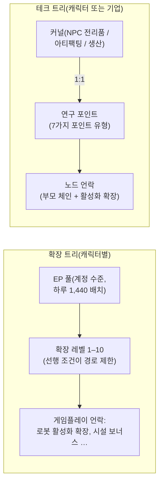

# 연구

**두 가지 독립된 성장 시스템**이 있습니다. 모두 도킹 전용입니다.

> UI 위치는 [클라이언트 UI 개요](/ko/features/ui/)를 따릅니다(캐릭터 창 → 확장; 테크 트리는
> 자체 창이 있습니다). 아래 메커니즘은 서버 기준으로 확인되었습니다.

## 확장 트리(캐릭터 스킬)

확장은 캐릭터별 스킬 레벨로, 게임플레이를 언락합니다. 특히 로봇 클래스를 조종할 수
있게 해 주는 **활성화 확장(enabler extensions)**이 가장 중요합니다(도킹 해제와 로봇
선택에 필수이며, [이동](/ko/features/movement/)과 [로봇](/ko/features/robots/)을 참고하세요).

### 학습 방식

- 학습하려면 **도킹** 상태여야 합니다.
- 각 확장은 **레벨 1–10**까지 올릴 수 있습니다(레벨 10이 상한입니다).
- **레벨 1은 크레딧이 필요합니다**(확장의 `price`) 지갑에서 차감됩니다.
- **모든 레벨은 확장 포인트(EP)가 필요합니다**. 고정된 랭크 × 레벨 표에 따라,
  레벨 1–5의 비용은 `60 × rank × level`이고, 레벨 6–10은
  `rank × (1440, 2520, 3840, 5400, 12000)`으로 증가합니다. 랭크 1 확장의 10개 레벨
  비용은 60 → 6,000 EP로 총 13,500 EP이며, 랭크 10은 각 레벨마다 10배의 비용이 듭니다.
- **선행 조건**이 이미 학습되어 있어야 확장을 선택할 수 있습니다
  ("prerequire" 목록).
- EP는 **계정 수준 풀**입니다: 캐릭터 간에 공유되며 시간 경과에 따라 획득합니다
  (아래 "EP 획득처" 참고).

### 확장 관리

- **카테고리 목록 / 전체 조회 / 학습 목록 / 선행 조건 목록** — 트리와 이미 보유한
  항목을 확인합니다.
- **사용 가능 포인트** — 현재 EP 풀을 확인합니다.
- **레벨 1개 제거** — 확장의 레벨을 하나 내립니다.
- **캐릭터 확장 초기화** — 캐릭터의 전체 트리를 초기화합니다.
- **잠긴 EP 해제** — 잠긴 EP를 해제합니다(예: 레벨 제거 후).
- **EP 부스트 구매** — EP 획득량을 증가시키는 유료 가속기입니다.
- **활동별 EP 일일 로그** — 플레이로 획득한 EP를 확인합니다.

### EP 획득처

EP는 구매하여 사용하는 화폐가 아니라 **일일 배치**로 누적됩니다:

- 모든 계정은 **하루 1,440 EP**를 받습니다(서버 시간 08:00~11:00 사이 하루 한 번,
  `extensionPointsAdd` 프로시저로 지급). 코드에는 유료 구독 계정을 위한 2배
  **2,880 EP** 배치도 정의되어 있지만, 현재 프로시저는 모든 계정에 기본 배치를
  지급합니다.
- **유료 부스트**(EP 부스트 구매)는 추가로 더해집니다.
- **사용 가능 EP** = 받은 모든 일일 배치 − 패널티 − 게임 내 사용 EP입니다.
  (활동별 EP 로그는 일일 획득 내역을 보여 줍니다.)

**전체 카탈로그** — 모든 확장(랭크, 레벨 1 가격, 보너스, 선행 조건)은
[확장](/content/extensions/)에, 모든 테크 트리 노드(언락 항목, 활성화 확장,
포인트 가격)은 [테크 트리](/content/techtree/)에 있습니다.

## 테크 트리(언락)

테크 트리는 **연구 포인트**를 사용해 **노드**를 언락하는 그래프입니다. EP(계정 풀)와
달리, 테크 트리 포인트는 **"커널"을 소모하여 획득**합니다 — 연구한 뒤 제출하는
아이템입니다.

### 작동 방식

- **커널 연구** — 컨테이너에서 커널 아이템을 제출합니다. 각 커널은 지정된
  **포인트 유형**의 연구 포인트로 **1:1** 변환되며, 커널은 소모됩니다.
  포인트 유형별로 7가지 커널 유형이 있습니다: Theodica, Pelistal, Nüimqol,
  Industrial, Common, HiTech, NewTech.
- **노드 언락** — 필요한 연구 포인트를 사용합니다. 노드는 다음 조건을 모두
  충족해야만 언락할 수 있습니다:
  - 모든 **부모 노드**가 이미 언락되어 있고,
  - 캐릭터에 해당 노드의 **활성화 확장**이 학습되어 있어야 합니다.
- **기업 언락** — 적절한 기업 직책이 있으면 노드를 **기업용**(공유)으로 언락할 수
  있습니다. 기업 언락은 더 비싸며(기업 가격 배율이 적용됨) 기업 포인트에서
  차감됩니다.
- **기부** — 연구 포인트를 기부합니다(예: 내 기업에).
- **정보 / 로그** — 노드 세부 정보와 언락/연구 이력을 확인합니다.

### 왜 중요한가

언락된 테크 트리 노드는 상위 티어 콘텐츠와 기능 접근을 제한합니다. 포인트를
사용하기 전에 노드의 선행 조건(부모 체인 + 활성화 확장)을 확인하세요.

## 실전 노트

- **활성화 확장이 로봇을 제한합니다** — 연구하지 않은 로봇 클래스를 조종할 수
  없습니다(도킹 해제/선택을 차단하는 동일한 검사입니다).
- 확장 트리에서 **크레딧 비용은 레벨 1뿐**입니다. 그 이후는 모두 EP입니다.
- **테크 트리는 되돌릴 수 없습니다** — 언락에 사용한 포인트는 사라지므로 경로를
  계획하세요.
- **기업 테크는 팀 작업입니다** — 공유 포인트와 가격 배율을 사용합니다.

<!-- TODO: 연구 UI만 남음(창 레이아웃, 포인트 표시).
     확인됨: EP 획득 = dbo.extensionPointsAdd를 통해 하루 1,440 고정(08:00-11:00 창,
     하루 한 번; 유료 구독을 위한 2,880 보너스 상수는 GiveExtensionPointsService에 존재하지만
     현재 SP는 모든 계정에 기본 배치를 지급); 사용 가능 = 배치 -
     패널티 - 사용 (extensionPointsAvailable fn); EP 비용 표는
     Services/ExtensionService/ExtensionPoints.cs (레벨 1-5는 60*rank*level, 이후
     rank*(1440,2520,3840,5400,12000)); 커널은 1:1 변환 (TechTreeResearch.cs), 7가지
     커널 정의 -> 포인트 유형 n1..n7 (Theodica/Pelistal/Nuimqol/Industrial/
     Common/HiTech/NewTech).
     개발자 노트: Extensions/ExtensionBuyForPoints.cs (도킹, 선행 조건, 레벨 상한 10,
     레벨 1 크레딧 가격, 랭크/레벨별 EP, 계정 풀, 훈련 캐릭터 무료);
     Extensions/ExtensionGetAvailablePoints.cs; Extensions/ExtensionBuyEpBoost.cs,
     ExtensionFreeLockedEp.cs, ExtensionRemoveLevel.cs, ExtensionResetCharacter.cs;
     EpForActivityDailyLog.cs; TechTree/TechTreeResearch.cs (커널 → 포인트);
     TechTree/TechTreeUnlock.cs (부모 체인 + 활성화 확장, 기업 배율);
     TechTree/TechTreeDonate.cs; Services/ExtensionService/GiveExtensionPointsService.cs;
     Services/ExtensionService/ExtensionPoints.cs. -->
     개발자 노트: Extensions/ExtensionBuyForPoints.cs (도킹, 선행 조건, 레벨 상한 10,
     레벨 1 크레딧 가격, 랭크/레벨별 EP, 계정 풀, 훈련 캐릭터 무료);
     Extensions/ExtensionGetAvailablePoints.cs; Extensions/ExtensionBuyEpBoost.cs,
     ExtensionFreeLockedEp.cs, ExtensionRemoveLevel.cs, ExtensionResetCharacter.cs;
     EpForActivityDailyLog.cs; TechTree/TechTreeResearch.cs (커널 → 포인트);
     TechTree/TechTreeUnlock.cs (부모 체인 + 활성화 확장, 기업 배율);
     TechTree/TechTreeDonate.cs. -->