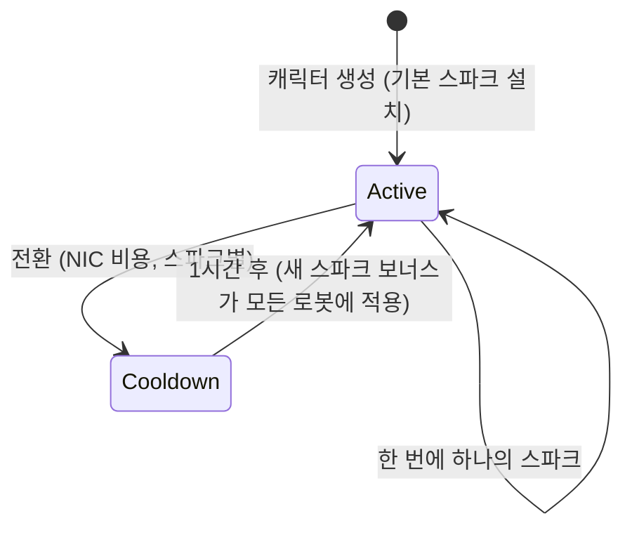

# 스파크

**스파크**는 캐릭터에 설치되는 나노봇 특화 기능입니다. 활성화되어 있는 동안, 해당 보너스는 조종하는 모든 로봇에 적용됩니다. 예를 들어, 팩션의 전투 계열 스파크는 레벨이 올라갈수록 무기 피해와 치명타 확률 레벨을 높이고, 산업 계열은 코어 용량과 채굴 수율을 높입니다.

각 캐릭터는 생성 시 **기본 스파크**를 하나 받습니다. 이 외에도 스파크는 계열로 나뉩니다 — 기본 계열, 팩션별 전투/산업/사회 계열(각 3단계), 유료 신디케이트 계열, 그리고 특수 한정 계열 — 스파크의 정확한 보너스는 [확장 페이지](/content/extensions/)에서 확인할 수 있는 고정 스킬 레벨 묶음일 뿐입니다. [아래의 계열 개요](#seupakeu-gyeyeol)에서 각 계열의 스파크로 바로 이동할 수 있습니다.

## 스파크 해금(인가)

아직 소유하지 않은 스파크를 설치하려면 먼저 **해금**해야 합니다(도킹 상태에서만 가능). 스파크에 따라 서버가 다음을 확인합니다:

- NIC **가격**(유료 계열 — 예: 신디케이트 유틸리티 스파크와 한정 특수 스파크),
- 개발 메가코퍼레이션과의 **스탠딩**(팩션별 계열은 해당 팩션 메가코퍼레이션과의 최소 스탠딩이 필요하며, 해당 팩션의 [미션](/ko/features/missions/)을 완료하여 쌓을 수 있음),
- 또는 인벤토리에서 소모되는 **아이템**(일부 특수 스파크는 키 아이템으로 해금).

해금은 일회성입니다. 한 번 해금하면 스파크는 컬렉션에 계속 보관됩니다.

## 스파크 전환

- 한 번에 **활성 스파크는 하나만** 사용할 수 있으며, 다른 스파크를 설치하면 교체됩니다.
- 각 전환에는 **NIC 비용**이 발생합니다 — 금액은 스파크별로 다르며(일반 계열은 10k, 유료 특수 계열은 최대 100만).
- 전환 사이에 **1시간 쿨다운**이 있습니다: 서버는 현재 스파크가 활성화된 시간을 추적하며, 1시간이 지나기 전에는 새 스파크 설치를 거부합니다.

전환은 항상 NIC 비용과 1시간이 소요되므로, 가장 많은 시간을 보내는 활동에 맞는 스파크를 선택하고, 재특화를 매 세션마다 하는 것이 아니라 가끔 내리는 결정으로 취급하세요.
<!-- sparkfamilies:generated -->

## 스파크 계열

6개 계열의 47개 스파크를 한눈에 보기: 계열별 하나의 상자(스파크 수, 계열 해금 방식)를 표시하며, 계열이 추가된 순서대로 배치되어 있습니다(왼쪽에서 오른쪽, 위에서 아래). **상자를 클릭하면 아래 해당 계열의 스파크로 이동합니다.** **도형 위에 스크롤하면 확대**되고, 드래그로 이동하며, ⟲ 버튼으로 초기화할 수 있습니다.

<button type="button" class="zoommap-reset" title="확대 초기화">⟲</button>
<svg class="zoommap" xmlns="http://www.w3.org/2000/svg" viewBox="0 0 1008 278" width="960" height="264" role="img" aria-label="스파크 계열: 6개 계열, 47개 스파크; 계열을 클릭하면 아래 해당 계열의 스파크로 이동합니다">
  <rect x="0" y="0" width="1008" height="278" fill="#10151f" stroke="#39445a" stroke-width="1"/>
  <g><title>이벤트 &amp; 특수: 9개 스파크, 무료 해금</title><a href="#family-special"><rect x="24" y="40" width="300" height="84" rx="10" fill="#10151f" stroke="#c8d2e0" stroke-width="1.5"/><text x="174" y="68" text-anchor="middle" fill="#e8eefc" font-size="15" font-weight="700">이벤트 &amp; 특수</text><text x="174" y="92" text-anchor="middle" fill="#c8d2e0" font-size="12">9개 스파크 · 무료</text></a></g>
  <g><title>TM (Truhold-Markson): 9개 스파크, TM 스탠딩으로 해금</title><a href="#family-tm"><rect x="354" y="40" width="300" height="84" rx="10" fill="#10151f" stroke="#41d3ff" stroke-width="1.5"/><text x="504" y="68" text-anchor="middle" fill="#e8eefc" font-size="15" font-weight="700">TM (Truhold-Markson)</text><text x="504" y="92" text-anchor="middle" fill="#41d3ff" font-size="12">9개 스파크 · TM 스탠딩</text></a></g>
  <g><title>ICS: 9개 스파크, ICS 스탠딩으로 해금</title><a href="#family-ics"><rect x="684" y="40" width="300" height="84" rx="10" fill="#10151f" stroke="#6ee7a0" stroke-width="1.5"/><text x="834" y="68" text-anchor="middle" fill="#e8eefc" font-size="15" font-weight="700">ICS</text><text x="834" y="92" text-anchor="middle" fill="#6ee7a0" font-size="12">9개 스파크 · ICS 스탠딩</text></a></g>
  <g><title>ASI: 9개 스파크, ASI 스탠딩으로 해금</title><a href="#family-asi"><rect x="24" y="154" width="300" height="84" rx="10" fill="#10151f" stroke="#f5a05a" stroke-width="1.5"/><text x="174" y="182" text-anchor="middle" fill="#e8eefc" font-size="15" font-weight="700">ASI</text><text x="174" y="206" text-anchor="middle" fill="#f5a05a" font-size="12">9개 스파크 · ASI 스탠딩</text></a></g>
  <g><title>신디케이트 (NIC): 5개 스파크, NIC 가격으로 해금</title><a href="#family-syndicate"><rect x="354" y="154" width="300" height="84" rx="10" fill="#10151f" stroke="#a78bfa" stroke-width="1.5"/><text x="504" y="182" text-anchor="middle" fill="#e8eefc" font-size="15" font-weight="700">신디케이트 (NIC)</text><text x="504" y="206" text-anchor="middle" fill="#a78bfa" font-size="12">5개 스파크 · NIC 가격</text></a></g>
  <g><title>한정: 6개 스파크, NIC 가격으로 해금</title><a href="#family-limited"><rect x="684" y="154" width="300" height="84" rx="10" fill="#10151f" stroke="#f472b6" stroke-width="1.5"/><text x="834" y="182" text-anchor="middle" fill="#e8eefc" font-size="15" font-weight="700">한정</text><text x="834" y="206" text-anchor="middle" fill="#f472b6" font-size="12">6개 스파크 · NIC 가격</text></a></g>
</svg>

### 이벤트 &amp; 특수 (9)

해금: 없음 — 기본 계열입니다. 각 전환에는 NIC 비용이 발생하며(금액은 스파크별로 다르므로 카드 참조), 1시간 쿨다운이 적용됩니다 — 위 [스파크 전환](#seupakeu-jeonhwan) 참조.

ww

해금 무료 · 전환 10k NIC

기본 스파크 — 캐릭터 생성 시 설치

wi

해금 무료 · 전환 10k NIC

기본 스파크 — 캐릭터 생성 시 설치

ws

해금 무료 · 전환 10k NIC

기본 스파크 — 캐릭터 생성 시 설치

iw

해금 무료 · 전환 10k NIC

기본 스파크 — 캐릭터 생성 시 설치

ii

해금 무료 · 전환 10k NIC

기본 스파크 — 캐릭터 생성 시 설치

is

해금 무료 · 전환 10k NIC

기본 스파크 — 캐릭터 생성 시 설치

sw

해금 무료 · 전환 10k NIC

기본 스파크 — 캐릭터 생성 시 설치

si

해금 무료 · 전환 10k NIC

기본 스파크 — 캐릭터 생성 시 설치

ss

해금 무료 · 전환 10k NIC

기본 스파크 — 캐릭터 생성 시 설치

### TM (Truhold-Markson) (9)

해금: TM 메가코퍼레이션과의 스탠딩(레벨별 2 → 4 → 6). 각 전환에는 NIC 비용이 발생하며(금액은 스파크별로 다르므로 카드 참조), 1시간 쿨다운이 적용됩니다 — 위 [스파크 전환](#seupakeu-jeonhwan) 참조.

전투 1단계

해금 TM 스탠딩 2 · 전환 10k NIC

확장 레벨 2개 묶음

전투 2단계

해금 TM 스탠딩 4 · 전환 100k NIC

확장 레벨 3개 묶음

전투 3단계

해금 TM 스탠딩 6 · 전환 1M NIC

확장 레벨 3개 묶음

산업 1단계

해금 TM 스탠딩 2 · 전환 10k NIC

확장 레벨 2개 묶음

산업 2단계

해금 TM 스탠딩 4 · 전환 100k NIC

확장 레벨 3개 묶음

산업 3단계

해금 TM 스탠딩 6 · 전환 1M NIC

확장 레벨 3개 묶음

사회 1단계

해금 TM 스탠딩 2 · 전환 10k NIC

확장 레벨 2개 묶음

사회 2단계

해금 TM 스탠딩 4 · 전환 100k NIC

확장 레벨 3개 묶음

사회 3단계

해금 TM 스탠딩 6 · 전환 1M NIC

확장 레벨 3개 묶음

### ICS (9)

해금: ICS 메가코퍼레이션과의 스탠딩(레벨별 2 → 4 → 6). 각 전환에는 NIC 비용이 발생하며(금액은 스파크별로 다르므로 카드 참조), 1시간 쿨다운이 적용됩니다 — 위 [스파크 전환](#seupakeu-jeonhwan) 참조.

전투 1단계

해금 ICS 스탠딩 2 · 전환 10k NIC

확장 레벨 2개 묶음

전투 2단계

해금 ICS 스탠딩 4 · 전환 100k NIC

확장 레벨 3개 묶음

전투 3단계

해금 ICS 스탠딩 6 · 전환 1M NIC

확장 레벨 3개 묶음

산업 1단계

해금 ICS 스탠딩 2 · 전환 10k NIC

확장 레벨 2개 묶음

산업 2단계

해금 ICS 스탠딩 4 · 전환 100k NIC

확장 레벨 3개 묶음

산업 3단계

해금 ICS 스탠딩 6 · 전환 1M NIC

확장 레벨 3개 묶음

사회 1단계

해금 ICS 스탠딩 2 · 전환 10k NIC

확장 레벨 2개 묶음

사회 2단계

해금 ICS 스탠딩 4 · 전환 100k NIC

확장 레벨 3개 묶음

사회 3단계

해금 ICS 스탠딩 6 · 전환 1M NIC

확장 레벨 3개 묶음

### ASI (9)

해금: ASI 메가코퍼레이션과의 스탠딩(레벨별 2 → 4 → 6). 각 전환에는 NIC 비용이 발생하며(금액은 스파크별로 다르므로 카드 참조), 1시간 쿨다운이 적용됩니다 — 위 [스파크 전환](#seupakeu-jeonhwan) 참조.

전투 1단계

해금 ASI 스탠딩 2 · 전환 10k NIC

확장 레벨 2개 묶음

전투 2단계

해금 ASI 스탠딩 4 · 전환 100k NIC

확장 레벨 3개 묶음

전투 3단계

해금 ASI 스탠딩 6 · 전환 1M NIC

확장 레벨 3개 묶음

산업 1단계

해금 ASI 스탠딩 2 · 전환 10k NIC

확장 레벨 2개 묶음

산업 2단계

해금 ASI 스탠딩 4 · 전환 100k NIC

확장 레벨 3개 묶음

산업 3단계

해금 ASI 스탠딩 6 · 전환 1M NIC

확장 레벨 3개 묶음

사회 1단계

해금 ASI 스탠딩 2 · 전환 10k NIC

확장 레벨 5개 묶음

사회 2단계

해금 ASI 스탠딩 4 · 전환 100k NIC

확장 레벨 6개 묶음

사회 3단계

해금 ASI 스탠딩 6 · 전환 1M NIC

확장 레벨 6개 묶음

### 신디케이트 (NIC) (5)

해금: NIC 가격(스파크당 1M). 각 전환에는 NIC 비용이 발생하며(금액은 스파크별로 다르므로 카드 참조), 1시간 쿨다운이 적용됩니다 — 위 [스파크 전환](#seupakeu-jeonhwan) 참조.

Syndicate Nic 전투

해금 1M NIC · 전환 100k NIC

확장 레벨 2개 묶음

Syndicate Nic 스카우트

해금 1M NIC · 전환 100k NIC

확장 레벨 2개 묶음

Syndicate Nic 코어부스트

해금 1M NIC · 전환 100k NIC

확장 레벨 2개 묶음

Syndicate Nic 전방어

해금 1M NIC · 전환 100k NIC

확장 레벨 4개 묶음

Syndicate Nic 피트부스트

해금 1M NIC · 전환 100k NIC

확장 레벨 2개 묶음

### 한정 (6)

해금: NIC 가격(스파크당 25–50M). 각 전환에는 NIC 비용이 발생하며(금액은 스파크별로 다르므로 카드 참조), 1시간 쿨다운이 적용됩니다 — 위 [스파크 전환](#seupakeu-jeonhwan) 참조.

기념일 전투

해금 25M NIC · 전환 1M NIC

확장 레벨 6개 묶음

기념일 물류

해금 25M NIC · 전환 1M NIC

확장 레벨 6개 묶음

Amazon c1 전투

해금 25M NIC · 전환 1M NIC

확장 레벨 2개 묶음

Amazon c1 산업

해금 25M NIC · 전환 1M NIC

확장 레벨 2개 묶음

Steam a

해금 50M NIC · 전환 1M NIC

확장 레벨 2개 묶음

Steam b

해금 50M NIC · 전환 1M NIC

확장 레벨 2개 묶음

<!--
서버 백엔드를 기준으로 처음 작성, 2026-09-27:
RequestHandlers/Sparks/SparkUnlock.cs (해금 규칙: 가격, 스탠딩, 아이템),
RequestHandlers/Sparks/SparkChange.cs + Services/Sparks/SparkHelper.cs
(60분 전환 쿨다운, 스파크별 전환 가격),
Services/Sparks/Spark.cs, sparks + sparkextensions 테이블 (47개 스파크, 계열별
보너스 묶음).
이전 버전은 Open Perpetuum 커뮤니티 위키(perpetuum.miraheze.org)에서 가져와
작성되었으나, 백엔드 소스를 기준으로 완전히 다시 작성했습니다. 기존 텍스트를
재사용하지 않았습니다.
-->