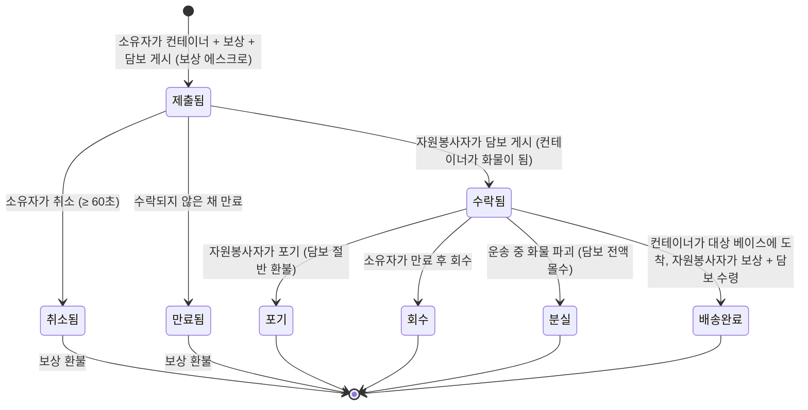

# 운송 (아이템 운반)

**운송 임무**는 아이템 컨테이너를 한 베이스에서 다른 베이스로 이동시키며, **자원봉사 운반자**가 보상을 받습니다. 양면 시장입니다: **소유자**가 운송을 게시하고, **자원봉사자**가 수락하여 배송합니다.

> UI 위치는 [클라이언트 UI 개요](/ko/features/ui/)를 따릅니다(상단 바의 **임무** 카테고리). 아래 메커니즘은 서버 기준으로 확인되었습니다.

## 두 당사자

- **소유자(주체)** — 운송을 게시합니다: 이동할 **컨테이너**, **출발 베이스**에서 **대상 베이스**로, **보상**, **담보**, **기간**.
- **자원봉사자(운반자)** — 임무를 수락하고, 컨테이너를 운반하며, 배송합니다.

## 운송 게시 (소유자)

다음 항목으로 **운송을 제출**합니다:
- 운송할 **컨테이너**(볼륨 래퍼),
- 배송 시 지불하는 **보상**,
- **담보**(운반자가 게시하는 보증금),
- **출발 베이스**와 **대상 베이스**,
- 임무가 열려 있는 **기간**(일).

제출 시 **보상은 지갑에서 에스크로**됩니다.

## 운송 수락 (자원봉사자)

- 임무를 **수락**합니다 — **담보**를 보증금으로 게시하고, 컨테이너는 운반할 수 있는 자신의 화물이 됩니다.

## 배송 및 회수

- **배송** — 컨테이너를 대상 베이스로 가져갑니다. 배송 시 **자원봉사자에게 보상 + 담보가 지급**되고, 소유자는 화물을 받습니다.
- **회수** — 소유자(또는 해당되는 경우 자원봉사자)가 컨테이너를 베이스로 회수합니다; 회수 시 **담보는 반환**되고 **보상은 소유자에게 반환**됩니다.

## 취소 / 포기

- **취소** — 임무를 취소합니다.
- **포기** — 자원봉사자가 포기합니다. 포기 시 **담보 페널티**가 적용되어 담보의 **절반**만 환불됩니다(나머지는 몰수) — 페널티 상수는 `TransportAssignment.cs`에서 0.5입니다.

## 확인

- **목록** 보기, 특정 운송의 **내용 목록** 보기, **컨테이너 정보**, **실행 중인지?**, 그리고 **운송 로그**.

## 자금 흐름 (한눈에 보기)

**보상**은 소유자의 지급액으로, 제출 시 에스크로되고 배송 시에만 지급됩니다. **담보**는 자원봉사자의 보증금으로: 수락 시 소유자에게 지불되고, 화물이 운송 중일 동안 보유되며, 배송 시(보상과 함께) 반환됩니다.

| 이벤트 | 조건 | 소유자 | 자원봉사자 | 컨테이너 |
|---|---|---|---|---|
| 제출 | — | 보상 에스크로 | — | 운송 저장소로 이동 |
| 수락 | 미수락 | 담보 보증금 수령 | 담보 지불 | 자원봉사자의 화물이 됨 |
| 배송 | 대상 베이스 도착 | 화물 수령 | **보상 + 담보** 수령 | 배송 완료 |
| 취소 | 미수락, 제출 후 60초 이상 | 보상 환불 | — | 출발 베이스로 반환 |
| 포기 | 수락됨 | 보상 환불 | 담보 **절반** 환불 (0.5 페널티) | 출발 베이스로 반환 |
| 만료 | 미수락, 만료 후 | 보상 환불 | — | 출발 베이스로 반환 |
| 회수 | 수락됨 **그리고** 만료 후 | 보상 환불 | — | 출발 베이스로 반환 (도킹 중이면 즉시, 아니면 자원봉사자의 다음 도킹 시) |
| 화물 파괴 | 운송 중 | 보상 환불 **+ 담보 전액** | 담보 전액 몰수 | 분실 |

## 실무 노트

- **수수료 없음** — 이동하는 돈은 보상과 담보뿐입니다.
- **보상은 에스크로됩니다** — 운송이 종료될 때까지 소유자는 사용할 수 없습니다.
- **담보는 운반자의 보증금** — 담보를 게시해야 운송을 수락할 수 있으며, 운송 중 화물을 잃으면 **전액**이 몰수됩니다.
- **포기에는 비용이 듭니다** — 운송을 포기하면 담보의 절반이 몰수됩니다.
- **기간은 중요하지만, 미수락 상태에서만 해당됩니다** — 제출 시 설정한 만료는 아무도 수락하지 않은 임무만 자동으로 닫습니다(서버는 만료된 미수락 임무를 매시간 정리합니다). **수락된** 임무는 스스로 만료되지 않으며, 소유자의 탈출구는 **회수**입니다. 만료 후 사용 가능해지며, 화물(과 보상)을 출발 베이스로 회수합니다 — 운반자가 도킹 중이면 즉시, 아니면 운반자의 다음 도킹 시 자동으로 처리됩니다.
- **수락 전 내용 확인** — 컨테이너 안에 무엇이 있는지와 경로를 확인하세요.

<!-- TODO: 클라이언트 UI만 남아 있습니다(임무 화면 레이아웃).
     자금 모델 확인: 제출 시 보상 에스크로(CashInOnSubmit), 수락 시 자원봉사자가 담보 지불
     (TakeCollateral -> PayCollateralToPrincipal), 배송 시 자원봉사자에게 보상+담보 지불
     (PayOutReward); 취소는 생성 후 60초 필요;
     만료 = 제출 시간 + 클라이언트 기간 일수 (<=0 -> 1), MissionProcessor(_transportAssignmentInterval 1h)가 매시간 정리, taken=0만; 회수는
     만료 경과 + 수락 필요, 다음 도킹 시 자동 완료; 파괴된 화물은 보상 환불
     및 소유자에게 담보 전액 몰수.
     개발자 노트: TransportAssignments/TransportAssignmentSubmit.cs;
     Services/MissionEngine/TransportAssignments/TransportAssignment.cs (보상/담보
     에스크로, PayOutReward = reward+collateral, PaybackCollateral, PaybackHalfCollateral
     = 포기 시 COLLATERAL_PENALTY, RetrieveToBasePublicContainer, 만료);
     TransportAssignmentTake/Deliver/Retrieve/Cancel/GiveUp/List/ListContent/
     ContainerInfo/Running/Log. -->