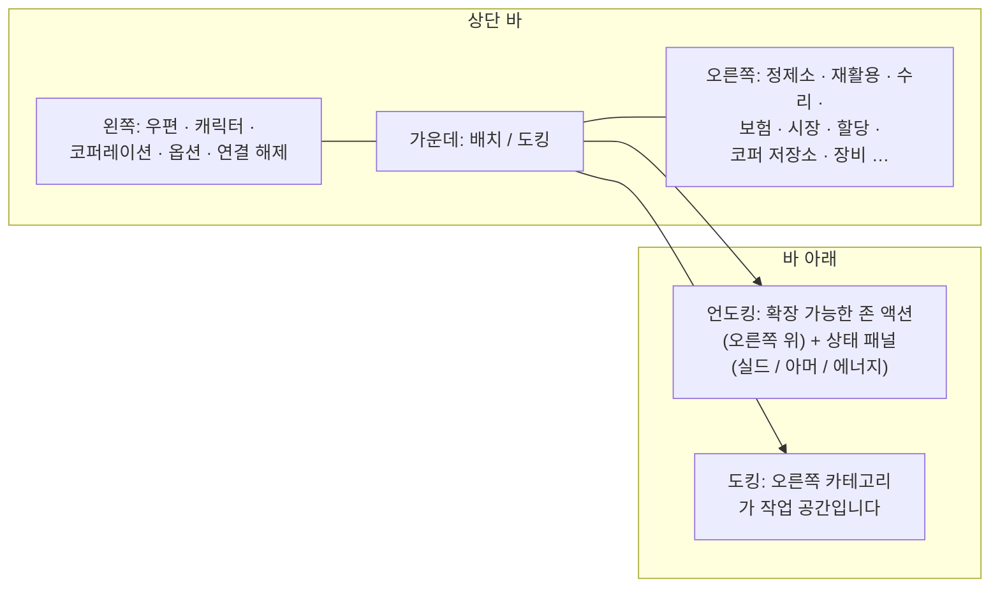

# 클라이언트 UI 개요

클라이언트는 **EVE Online 스타일** 인터페이스입니다: 전체 화면 우주/존 뷰 위에
떠 있는, **크기 조절 및 이동이 가능한 창**을 **원할 때 닫고 다시 열 수** 있습니다.
시스템별 연결 구조입니다 — 아래 링크된 페이지를 참조하세요.

> 이 레이아웃은 프로젝트에서 제공한 작업용 모델로, 액션이 어디에 위치하는지를 설명하는 데 사용됩니다.
> 정확한 화면 이름은 약간 다를 수 있으며, 구조가 기준입니다.

## 상단 바

화면 상단을 가로지르는 상시 표시 바입니다.

| 영역 | 내용 |
|---|---|
| **왼쪽** | 주요 버튼: **우편**, **캐릭터**, **코퍼레이션**, 기타 **옵션**, **연결 해제** |
| **가운데** | **배치 / 도킹** 버튼 — 주요 도킹⇄언도킹 토글 (참조: [이동](/ko/features/movement/)) |
| **오른쪽** | 버튼 형태의 액션 카테고리: **정제소**, **재활용**, **수리**, **보험**, **시장**, **할당** (운송), **코퍼 저장소**, **장비**, … |

오른쪽 카테고리는 해당 시스템 창을 엽니다:

| 버튼 | 열기 / 수행 | 위키 페이지 |
|---|---|---|
| 정제소 | 원자재를 구성 요소로 가공 | [생산](/ko/features/production/) |
| 재활용 | 아이템을 기본 재료로 분해 | [생산](/ko/features/production/) |
| 수리 | 손상된 로봇/모듈 수리 | [생산](/ko/features/production/) |
| 보험 | 생산/로봇 보험 정책 | [생산](/ko/features/production/) |
| 시장 | 시장 주문 및 직접 구매 | [시장](/ko/features/market/) |
| 할당 | 운송 할당(배송) | [운송](/ko/features/transport/) |
| 코퍼 저장소 | 코퍼레이션 격납고/저장소 | [그룹](/ko/features/groups/) |
| 장비 | 활성 로봇에 모듈과 탄약 장착 | [로봇](/ko/features/robots/) |

## 도킹 상태

**도킹** 상태에서는 오른쪽 액션 카테고리가 주요 작업 공간입니다. 기지를 벗어나지 않고
가공, 거래, 피팅, 저장소 관리를 수행할 수 있습니다. 배치/도킹 버튼은 존으로 언도킹합니다
(언도킹 전제 조건은 [이동](/ko/features/movement/)을 참조하세요).

## 언도킹 상태

**언도킹** 상태(존에서 활성 로봇을 조종하는 중):

- **오른쪽 위** 영역에 **확장 가능한 액션 버튼**이 나타납니다. 클릭하면 추가 존 액션 목록이
  아래로 확장됩니다(스캐닝, 수확/상호작용 액션, 존 도구 — [수집](/ko/features/gathering/)과
  [전투](/ko/features/combat/)에 문서화된 액션).
- **주 상태 패널**은 로봇의 상태를 표시합니다: **실드, 아머/선체, 에너지** 및 관련 전투 상태 —
  [전투](/ko/features/combat/) 페이지에서 언급하는 것과 동일한 데이터입니다(예: "에너지 시스템 무결" 언도킹 검사).
- 기지 전용 카테고리(정제소, 시장, …)는 다시 도킹할 때까지 사용할 수 없습니다.

## 일반 창

대부분의 시스템은 표준 플로팅 창으로 열립니다: 제목 바, 닫기 버튼, 크기 조절 가능한
가장자리, 탭 또는 목록 콘텐츠. 반복적으로 여는 시스템(인벤토리/컨테이너, 시장, 생산
라인)은 동시에 여러 창을 열 수 있습니다.

- **인벤토리 / 컨테이너** — 컨테이너 목록 보기, 아이템 이동/스택/압축, 이름 변경, 삭제 —
  [아이템](/ko/features/items/) 참조.
- **캐릭터 창** (왼쪽 위 버튼) — 프로필, 확장(연구), 설정, 크레딧 — [시작하기](/ko/features/getting-started/)와
  [연구](/ko/features/research/) 참조.
- **코퍼레이션 창** (왼쪽 위 버튼) — 코퍼레이션 정보, 격납고, 문서, 투표, 공지 —
  [그룹](/ko/features/groups/) 참조.
- **우편 창** (왼쪽 위 버튼) — 개인 및 대량 우편 — [소셜](/ko/features/social/) 참조.

## 이 위키에서 사용하는 약정

- **"상단 바 → X"** = 상단 바의 X 버튼.
- **"언도킹 액션"** = 존에서 오른쪽 위의 확장 가능한 목록.
- **배치/도킹 버튼** = 상단 바 중앙의 토글.

<!-- 참고: 이 페이지는 합의된 UI 모델(프로젝트 제공)입니다. 실제 클라이언트가
     버튼 이름이나 배치에서 다르면, 이 페이지를 먼저 업데이트하세요 — 모든
     features/ 페이지가 여기에 정의된 약정을 참조합니다. -->