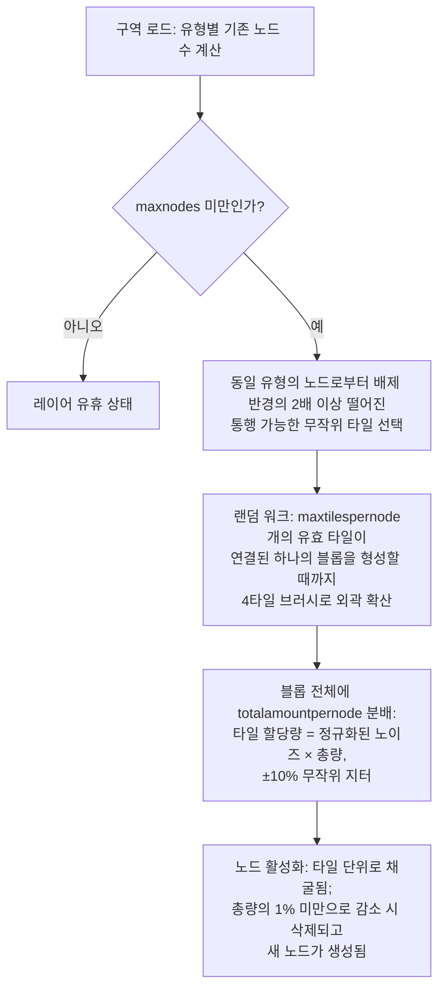

# 구역 자원 생성

이 페이지에서는 서버가 구역의 자원을 비축된 상태로 유지하는 방식을 설명합니다. 두 시스템 모두 구역이 로드되어 있는 동안 백그라운드에서 지속적으로 실행되며, 이들이 틱(tick)을 진행하기 위해 플레이어가 특정 행동을 취할 필요는 없습니다.

## 구역의 자원 구성

각 구역은 데이터베이스에서 두 개의 독립적인 목록으로 구성됩니다:

- **광석 구성** (`mineralconfigs`) — 구역에 존재하는 광석 유형당 하나의 행으로 구성되며, 각 유형마다 4개의 설정값을 갖습니다:
  | 열 | 의미 |
  |---|---|
  | `maxnodes` | 구역에서 유지하는 이 유형의 노드 수 |
  | `maxtilespernode` | 단일 노드가 차지할 수 있는 최대 타일 수 |
  | `totalamountpernode` | 새로 생성된 노드의 총 자원량 (타일들에 분배됨) |
  | `minthreshold` | 타일당 최소 채움 비율 (0–1). 채굴 후 이 미만으로 떨어진 타일은 삭제됨 |
- **식물 구성** (`zones.fertility` + 식물 규칙 세트) — 구역의 식물 피도 목표치(백분율) 및 그곳에서 자랄 수 있도록 허용된 식물 종 목록 (각 종의 동작은 규칙 파일로 정의되며, [식물](/ko/content/plants/)에 문서화되어 있습니다).

광석 구성이 없는 구역(아레나, 훈련 구역, 요새, 일부 감마 구역)에는 광석 레이어가 전혀 존재하지 않습니다.

## 광석 노드

### 노드 배치 방식

구역이 로드되면, 각 광석 유형의 레이어는 기존 노드 수(`mineralnodes` 테이블에 보존됨)를 계산하고 `maxnodes`에 도달할 때까지 새 노드를 생성합니다. 새 노드는 **랜덤 워크(random walk)** 방식으로 배치됩니다:

1. 통행 가능한 무작위 타일을 선택합니다.
2. 동일 유형의 가장 가까운 기존 노드로부터 충분히 멀리 떨어져 있어야 합니다. 배제 반경은 `maxtilespernode`로부터 도출되며(`√(maxtilespernode/π) × 2`, 시작점은 이 거리의 2배 이상 떨어져야 함), 따라서 노드들이 하나의 거대한 매장지로 병합되지 않습니다.
3. 시작 타일부터 랜덤 워크를 통해 외곽으로 무작위 확산(한 번에 4타일 브러시 사용)하며, 최대 `maxtilespernode`개의 유효 타일을 모아 하나의 연결된 블롭(blob)을 형성합니다.
4. 노드의 `totalamountpernode` 자원량이 블롭 전체에 분배됩니다. 각 타일의 할당량은 정규화된 노이즈 값에 총량을 곱하고 ±10%의 무작위 지터를 적용하여 결정되므로, 같은 유형의 노드라도 완전히 동일한 형태를 띠지 않습니다.

타일은 구역 내부에 있고, 섬(고립지)이 아니며, PBS 테라포밍 보호 구역이 아니고, 통행 가능할 때만 노드에 유효한 타일로 간주됩니다. 두 가지 희귀 광석은 도킹 기지 및 텔레포트 주변에 **접근 금지 구역(keep-out zone)**을 가집니다. **에프리톤(epriton)**은 최소 거리를 유지하며, **플럭스 광석(flux ore)**은 그 2배의 거리를 유지합니다. 따라서 플럭스 광석은 기지 바로 옆에서 발견되지 않습니다.

### 노드 소모 방식

- 채굴은 타일 단위로 자원을 제거합니다.
- 설정된 **총량의 1% 미만**으로 떨어진 노드는 삭제되며, 구역의 `maxnodes`를 유지하기 위해 새 노드가 생성됩니다(1단계로 복귀).
- 플럭스 광석 노드는 추가로 **NPC 스폰**을 유발합니다. 노드가 채굴되거나 제거되면 NPC 시스템이 수신하는 이벤트를 발행하며, 이것이 바로 플럭스 광석 채굴지가 주의를 끄는 이유입니다.

## 식물

### 식물 스캔

구역은 **32×32 타일** 단위로 분할됩니다. 식물 핸들러는 이 타일들을 순서대로 순회하며 틱당 하나씩 처리하고, **구역 전체를 한 번 순회하는 데 약 8시간**이 걸리도록 조절됩니다(구역별로 재정의 가능). 각 32×32 "큐브"는 고정된 파이프라인에 따라 처리됩니다:

1. **유효성 검사** — 유효하지 않은 식물(잘못된 지형, 고사됨, 위치 부적합)을 제거합니다.
2. **성장** — 각 식물을 성장 단계에 따라 진행시킵니다(`growRate` 및 결실에 대해서는 [채집](/ko/features/gathering/) 참조).
3. **스폰** — 큐브가 비옥도 목표치 미만인 위치에 새 식물을 추가합니다.
4. **벽 손상** — 식물의 차단 높이가 시간이 지남에 따라 점차 감소합니다.
5. **거리별 제거** — 동일 유형 간의 최소 간격(`killDistance`)을 적용합니다.
6. **자원 갱신** — 소량의 열매 자원이 재생성됩니다.

### 새 식물 선택 방식

타일은 구역 파일에서 **스폰 잠재력(spawn potential)**을 부여한 경우에만 싹을 틔울 수 있습니다(구역의 식물 레이어에 내장된 타일당 바이트 값으로, 0은 타일에서 싹이 전혀 트지 않음을 의미). 매 틱마다 적격한 각 타일에 대해:

- **구역 비옥도 우선 검사**: 큐브의 차단 식물 피도가 지면 타일의 `비옥도%`를 이미 충족한 경우, 해당 위치에는 새 식물이 스폰되지 않습니다.
- **타일별 확률**: 무작위 주사위 굴림 결과가 타일의 스폰 잠재력을 넘어서야 합니다.
- **종 선택**:
  - 타일에 **인접 식물이 없는 경우**: 허용된 각 종의 가중치가 해당 종의 `fertility` 값인 가중 무작위 추첨으로 종이 결정됩니다(플레이어가 심는 종은 자연 스폰에서 제외됨).
  - 인접 식물이 **있는 경우**: 동전 던지기(50/50 확률)로 결정됩니다. 50%는 현재 인접한 종 중 가장 우세한(*지배적인*) 종이며, 50%는 각 종의 `(인접 개체 수 × spreading)`으로 가중치가 부여된 **확산(spreading)** 추첨입니다. 이 방식 덕분에 군락이 동일한 종류로 확장됩니다.
- **상한선 및 간격**: `maxAmount` 상한이 있는 종은 구역 내에 충분한 수가 존재하면 생략되며, 동일 유형의 다른 식물로부터 `killDistance` 이내에 있는 타일도 생략됩니다.

### 플레이어 유의 사항

- 식물 밀도는 구역의 비옥도에 의해 제한됩니다. 비옥도가 20인 구역에서 식물 피도가 100%가 되는 일은 절대 없습니다.
- 군락을 이루는 것이 일반적입니다. 확산(spreading) 메커니즘으로 인해 각 종은 자신의 군락지를 확장하므로, 구역은 무작위로 뒤섞인 형태보다는 종별 영역을 형성하는 경향이 있습니다.
- `killDistance`가 적용되는 종(예: 특정 고가치 식물)은 일정한 간격으로 배치되므로, 하나를 발견하면 다음 위치를 예측하기 쉽습니다.
- 새 노드는 랜덤 워크가 도달하는 곳마다 나타납니다. 구역에 고정된 "광석 위치"는 없으므로 탐색(스캔)이 필수적입니다([채집](/ko/features/gathering/) 참조).

<!-- 개발자 참고사항: TerrainsModule.cs (구역별 레이어 구성: Solid의 경우 OreLayer, Liquid의 경우 LiquidLayer, TrainingZone의 경우 GravelLayer; LoadMineralNodes 보충); MineralLayer.cs (LoadMineralNodes: 1% 미만 노드 삭제, maxnodes까지 생성; FluxOre -> 감소/만료 시 OreNpcSpawnMessage 발생); Generators/MineralNodeGeneratorBase.cs (FindStartPosition 접근 금지 + 간격, NormalizeNoise, CreateMineralNode 지터); RandomWalkMineralNodeGenerator.cs (플러드 필 브러시 4, 5만 단계 상한); MineralNodeRepository.cs (mineralnodes 테이블, 압축된 타일별 값); PlantHandler.cs (32x32 영역, 8시간 전체 패스, PlantsGrowthTimerOverrideMin, 스캐너 모드); NatureCube.cs (ProcessAll 파이프라인, SpawnPlants 비옥도/스폰/killDistance 로직, GetNewPlantRule 50/50 지배 vs 확산); PlantRuleExtensions.cs (비옥도 가중 + 확산 가중 추첨); PlantInfo.cs (타일별 스폰 바이트는 구역의 식물 레이어 파일에서 제공되며 서버 코드에서 할당되지 않음). -->
