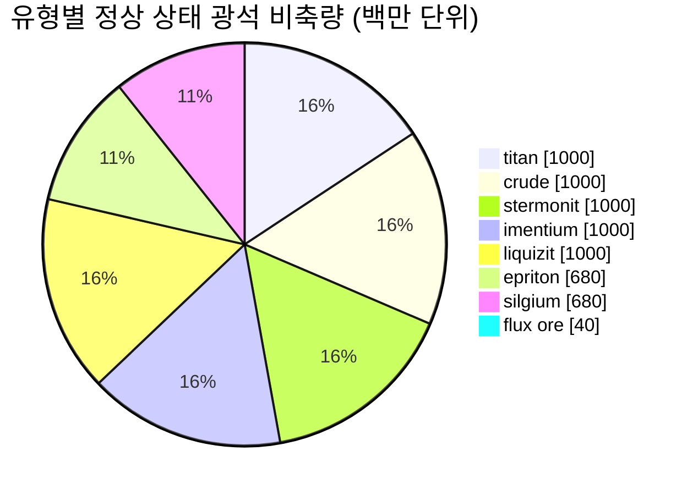

# Daoden (zone_ASI) — 사례 연구

  <a href="/ko/zones/map/">
    
    <strong>월드 맵</strong> — 텔레포트 연결을 포함하여 다른 모든 구역 사이에서 이 구역의 위치. 전체 지도 열기.
  </a>

이 구역의 텔레포트 기둥 위치(목적지가 표시된 점 — 기둥이 비활성화된 경우 흐리게 표시), 다른 구역에서 도착하는 텔레포트 착륙 지점(점선 원), 그리고 출구 게이트(다이아몬드)를 나타냅니다. 위치는 서버에 기록된 타일 좌표입니다.
점선은 로컬(구역 내부) 텔레포트 기둥 쌍을 연결합니다.

알파 티어의 **오픈 PvP** 구역으로, 게임 내에서 가장 풍부한 광석 구성을 지니며 희귀 유형이 서식하는 장소입니다. New Virginia가 가진 모든 것에 더해 에프리톤, 실기움, 그리고 NPC 공격을 유발하는 플럭스 광석 채굴지가 존재합니다.

| 항목 | 값 |
|---|---|
| 존 ID | 2 |
| 유형 | PvP (오픈) |
| 보호 | [Beta](/ko/zones/protection/) — 오픈 PvP, 표준 지형 |
| 크기 | 2048 × 2048 타일 |
| 비옥도 | 20 |
| 식물 규칙 세트 | 2 — 19 종 (고티어 수확 식물 포함) |
| 광석 종류 | 8 (titan, crude, stermonit, imentium, liquizit, epriton, silgium, flux ore) |
| 총 광석 노드 수 | 64 (유형당 8개) |

## 광석 구성

| 재료 | 노드 | 최대 타일/노드 | 노드당 총량 | 최소 임계값 |
|---|---|---|---|---|
| [titan](/ko/content/ores/titan/) | 8 | 500 | 125,000,000 | 0.5 |
| [crude](/ko/content/ores/crude/) | 8 | 1257 | 125,000,000 | 0.5 |
| [stermonit](/ko/content/ores/stermonit/) | 8 | 500 | 125,000,000 | 0.5 |
| [imentium](/ko/content/ores/imentium/) | 8 | 500 | 125,000,000 | 0.5 |
| [liquizit](/ko/content/ores/liquizit/) | 8 | 500 | 125,000,000 | 0.5 |
| [epriton](/ko/content/ores/epriton/) | 8 | 500 | 85,000,000 | 0.5 |
| [silgium](/ko/content/ores/silgium/) | 8 | 500 | 85,000,000 | 0.5 |
| [fluxore](/ko/content/ores/fluxore/) | 8 | 300 | 5,000,000 | 0.5 |

눈에 띄는 점:

- **New Virginia보다 8배 많은 노드**, 하지만 각 노드는 더 작습니다(1,000타일 대신 500타일). 일반 광석의 이동 반경은 34타일에서 24타일로 줄어듭니다. 여기서는 매장지가 더 얇고 개수가 많기 때문에 탐색(스캔)이 더 중요합니다.
- **에프리톤과 실기움**은 줄어든 총량(125M 대신 85M)을 가지며, 가치가 높고 더 희귀한 비축량입니다. 에프리톤은 추가로 **기지 및 텔레포트로부터 최소 거리**를 유지하므로, 노드가 스폰 지점에 위치하지 않습니다.
- **플럭스 광석은 극단적인 사례입니다**: 300타일에 걸쳐 노드당 5M에 불과하며(타일당 약 16,600 — 거대한 매장지가 아니라 실개천 수준), 8개의 노드가 있고, 기지로부터 에프리톤 거리의 **2배**에 달하는 접근 금지 구역을 가집니다. 플럭스 노드를 채굴하면 NPC 시스템에 스폰 이벤트가 발행됩니다 — 플럭스 사이트는 설계상 분쟁 지역입니다([침투 및 NPC 시스템](/ko/features/intrusion/) 참조).
- 정상 상태 비축량: 총 약 64억 단위의 자원.

## 식물 조합

규칙 세트 2는 19종을 허용하며, 완전한 알파 조합입니다: 기본 식물에 더해 **데브리놀(devrinol)**, **벽(wall)**, **타이탄플랜트(titanplant)**, 그리고 **고티어 수확 식물**(상위 일렉트로플랜트, 상위 철나무, 상위 러스트부시, 상위 슬라임루트)이 포함됩니다. 비옥도는 여전히 20이므로 밀도는 New Virginia와 동일합니다. 달라지는 점은 *어떤* 종이 비옥도 추첨에서 승리할 수 있는가입니다. 고티어 수확 식물 자체의 `fertility` 가중치에 따라 풀보다 얼마나 자주 추첨될지가 결정됩니다.

종별 규칙은 [식물](/ko/content/plants/)에 있으며, 광석별 생산량은 [광석](/ko/content/ores/)에 있습니다.

## 플레이어 유의 사항

- 플럭스 광석 경제를 포함하여 전체 광석 사다리를 이용할 수 있습니다. 하지만 오픈 PvP 구역이므로 채굴한 모든 자원을 빼앗길 수 있습니다(기지 간 물품을 안전하게 옮기는 방법은 [운송](/ko/features/transport/) 참조).
- 플럭스 광석 노드 근처에서는 NPC의 위협을 예상해야 합니다. 스포너는 해당 노드의 채굴 이벤트를 감지합니다.
- 이곳의 식물 채집은 초보자 구역의 하위 티어 종보다 더 좋은 열매를 제공하는 고티어 변종을 목표로 합니다.

<!-- 개발자 참고사항: zones 행 id 2 (zonetype 2 = PvP, protected 0, fertility 20, plantruleset 2); mineralconfigs 8개 행 (기본 7개 + fluxore 8/300/5M); MineralNodeGeneratorBase.KeepOutDist: Epriton = MINERAL_DISTANCE_FROM_BASE_MIN, FluxOre = 2x; MineralLayer.OnNodeDecrease/OnNodeExpired -> FluxOre에 대한 OreNpcSpawnMessage 발생; plantrules rulesetid 2 = 19개 파일 (수확 가능 4개, devrinol 및 wall 포함). -->
