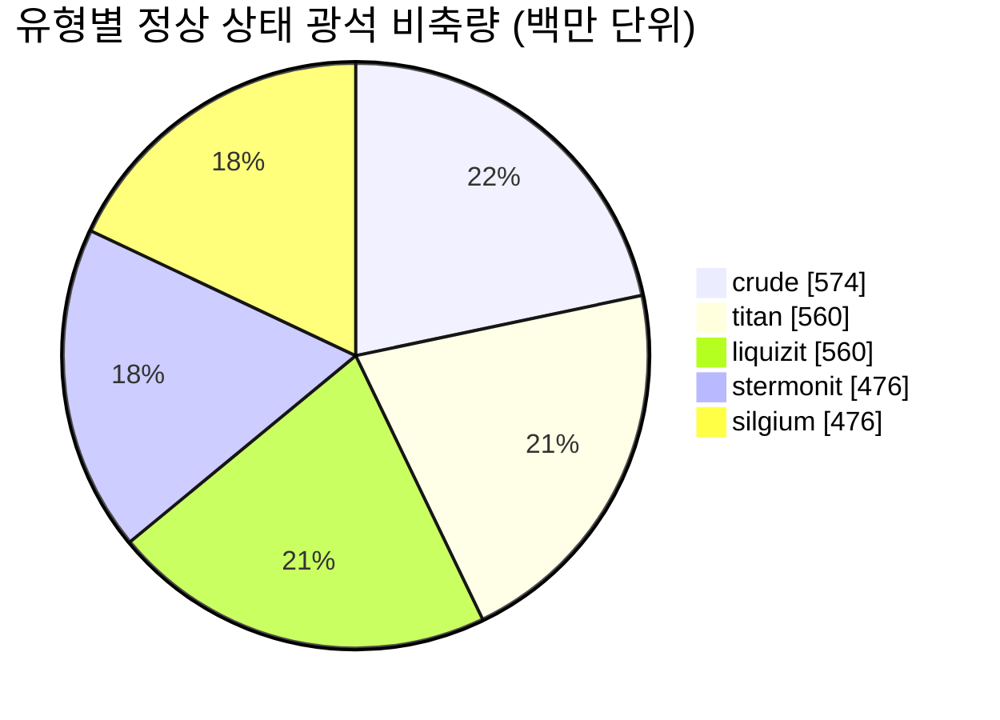

<!-- Generated by tools/generate from the live database (source: zones, mineralconfigs, plantrules, teleportdescriptions, strongholdexitconfig).
     Do not edit by hand; regenerate instead. -->
# Shinjalar (zone_ASI_pve)

  <a href="/ko/zones/map/">
    
    <strong>월드 맵</strong> — 텔레포트 연결을 포함하여 다른 모든 존 사이에서 이 존의 위치. 전체 지도 열기.
  </a>

이 존의 텔레포트 기둥 위치(목적지가 표시된 점 — 기둥이 비활성화된 경우 흐리게 표시), 다른 존에서 도착하는 텔레포트 착륙 지점(점선 원), 그리고 출구 게이트(다이아몬드)를 나타냅니다. 위치는 서버에 기록된 타일 좌표입니다. 점선은 로컬(존 내부) 텔레포트 기둥 쌍을 연결합니다.

Daoden (ASI)의 보호(Alpha) 존 — 플레이어의 공격으로부터 안전하며 Daoden (ASI) 은하의 기본 자원 채집지입니다. 5가지 광석 유형을 유지합니다.

| 항목 | 값 |
|---|---|
| 존 ID | 7 |
| 유형 | PvE |
| 보호 | [Alpha](/ko/zones/protection/) — 보호 구역, PvP 비활성화 |
| 크기 | 2048×2048 타일 |
| 비옥도 | 20 |
| 식물 종 | 14 (규칙 세트 7) |
| 광석 종류 | 5 |
| 총 광석 노드 수 | 35 |
| 최대 도킹 기지 | 없음 |

## 광석 구성

이 존이 유지하는 노드 생성입니다. 광석별 산출량 및 생성 공식은 [광석](/ko/content/ores/)에서 확인할 수 있습니다(이 존의 섹션은 아래에 링크됨).

| 재료 | 노드 | 최대 타일/노드 | 노드당 총량 | 최소 임계값 |
|---|---|---|---|---|
| [titan](/ko/content/ores/titan/) | 7 | 625 | 80M | 0.5 |
| [crude](/ko/content/ores/crude/) | 7 | 1k | 82.125M | 0.5 |
| [stermonit](/ko/content/ores/stermonit/) | 7 | 625 | 68M | 0.5 |
| [liquizit](/ko/content/ores/liquizit/) | 7 | 625 | 80M | 0.5 |
| [silgium](/ko/content/ores/silgium/) | 7 | 625 | 68M | 0.5 |

[존 색인](/ko/zones/zone-index/) · [월드 맵](/ko/zones/map/#alpha) · [보호 레벨](/ko/zones/protection/)
