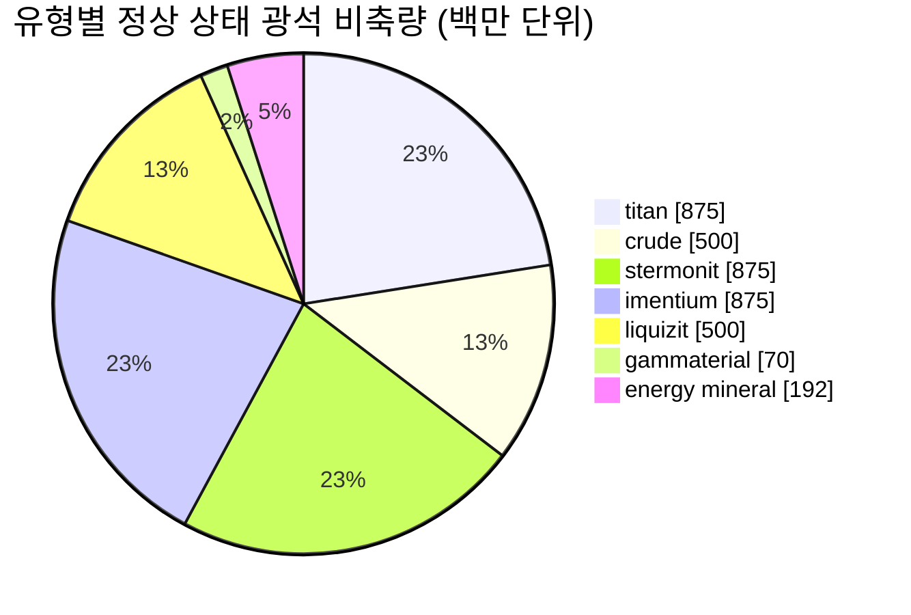

# zone_gamma_z106 — 사례 연구

  <a href="/ko/zones/map/">
    
    <strong>월드 맵</strong> — 텔레포트 연결을 포함하여 다른 모든 구역 사이에서 이 구역의 위치. 전체 지도 열기.
  </a>

이 구역의 텔레포트 기둥 위치(목적지가 표시된 점 — 기둥이 비활성화된 경우 흐리게 표시), 다른 구역에서 도착하는 텔레포트 착륙 지점(점선 원), 그리고 출구 게이트(다이아몬드)를 나타냅니다. 위치는 서버에 기록된 타일 좌표입니다.

고티어 **오픈 PvP** 구역: 테라포밍 가능, 낮은 비옥도, 2티어 식물 변종, 그리고 더 빠듯한 광석 경제를 특징으로 합니다. 이는 더 적고 더 치열하게 경쟁하는 자원을 가진 구역의 "엔드게임" 형태를 보여줍니다.

| 항목 | 값 |
|---|---|
| 존 ID | 106 |
| 유형 | PvP (오픈) |
| 보호 | [Gamma](/ko/zones/protection/) — 오픈 PvP, 테라포밍 가능 |
| 크기 | 2048 × 2048 타일 |
| 비옥도 | 15 |
| 테라포밍 가능 여부 | 가능 (PBS 테크 제한 2) |
| 식물 규칙 세트 | 22 — 17 종 ("Gamma Plant Rules", 2티어 조합) |
| 광석 종류 | 7 (titan, crude, stermonit, imentium, liquizit, gammaterial, energy mineral) |
| 총 광석 노드 수 | 44 |

## 광석 구성

| 재료 | 노드 | 최대 타일/노드 | 노드당 총량 | 최소 임계값 |
|---|---|---|---|---|
| [titan](/ko/content/ores/titan/) | 7 | 600 | 125,000,000 | 0.5 |
| [crude](/ko/content/ores/crude/) | 4 | 600 | 125,000,000 | 0.5 |
| [stermonit](/ko/content/ores/stermonit/) | 7 | 600 | 125,000,000 | 0.5 |
| [imentium](/ko/content/ores/imentium/) | 7 | 600 | 125,000,000 | 0.5 |
| [liquizit](/ko/content/ores/liquizit/) | 4 | 600 | 125,000,000 | 0.5 |
| [gammaterial](/ko/content/ores/gammaterial/) | 7 | 100 | 10,000,000 | 0.5 |
| [energymineral](/ko/content/ores/energymineral/) | 8 | 300 | 24,000,000 | 0.5 |

눈에 띄는 점:

- **알파 구역보다 적은 노드 수**(Daoden의 64개 대비 44개): 원유(crude)와 리퀴지트(liquizit)는 각각 단 4개의 노드로 줄어듭니다. 알파 일반 광석과 노드당 총량은 동일하므로, 정상 상태 비축량(총 약 39억 단위)은 더 빈약하며 회복 속도가 느립니다.
- **두 가지 이색 광석**: 매우 작은 100타일 노드의 **감마테리얼(gammaterial)**(이동 반경 10타일 — 작고 발견하기 쉬우며, 노드당 약 1.4M)과 노드당 24M의 **에너지 미네랄(energy mineral)**.
- 에프리톤과 플럭스 광석 없음 — 희귀/경제 광석은 알파 티어에만 유지됩니다.

## 식물 조합

규칙 세트 22는 17종을 허용합니다: 기본 식물에 더해 **2티어 변종** — 야생 수확 식물인 상위 철나무 t2 및 상위 러스트부시 t2, 그리고 **2티어 파종 식물**(상위 일렉트로플랜트 t2, 상위 슬라임루트 t2)이 포함됩니다. 파종 식물은 `playerSeeded` 속성을 가지며 자연적으로 **절대** 스폰되지 않고 플레이어 정원에서만 존재합니다([채집 → 식물](/ko/features/gathering/) 참조).

비옥도는 20이 아닌 **15**입니다: 32×32 큐브는 최대 약 15%의 차단 식물만을 가질 수 있으므로 알파 구역보다 식물 분포가 눈에 띄게 희박하며, 큐브가 "포화"되기 전에 비옥도 추첨이 채워질 공간이 약간 적습니다.

종별 규칙(t2 열매 양 포함)은 [식물](/ko/content/plants/)에 있으며, 광석별 생산량은 [광석](/ko/content/ores/)에 있습니다.

## 플레이어 유의 사항

- 더 빠듯하고 느린 경제: 일반 광석 노드 수가 적다는 것은 채굴 압박이 더 빨리 나타남을 의미합니다 — 고갈된 원유 노드는 구역이 교체하는 데 더 오랜 시간이 걸립니다.
- 더 희박한 식생: 15% 비옥도로 인해 개활지가 일반적이며 식물 군락은 예외적인 수준입니다.
- 이곳의 고가치 채집 대상은 2티어 철나무 / 러스트부시 야생 식물과, 파종된 2티어 일렉트로플랜트 및 슬라임루트를 기르는 플레이어 정원입니다.
- 테라포밍(PBS 테크 제한 2)은 지형 자체를 플레이어가 재구성할 수 있음을 의미합니다([파워 베이스 스테이션](/ko/features/pbs/) 참조).

<!-- 개발자 참고사항: zones 행 id 106 (zonetype 2 = PvP, protected 0, fertility 15, terraformable 1, pbsTechLimit 2, plantruleset 22); mineralconfigs 7개 행 (crude 및 liquizit 각 4개 노드); plantrules rulesetid 22 = 17개 파일, "Gamma Plant Rules" 메모; electroplant_seeded_t2.txt / slimeroot_seeded_t2.txt에 playerSeeded=n1 설정 (electroplant_hi.txt / slimeroot_hi.txt로부터 source=를 통해 상속됨) -> PlantRuleExtensions.GetWinnerPlantTypeBasedOnFertility에서 자연 스폰 제외. -->
