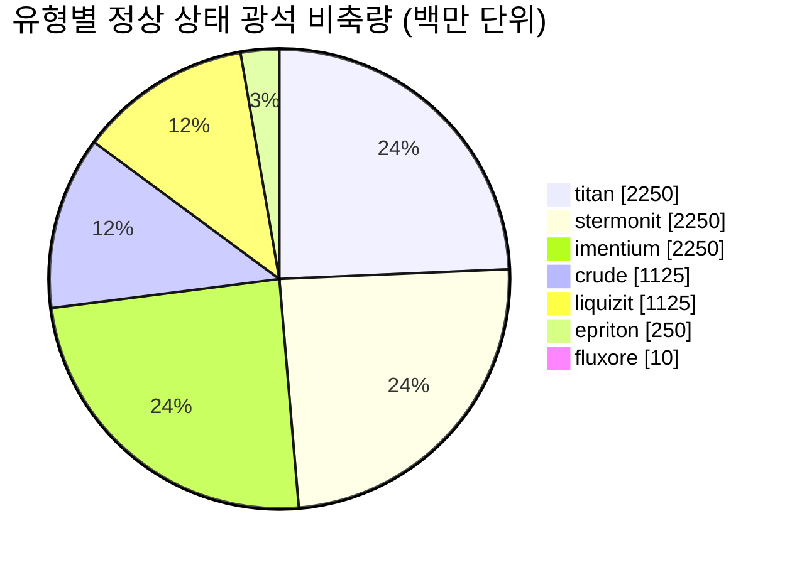

<!-- Generated by tools/generate from the live database (source: zones, mineralconfigs, plantrules, teleportdescriptions, strongholdexitconfig).
     Do not edit by hand; regenerate instead. -->
# zone_gamma_z131

  <a href="/ko/zones/map/">
    
    <strong>월드 맵</strong> — 텔레포트 연결을 포함하여 다른 모든 존 사이에서 이 존의 위치. 전체 지도 열기.
  </a>

이 존의 텔레포트 기둥 위치(목적지가 표시된 점 — 기둥이 비활성화된 경우 흐리게 표시), 다른 존에서 도착하는 텔레포트 착륙 지점(점선 원), 그리고 출구 게이트(다이아몬드)를 나타냅니다. 위치는 서버에 기록된 타일 좌표입니다.

frontier belt의 오픈 PvP(Beta) 섬 — 플레이어가 자유롭게 공격할 수 있으며 블롭이 적용됩니다. 7가지 광석 유형을 유지합니다.

| 항목 | 값 |
|---|---|
| 존 ID | 131 |
| 유형 | PvP |
| 보호 | [Beta](/ko/zones/protection/) — 오픈 PvP, 표준 지형 |
| 크기 | 2048×2048 타일 |
| 티어 | T0 (서버 기록) |
| 비옥도 | 15 |
| 식물 종 | 15 (규칙 세트 20) |
| 광석 종류 | 7 |
| 총 광석 노드 수 | 47 |
| PBS 테크 한도 | 0 |
| 최대 도킹 기지 | 없음 |

## 광석 구성

이 존이 유지하는 노드 생성입니다. 광석별 산출량 및 생성 공식은 [광석](/ko/content/ores/)에서 확인할 수 있습니다(이 존의 섹션은 아래에 링크됨).

| 재료 | 노드 | 최대 타일/노드 | 노드당 총량 | 최소 임계값 |
|---|---|---|---|---|
| [titan](/ko/content/ores/titan/) | 10 | 600 | 225M | 0.5 |
| [crude](/ko/content/ores/crude/) | 5 | 600 | 225M | 0.5 |
| [stermonit](/ko/content/ores/stermonit/) | 10 | 600 | 225M | 0.5 |
| [imentium](/ko/content/ores/imentium/) | 10 | 600 | 225M | 0.5 |
| [liquizit](/ko/content/ores/liquizit/) | 5 | 600 | 225M | 0.5 |
| [epriton](/ko/content/ores/epriton/) | 5 | 300 | 50M | 0.5 |
| [fluxore](/ko/content/ores/fluxore/) | 2 | 200 | 5M | 0.5 |

[존 색인](/ko/zones/zone-index/) · [월드 맵](/ko/zones/map/#t1) · [보호 레벨](/ko/zones/protection/)
