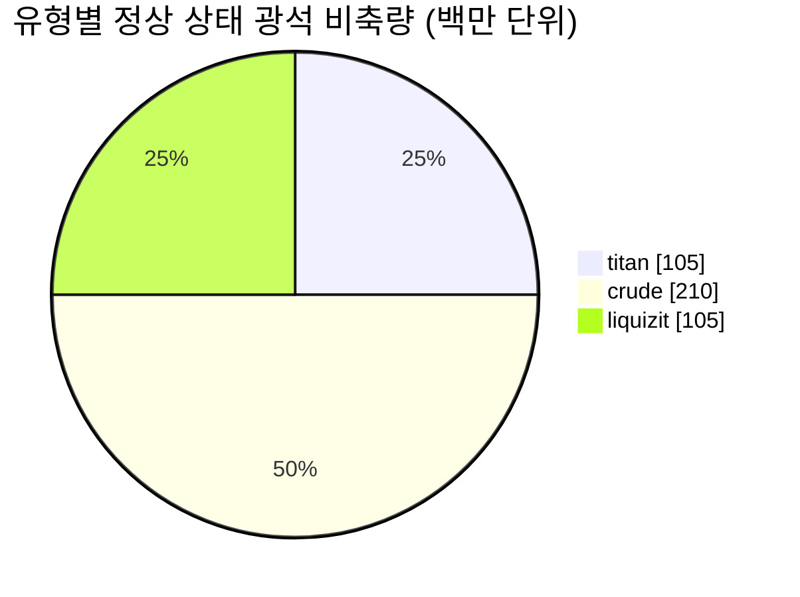

# New Virginia (zone_TM) — 사례 연구

  <a href="/ko/zones/map/">
    
    <strong>월드 맵</strong> — 텔레포트 연결을 포함하여 다른 모든 구역 사이에서 이 구역의 위치. 전체 지도 열기.
  </a>

이 구역의 텔레포트 기둥 위치(목적지가 표시된 점 — 기둥이 비활성화된 경우 흐리게 표시), 다른 구역에서 도착하는 텔레포트 착륙 지점(점선 원), 그리고 출구 게이트(다이아몬드)를 나타냅니다. 위치는 서버에 기록된 타일 좌표입니다.
점선은 로컬(구역 내부) 텔레포트 기둥 쌍을 연결합니다.

저티어 **보호된 PvE** 구역으로, 신규 캐릭터들이 모이는 안전한 장소입니다. 이 구역의 구성은 가장 단순한 형태를 보여줍니다. 적은 수의 광석 유형, 큰 규모의 노드, 그리고 기본적인 식물 구성을 갖추고 있습니다.

| 항목 | 값 |
|---|---|
| 존 ID | 0 |
| 유형 | PvE (보호) |
| 보호 | [Alpha](/ko/zones/protection/) — 보호됨, PvP 비활성화 |
| 크기 | 2048 × 2048 타일 |
| 비옥도 | 20 |
| 식물 규칙 세트 | 0 — 15 종 (기본 "tm pve" 조합) |
| 광석 종류 | 3 (titan, crude, liquizit) |
| 총 광석 노드 수 | 21 (유형당 7개) |

## 광석 구성

| 재료 | 노드 | 최대 타일/노드 | 노드당 총량 | 최소 임계값 |
|---|---|---|---|---|
| [titan](/ko/content/ores/titan/) | 7 | 1000 | 15,000,000 | 0.5 |
| [crude](/ko/content/ores/crude/) | 7 | 1257 | 30,000,000 | 0.5 |
| [liquizit](/ko/content/ores/liquizit/) | 7 | 1000 | 15,000,000 | 0.5 |

눈에 띄는 점:

- **크고 드문드문한 노드** — 각 노드가 1,000–1,257 타일에 달하며(이동 반경 `(int)√(tiles/π)×2` = 34–40 타일), 각 노드가 거대한 블롭을 형성하고 구역당 유형별로 7개만 존재합니다. 정상 상태 비축량은 총 약 4억 2천만 단위의 자원입니다(titan 105M + crude 210M + liquizit 105M).
- **희귀 광석 없음** — 에프리톤(epriton)이나 플럭스 광석(flux ore)이 없으므로 기지 주변의 접근 금지 구역이나 NPC를 스폰하는 광석 채굴지가 없습니다.
- `minthreshold` 0.5는 노드의 노이즈 채움 값이 최대값의 절반 이상인 경우에만 해당 타일을 사용할 수 있음을 의미하며, 각 블롭의 가장자리는 얇게 형성됩니다.

유형별 생산량(각 광석 1단위를 정제하여 얻는 결과물 및 위 수치들의 기반이 되는 노드 생성 공식)은 [광석](/ko/content/ores/)에서 확인할 수 있습니다.

## 식물 조합

규칙 세트 0은 15종을 허용하며, 이는 기본적인 초보자 세트입니다: 풀 (a/b), 소나무, 덤불 (a/b), 란고, 구리나무, 갈대, 나노밀, 하위 티어 러스트부시/슬라임루트/일렉트로플랜트, 분재, 하위 티어 철나무. 벽(wall), 데브리놀, 고티어 수확 식물은 없습니다.

비옥도 20에서 32×32 큐브는 최대 약 20%의 차단 식물만을 수용할 수 있습니다. 전체 2048×2048 맵 전체에서 이는 대략 838,000개의 식물 타일이라는 상한선이 됩니다(실제로는 물과 섬 지형이 땅이 아니므로 이보다 적습니다). 종 선택은 각 규칙의 `fertility`에 따라 가중치가 부여되므로, 기본 풀과 덤불이 우세하며 하위 티어 수확 식물은 드물게 유지됩니다.

종별 전체 규칙(성장 속도 growRate, 열매, 체력)은 [식물](/ko/content/plants/)에서 확인할 수 있습니다.

## 플레이어 유의 사항

- 안전한 초반 경제: 크고 탐색(스캔)하기 쉬운 블롭 형태의 일반 광석 3종.
- 이곳의 수확 식물은 하위 티어 변종입니다 — 고가치 식물(상위 티어 일렉트로플랜트/철나무/러스트부시/슬라임루트)은 이후 구역에서 나타납니다.
- 구역이 보호되므로 자원 채집 루프에서 PvP 위험만이 배제되어 있습니다(구역 진입에 대해서는 [이동](/ko/features/movement/) 참조).

<!-- 개발자 참고사항: zones 행 id 0 (zonetype 1 = PvE, protected 1, fertility 20, plantruleset 0); mineralconfigs 3개 행 (titan/crude/liquizit, 각각 7개 노드); plantrules rulesetid 0 = 15개 파일, "tm pve" 메모. 노드 반경 공식 및 임계값 의미: generation.md 참조. -->
