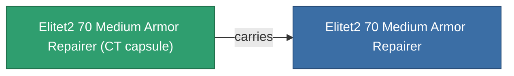

<!-- Generated by tools/generate from the live database (source: entitydefaults definition 5937, aggregatevalues via aggregatefields).
     Do not edit by hand; regenerate instead. -->

# Elitet2 70 Medium Armor Repairer

|  |  |
|---|---|
| Definitie | `def_elitet2_70_medium_armor_repairer` |
| Tier | T2 (special) |
| Levenspunten | 100 |
| Volume | 1.5 |
| Massa | 506.25 |
| Categorie | Modules / Repair |
| Opmerking | elite module |

## Statistieken

| Veld | Waarde |
|---|---|
| armor_repair_amount | 200 |
| core_recharge_time_modifier | 0.975 |
| core_usage | 278 |
| cpu_usage | 43 |
| cycle_time | 13.5k |
| powergrid_usage | 87 |

## Transporthoeft

A transport capsule (CT) exists for this item — it is how the item moves between players and zones.

## Waar te kopen

Fixed-price vendors that sell this item (see the [Item shop](/nl/content/shop/) for the full catalog).

| Vendor | Qty | ICS Coin | Credits |
|---|---|---|---|
| Daoden outpost | ∞ | 2.5k | 375M |

<!-- production:generated -->
## Productie

**Geproduceerd uit 2 componentën** — monteer de componenten om het te bouwen (volledige lijst in [Recepten](/nl/content/recipes/)):

**Bouwtekening:** [Elitet2 70 Medium Armor Repairer Cprg](/content/items/elitet2-70-medium-armor-repairer-cprg/)

<svg class="prod-card-icon" aria-hidden="true"><use href="#mi-grid"/></svg><a class="prod-card-name" href="/nl/content/items/material-boss-z70/">Material Boss Z70</a>

vereist: <b>300</b>

<svg class="prod-card-icon" aria-hidden="true"><use href="#mi-tree"/></svg><a class="prod-card-name" href="/nl/content/items/named1-medium-armor-repairer/">Vautrell medium armor repairer</a>

vereist: <b>1</b>

