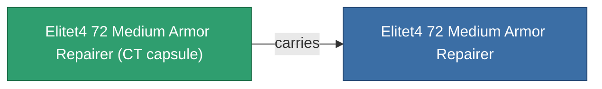

<!-- Generated by tools/generate from the live database (source: entitydefaults definition 6045, aggregatevalues via aggregatefields).
     Do not edit by hand; regenerate instead. -->

# Elitet4 72 Medium Armor Repairer

|  |  |
|---|---|
| Definitie | `def_elitet4_72_medium_armor_repairer` |
| Tier | T4 (special) |
| Levenspunten | 100 |
| Volume | 1.5 |
| Massa | 600 |
| Categorie | Modules / Repair |
| Opmerking | elite module |

## Statistieken

| Veld | Waarde |
|---|---|
| armor_max | 405 |
| armor_repair_amount | 230 |
| core_usage | 297 |
| cpu_usage | 52 |
| cycle_time | 12k |
| powergrid_usage | 105 |

## Transporthoeft

A transport capsule (CT) exists for this item — it is how the item moves between players and zones.

## Waar te kopen

Fixed-price vendors that sell this item (see the [Item shop](/nl/content/shop/) for the full catalog).

| Vendor | Qty | ICS Coin | Credits |
|---|---|---|---|
| Daoden outpost | ∞ | 5k | 750M |

<!-- production:generated -->
## Productie

**Geproduceerd uit 2 componentën** — monteer de componenten om het te bouwen (volledige lijst in [Recepten](/nl/content/recipes/)):

**Bouwtekening:** [Elitet4 72 Medium Armor Repairer Cprg](/nl/content/items/elitet4-72-medium-armor-repairer-cprg/)

<svg class="prod-card-icon" aria-hidden="true"><use href="#mi-grid"/></svg><a class="prod-card-name" href="/nl/content/items/material-boss-z72/">Material Boss Z72</a>

vereist: <b>400</b>

<svg class="prod-card-icon" aria-hidden="true"><use href="#mi-tree"/></svg><a class="prod-card-name" href="/nl/content/items/named3-medium-armor-repairer/">CRC40 medium armor repairer</a>

vereist: <b>1</b>

