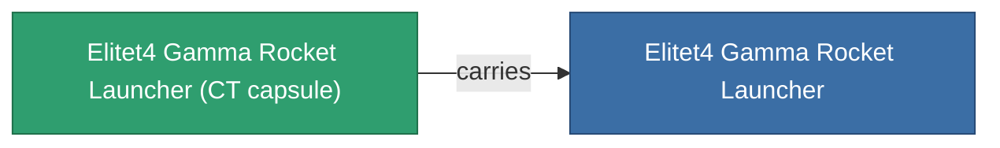

<!-- Generated by tools/generate from the live database (source: entitydefaults definition 6213, aggregatevalues via aggregatefields).
     Do not edit by hand; regenerate instead. -->

# Elitet4 Gamma Rocket Launcher

|  |  |
|---|---|
| Definitie | `def_elitet4_gamma_rocket_launcher` |
| Tier | T4 (special) |
| Levenspunten | 100 |
| Volume | 1 |
| Massa | 275 |
| Categorie | Modules / Weapons |
| Opmerking | elite module |

## Statistieken

| Veld | Waarde |
|---|---|
| accuracy | 1 |
| core_usage | 1 |
| cpu_usage | 32 |
| cycle_time | 6.5k |
| damage_modifier | 1.05 |
| module_missile_range_modifier | 1.2 |
| powergrid_usage | 28 |

## Transporthoeft

A transport capsule (CT) exists for this item — it is how the item moves between players and zones.

## Waar te kopen

Fixed-price vendors that sell this item (see the [Item shop](/nl/content/shop/) for the full catalog).

| Vendor | Qty | TM Coin | Credits |
|---|---|---|---|
| Daoden outpost | ∞ | 5k | 750M |

<!-- production:generated -->
## Productie

**Geproduceerd uit 2 componentën** — monteer de componenten om het te bouwen (volledige lijst in [Recepten](/nl/content/recipes/)):

**Bouwtekening:** [Elitet4 Gamma Rocket Launcher Cprg](/nl/content/items/elitet4-gamma-rocket-launcher-cprg/)

<svg class="prod-card-icon" aria-hidden="true"><use href="#mi-grid"/></svg><a class="prod-card-name" href="/nl/content/items/material-boss-gamma-pelistal/">Material Boss Gamma Pelistal</a>

vereist: <b>200</b>

<svg class="prod-card-icon" aria-hidden="true"><use href="#mi-star"/></svg><a class="prod-card-name" href="/nl/content/items/named3-rocket-launcher/">Pelistec-TR110 light missile launcher</a>

vereist: <b>1</b>

