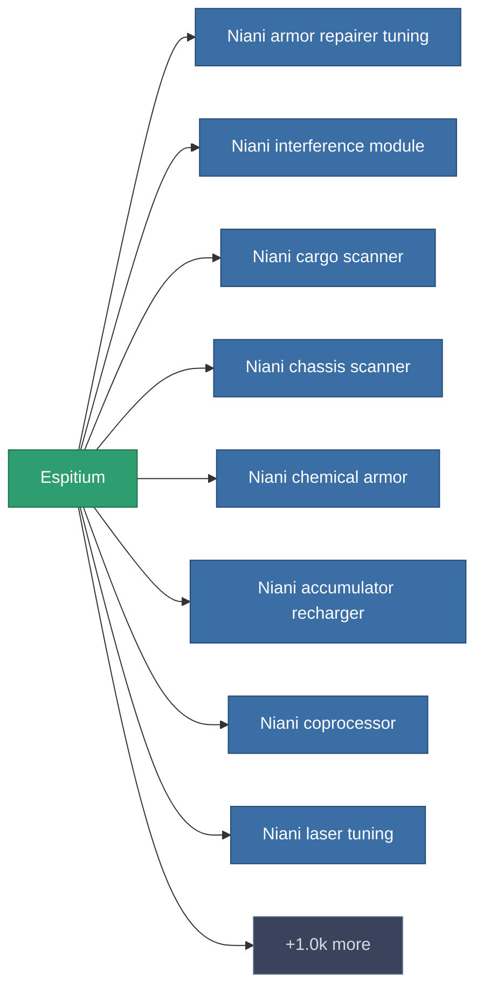

<!-- Generated by tools/generate from the live database (source: entitydefaults definition 189, aggregatevalues via aggregatefields).
     Do not edit by hand; regenerate instead. -->

# Espitium

|  |  |
|---|---|
| Definitie | `def_espitium` |
| Tier | – |
| Levenspunten | 100 |
| Volume | 0 |
| Massa | 0.35 |
| Categorie | Materials |

_Geen statistieken — dit item draagt geen geaggregeerde waarden._

<!-- production:generated -->
## Productie

**Geproduceerd uit 3 componentën** — monteer de componenten om het te bouwen (volledige lijst in [Recepten](/nl/content/recipes/)):

<svg class="prod-card-icon" aria-hidden="true"><use href="#mi-grid"/></svg><a class="prod-card-name" href="/nl/content/items/crude/">HDT</a>

vereist: <b>50</b>

<svg class="prod-card-icon" aria-hidden="true"><use href="#mi-grid"/></svg><a class="prod-card-name" href="/nl/content/items/epriton/">Epriton</a>

vereist: <b>50</b>

<svg class="prod-card-icon" aria-hidden="true"><use href="#mi-grid"/></svg><a class="prod-card-name" href="/nl/content/items/liquizit/">Liquizit</a>

vereist: <b>75</b>

## Gebruikt in productie

**Component van 1.0k items** — een voorbeeld van wat ermee geproduceerd kan worden (volledige lijst in [Recepten](/nl/content/recipes/)).

