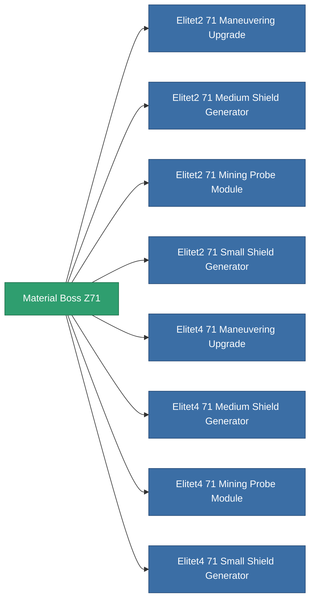

<!-- Generated by tools/generate from the live database (source: entitydefaults definition 6040, aggregatevalues via aggregatefields).
     Do not edit by hand; regenerate instead. -->

# Material Boss Z71

|  |  |
|---|---|
| Definitie | `def_material_boss_z71` |
| Tier | – |
| Levenspunten | 100 |
| Volume | 0.01 |
| Massa | 0.5 |
| Categorie | Materials |
| Opmerking | elite module material |

_Geen statistieken — dit item draagt geen geaggregeerde waarden._

<!-- production:generated -->
## Gebruikt in productie

**Component van 8 items** — alles dat het in productie gebruikt:

