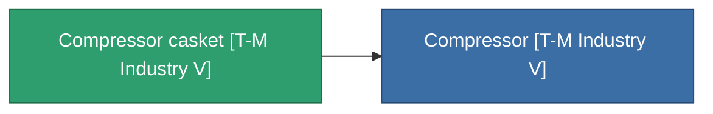

<!-- Generated by tools/generate from the live database (source: entitydefaults definition 4470, aggregatevalues via aggregatefields).
     Do not edit by hand; regenerate instead. -->

# Compressor casket [T-M Industry V]

|  |  |
|---|---|
| Definitie | `def_missionitem_tm_i_tutorial_exp3_05_t03` |
| Tier | – |
| Levenspunten | 100 |
| Volume | 1 |
| Massa | 50 |
| Categorie | Mission items |

_Geen statistieken — dit item draagt geen geaggregeerde waarden._

<!-- production:generated -->
## Gebruikt in productie

**Component van 1 items** — alles dat het in productie gebruikt:

