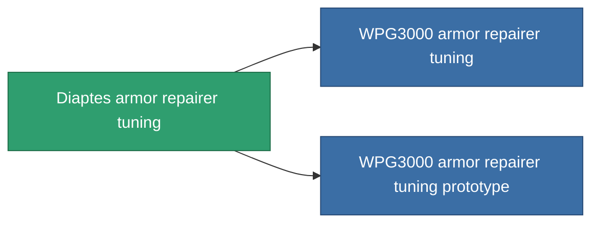

<!-- Generated by tools/generate from the live database (source: entitydefaults definition 1063, aggregatevalues via aggregatefields).
     Do not edit by hand; regenerate instead. -->

# Diaptes armor repairer tuning

|  |  |
|---|---|
| Definitie | `def_named1_armor_repairer_upgrade` |
| Tier | T2 |
| Levenspunten | 100 |
| Volume | 0.5 |
| Massa | 270 |
| Categorie | Modules / Repair |
| Tier line | [Standard armor repairer tuning](/nl/content/items/standard-armor-repairer-upgrade/) (T1) → **Diaptes armor repairer tuning** (T2) → [WPG3000 armor repairer tuning](/nl/content/items/named2-armor-repairer-upgrade/) (T3) → [Apogenion armor repairer tuning](/nl/content/items/named3-armor-repairer-upgrade/) (T4) |

## Statistieken

| Veld | Waarde |
|---|---|
| armor_repair_amount_modifier | 1.08 |
| armor_repair_cycle_time_modifier | 0.96 |
| cpu_usage | 32 |
| powergrid_usage | 22 |

<!-- production:generated -->
## Productie

**Geproduceerd uit 8 componentën, onderzoekslevel 4** — monteer de componenten om het te bouwen (volledige lijst in [Recepten](/nl/content/recipes/)):

**Bouwtekening:** [Diaptes armor repairer tuning CT](/content/items/named1-armor-repairer-upgrade-cprg/)

<svg class="prod-card-icon" aria-hidden="true"><use href="#mi-grid"/></svg><a class="prod-card-name" href="/nl/content/items/axicol/">Cryoperine</a>

vereist: <b>50</b>

<svg class="prod-card-icon" aria-hidden="true"><use href="#mi-grid"/></svg><a class="prod-card-name" href="/nl/content/items/chollonin/">Chollonin</a>

vereist: <b>50</b>

<svg class="prod-card-icon" aria-hidden="true"><use href="#mi-grid"/></svg><a class="prod-card-name" href="/nl/content/items/plasteosine/">Plasteosine</a>

vereist: <b>150</b>

<svg class="prod-card-icon" aria-hidden="true"><use href="#mi-crystal"/></svg><a class="prod-card-name" href="/nl/content/items/robotshard-common-basic/">Damaged common fragment</a>

vereist: <b>15</b>

<svg class="prod-card-icon" aria-hidden="true"><use href="#mi-crystal"/></svg><a class="prod-card-name" href="/nl/content/items/robotshard-nuimqol-basic/">Damaged nuimqol fragment</a>

vereist: <b>15</b>

<svg class="prod-card-icon" aria-hidden="true"><use href="#mi-tree"/></svg><a class="prod-card-name" href="/nl/content/items/standard-armor-repairer-upgrade/">Standard armor repairer tuning</a>

vereist: <b>1</b>

<svg class="prod-card-icon" aria-hidden="true"><use href="#mi-grid"/></svg><a class="prod-card-name" href="/nl/content/items/statichnol/">Statichnol</a>

vereist: <b>150</b>

<svg class="prod-card-icon" aria-hidden="true"><use href="#mi-grid"/></svg><a class="prod-card-name" href="/nl/content/items/titanium/">Titanium</a>

vereist: <b>100</b>

## Gebruikt in productie

**Component van 2 items** — alles dat het in productie gebruikt:

