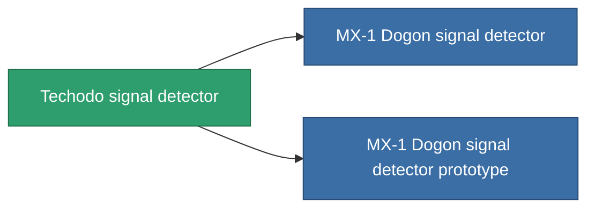

<!-- Generated by tools/generate from the live database (source: entitydefaults definition 2899, aggregatevalues via aggregatefields).
     Do not edit by hand; regenerate instead. -->

# Techodo signal detector

|  |  |
|---|---|
| Definitie | `def_named1_detection_modul` |
| Tier | T2 |
| Levenspunten | 100 |
| Volume | 0.5 |
| Massa | 225 |
| Categorie | Modules / Enhancements |
| Tier line | [Standard signal detector](/nl/content/items/standard-detection-modul/) (T1) → **Techodo signal detector** (T2) → [MX-1 Dogon signal detector](/nl/content/items/named2-detection-modul/) (T3) → ['Rogue' signal detector](/nl/content/items/named3-detection-modul/) (T4) |

## Statistieken

| Veld | Waarde |
|---|---|
| core_usage | 162 |
| cpu_usage | 75 |
| cycle_time | 25k |
| effect_detection_strength_modifier | 20 |
| effect_stealth_strength_modifier | -20 |
| powergrid_usage | 5 |

<!-- production:generated -->
## Productie

**Geproduceerd uit 5 componentën, onderzoekslevel 7** — monteer de componenten om het te bouwen (volledige lijst in [Recepten](/nl/content/recipes/)):

**Bouwtekening:** [Techodo signal detector CT](/content/items/named1-detection-modul-cprg/)

<svg class="prod-card-icon" aria-hidden="true"><use href="#mi-grid"/></svg><a class="prod-card-name" href="/nl/content/items/axicol/">Cryoperine</a>

vereist: <b>450</b>

<svg class="prod-card-icon" aria-hidden="true"><use href="#mi-grid"/></svg><a class="prod-card-name" href="/nl/content/items/plasteosine/">Plasteosine</a>

vereist: <b>50</b>

<svg class="prod-card-icon" aria-hidden="true"><use href="#mi-crystal"/></svg><a class="prod-card-name" href="/nl/content/items/robotshard-common-basic/">Damaged common fragment</a>

vereist: <b>60</b>

<svg class="prod-card-icon" aria-hidden="true"><use href="#mi-grid"/></svg><a class="prod-card-name" href="/nl/content/items/standard-detection-modul/">Standard signal detector</a>

vereist: <b>1</b>

<svg class="prod-card-icon" aria-hidden="true"><use href="#mi-grid"/></svg><a class="prod-card-name" href="/nl/content/items/titanium/">Titanium</a>

vereist: <b>200</b>

## Gebruikt in productie

**Component van 2 items** — alles dat het in productie gebruikt:

