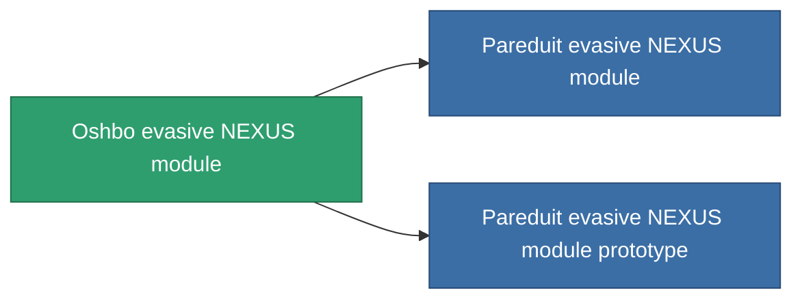

<!-- Generated by tools/generate from the live database (source: entitydefaults definition 2589, aggregatevalues via aggregatefields).
     Do not edit by hand; regenerate instead. -->

# Oshbo evasive NEXUS module

|  |  |
|---|---|
| Definitie | `def_named1_gang_assist_coordinated_maneuvering_module` |
| Tier | T2 |
| Levenspunten | 100 |
| Volume | 0.2 |
| Massa | 50 |
| Categorie | Modules / Enhancements |
| Tier line | [Standard evasive NEXUS module](/nl/content/items/standard-gang-assist-coordinated-maneuvering-module/) (T1) → **Oshbo evasive NEXUS module** (T2) → [Pareduit evasive NEXUS module](/nl/content/items/named2-gang-assist-coordinated-maneuvering-module/) (T3) → [R4S-A evasive NEXUS module](/nl/content/items/named3-gang-assist-coordinated-maneuvering-module/) (T4) |
| Opmerking | hit surfacet csokkent |

## Statistieken

| Veld | Waarde |
|---|---|
| core_usage | 31 |
| cpu_usage | 78 |
| cycle_time | 10k |
| default_effect_range | 100 |
| effect_signature_radius_modifier | -0.1 |
| powergrid_usage | 31 |

<!-- production:generated -->
## Productie

**Geproduceerd uit 6 componentën, onderzoekslevel 5** — monteer de componenten om het te bouwen (volledige lijst in [Recepten](/nl/content/recipes/)):

**Bouwtekening:** [Oshbo evasive NEXUS module CT](/content/items/named1-gang-assist-coordinated-maneuvering-module-cprg/)

<svg class="prod-card-icon" aria-hidden="true"><use href="#mi-grid"/></svg><a class="prod-card-name" href="/nl/content/items/axicol/">Cryoperine</a>

vereist: <b>500</b>

<svg class="prod-card-icon" aria-hidden="true"><use href="#mi-grid"/></svg><a class="prod-card-name" href="/nl/content/items/plasteosine/">Plasteosine</a>

vereist: <b>100</b>

<svg class="prod-card-icon" aria-hidden="true"><use href="#mi-crystal"/></svg><a class="prod-card-name" href="/nl/content/items/robotshard-nuimqol-basic/">Damaged nuimqol fragment</a>

vereist: <b>15</b>

<svg class="prod-card-icon" aria-hidden="true"><use href="#mi-crystal"/></svg><a class="prod-card-name" href="/nl/content/items/robotshard-pelistal-basic/">Damaged pelistal fragment</a>

vereist: <b>15</b>

<svg class="prod-card-icon" aria-hidden="true"><use href="#mi-panel"/></svg><a class="prod-card-name" href="/nl/content/items/standard-gang-assist-coordinated-maneuvering-module/">Standard evasive NEXUS module</a>

vereist: <b>1</b>

<svg class="prod-card-icon" aria-hidden="true"><use href="#mi-grid"/></svg><a class="prod-card-name" href="/nl/content/items/titanium/">Titanium</a>

vereist: <b>50</b>

## Gebruikt in productie

**Component van 2 items** — alles dat het in productie gebruikt:

