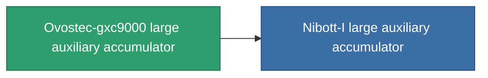

<!-- Generated by tools/generate from the live database (source: entitydefaults definition 819, aggregatevalues via aggregatefields).
     Do not edit by hand; regenerate instead. -->

# Ovostec-gxc9000 large auxiliary accumulator

|  |  |
|---|---|
| Definitie | `def_named1_large_core_battery` |
| Tier | T2 |
| Levenspunten | 100 |
| Volume | 3 |
| Massa | 2700 |
| Categorie | Modules / Power |
| Tier line | [Standard large auxiliary accumulator](/nl/content/items/standard-large-core-battery/) (T1) → **Ovostec-gxc9000 large auxiliary accumulator** (T2) → [Nibott-I large auxiliary accumulator](/nl/content/items/named2-large-core-battery/) (T3) → [Pheter Charge-L large auxiliary accumulator](/nl/content/items/named3-large-core-battery/) (T4) |

## Statistieken

| Veld | Waarde |
|---|---|
| core_max | 1.125k |
| cpu_usage | 360 |
| powergrid_usage | 800 |

<!-- production:generated -->
## Productie

**Geproduceerd uit 5 componentën** — monteer de componenten om het te bouwen (volledige lijst in [Recepten](/nl/content/recipes/)):

**Bouwtekening:** [T2 Large Core Battery Cprg](/nl/content/items/named1-large-core-battery-cprg/)

<svg class="prod-card-icon" aria-hidden="true"><use href="#mi-grid"/></svg><a class="prod-card-name" href="/nl/content/items/axicol/">Cryoperine</a>

vereist: <b>600</b>

<svg class="prod-card-icon" aria-hidden="true"><use href="#mi-crystal"/></svg><a class="prod-card-name" href="/nl/content/items/robotshard-common-basic/">Damaged common fragment</a>

vereist: <b>90</b>

<svg class="prod-card-icon" aria-hidden="true"><use href="#mi-grid"/></svg><a class="prod-card-name" href="/nl/content/items/specimen-sap-item-flux/">Specimen Sap Item Flux</a>

vereist: <b>10</b>

<svg class="prod-card-icon" aria-hidden="true"><use href="#mi-grid"/></svg><a class="prod-card-name" href="/nl/content/items/standard-large-core-battery/">Standard large auxiliary accumulator</a>

vereist: <b>1</b>

<svg class="prod-card-icon" aria-hidden="true"><use href="#mi-grid"/></svg><a class="prod-card-name" href="/nl/content/items/titanium/">Titanium</a>

vereist: <b>300</b>

## Gebruikt in productie

**Component van 1 items** — alles dat het in productie gebruikt:

