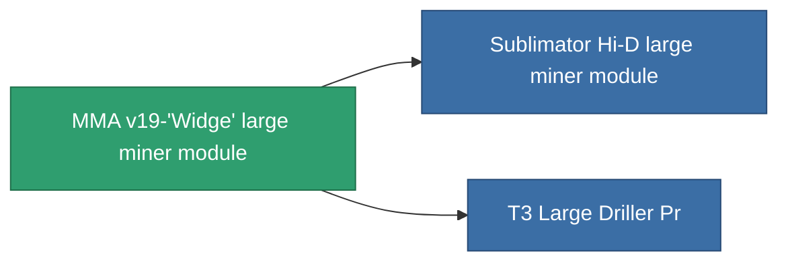

<!-- Generated by tools/generate from the live database (source: entitydefaults definition 8680, aggregatevalues via aggregatefields).
     Do not edit by hand; regenerate instead. -->

# MMA v19-'Widge' large miner module

|  |  |
|---|---|
| Definitie | `def_named1_large_driller` |
| Tier | T2 |
| Levenspunten | 100 |
| Volume | 2.5 |
| Massa | 1500 |
| Categorie | Modules / Enhancements |
| Tier line | [Standard large miner module](/nl/content/items/standard-large-driller/) (T1) → **MMA v19-'Widge' large miner module** (T2) → [Sublimator Hi-D large miner module](/nl/content/items/named2-large-driller/) (T3) → [Pellex large miner module](/nl/content/items/named3-large-driller/) (T4) |

## Statistieken

| Veld | Waarde |
|---|---|
| core_usage | 135 |
| cpu_usage | 432 |
| cycle_time | 12k |
| powergrid_usage | 1.215k |

<!-- production:generated -->
## Productie

**Geproduceerd uit 4 componentën** — monteer de componenten om het te bouwen (volledige lijst in [Recepten](/nl/content/recipes/)):

**Bouwtekening:** [T2 Large Driller Cprg](/nl/content/items/named1-large-driller-cprg/)

<svg class="prod-card-icon" aria-hidden="true"><use href="#mi-grid"/></svg><a class="prod-card-name" href="/nl/content/items/axicol/">Cryoperine</a>

vereist: <b>600</b>

<svg class="prod-card-icon" aria-hidden="true"><use href="#mi-crystal"/></svg><a class="prod-card-name" href="/nl/content/items/robotshard-common-basic/">Damaged common fragment</a>

vereist: <b>120</b>

<svg class="prod-card-icon" aria-hidden="true"><use href="#mi-panel"/></svg><a class="prod-card-name" href="/nl/content/items/standard-large-driller/">Standard large miner module</a>

vereist: <b>1</b>

<svg class="prod-card-icon" aria-hidden="true"><use href="#mi-grid"/></svg><a class="prod-card-name" href="/nl/content/items/titanium/">Titanium</a>

vereist: <b>2.4k</b>

## Gebruikt in productie

**Component van 2 items** — alles dat het in productie gebruikt:

