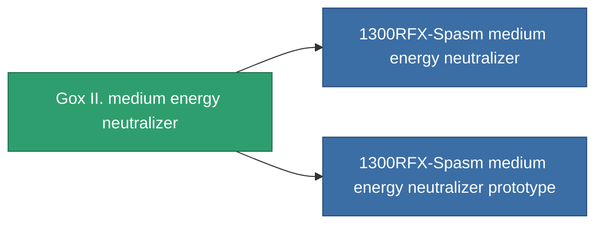

<!-- Generated by tools/generate from the live database (source: entitydefaults definition 756, aggregatevalues via aggregatefields).
     Do not edit by hand; regenerate instead. -->

# Gox II. medium energy neutralizer

|  |  |
|---|---|
| Definitie | `def_named1_medium_energy_neutralizer` |
| Tier | T2 |
| Levenspunten | 100 |
| Volume | 1 |
| Massa | 470 |
| Categorie | Modules / Shield |
| Tier line | [Standard medium energy neutralizer](/nl/content/items/standard-medium-energy-neutralizer/) (T1) → **Gox II. medium energy neutralizer** (T2) → [1300RFX-Spasm medium energy neutralizer](/nl/content/items/named2-medium-energy-neutralizer/) (T3) → [Sicado I. medium energy neutralizer](/nl/content/items/named3-medium-energy-neutralizer/) (T4) |

## Statistieken

| Veld | Waarde |
|---|---|
| core_usage | 215 |
| cpu_usage | 33 |
| cycle_time | 10k |
| energy_dispersion | 10 |
| energy_neutralized_amount | 250 |
| falloff | 0 |
| optimal_range | 25 |
| powergrid_usage | 190 |

<!-- production:generated -->
## Productie

**Geproduceerd uit 8 componentën, onderzoekslevel 5** — monteer de componenten om het te bouwen (volledige lijst in [Recepten](/nl/content/recipes/)):

**Bouwtekening:** [Gox II. medium energy neutralizer CT](/content/items/named1-medium-energy-neutralizer-cprg/)

<svg class="prod-card-icon" aria-hidden="true"><use href="#mi-grid"/></svg><a class="prod-card-name" href="/nl/content/items/axicol/">Cryoperine</a>

vereist: <b>200</b>

<svg class="prod-card-icon" aria-hidden="true"><use href="#mi-grid"/></svg><a class="prod-card-name" href="/nl/content/items/axicoline/">Axicoline</a>

vereist: <b>100</b>

<svg class="prod-card-icon" aria-hidden="true"><use href="#mi-grid"/></svg><a class="prod-card-name" href="/nl/content/items/phlobotil/">Phlobotil</a>

vereist: <b>100</b>

<svg class="prod-card-icon" aria-hidden="true"><use href="#mi-crystal"/></svg><a class="prod-card-name" href="/nl/content/items/robotshard-common-basic/">Damaged common fragment</a>

vereist: <b>30</b>

<svg class="prod-card-icon" aria-hidden="true"><use href="#mi-crystal"/></svg><a class="prod-card-name" href="/nl/content/items/robotshard-pelistal-basic/">Damaged pelistal fragment</a>

vereist: <b>30</b>

<svg class="prod-card-icon" aria-hidden="true"><use href="#mi-grid"/></svg><a class="prod-card-name" href="/nl/content/items/standard-medium-energy-neutralizer/">Standard medium energy neutralizer</a>

vereist: <b>1</b>

<svg class="prod-card-icon" aria-hidden="true"><use href="#mi-grid"/></svg><a class="prod-card-name" href="/nl/content/items/titanium/">Titanium</a>

vereist: <b>100</b>

<svg class="prod-card-icon" aria-hidden="true"><use href="#mi-grid"/></svg><a class="prod-card-name" href="/nl/content/items/vitricyl/">Vitricyl</a>

vereist: <b>200</b>

## Gebruikt in productie

**Component van 2 items** — alles dat het in productie gebruikt:

