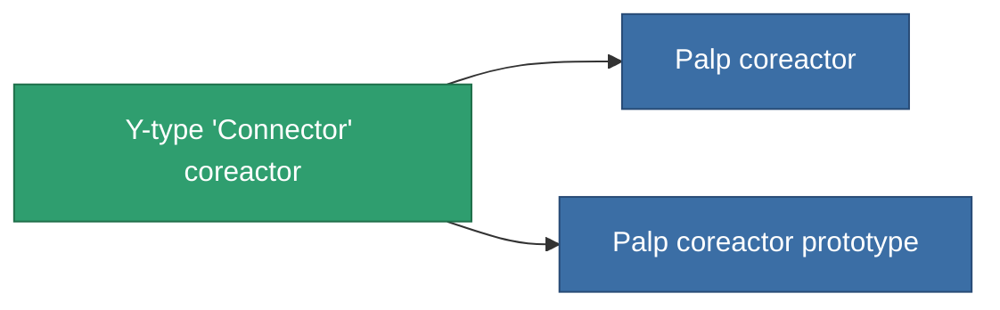

<!-- Generated by tools/generate from the live database (source: entitydefaults definition 765, aggregatevalues via aggregatefields).
     Do not edit by hand; regenerate instead. -->

# Y-type 'Connector' coreactor

|  |  |
|---|---|
| Definitie | `def_named1_powergrid_upgrades` |
| Tier | T2 |
| Levenspunten | 100 |
| Volume | 0.5 |
| Massa | 90 |
| Categorie | Modules / Power |
| Tier line | [Standard coreactor](/nl/content/items/standard-powergrid-upgrades/) (T1) → **Y-type 'Connector' coreactor** (T2) → [Palp coreactor](/nl/content/items/named2-powergrid-upgrades/) (T3) → [E-set 15VaW coreactor](/nl/content/items/named3-powergrid-upgrades/) (T4) |

## Statistieken

| Veld | Waarde |
|---|---|
| cpu_usage | 30 |
| powergrid_max_modifier | 1.1 |

<!-- production:generated -->
## Productie

**Geproduceerd uit 4 componentën, onderzoekslevel 4** — monteer de componenten om het te bouwen (volledige lijst in [Recepten](/nl/content/recipes/)):

**Bouwtekening:** [Y-type 'Connector' coreactor CT](/nl/content/items/named1-powergrid-upgrades-cprg/)

<svg class="prod-card-icon" aria-hidden="true"><use href="#mi-grid"/></svg><a class="prod-card-name" href="/nl/content/items/axicol/">Cryoperine</a>

vereist: <b>300</b>

<svg class="prod-card-icon" aria-hidden="true"><use href="#mi-crystal"/></svg><a class="prod-card-name" href="/nl/content/items/robotshard-common-basic/">Damaged common fragment</a>

vereist: <b>30</b>

<svg class="prod-card-icon" aria-hidden="true"><use href="#mi-crystal"/></svg><a class="prod-card-name" href="/nl/content/items/standard-powergrid-upgrades/">Standard coreactor</a>

vereist: <b>1</b>

<svg class="prod-card-icon" aria-hidden="true"><use href="#mi-grid"/></svg><a class="prod-card-name" href="/nl/content/items/titanium/">Titanium</a>

vereist: <b>200</b>

## Gebruikt in productie

**Component van 2 items** — alles dat het in productie gebruikt:

