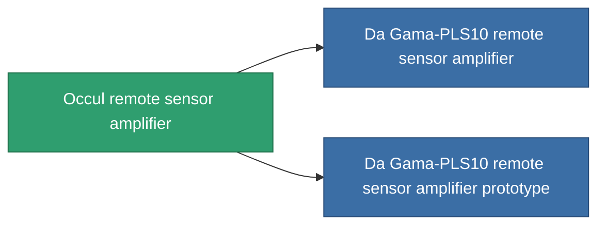

<!-- Generated by tools/generate from the live database (source: entitydefaults definition 771, aggregatevalues via aggregatefields).
     Do not edit by hand; regenerate instead. -->

# Occul remote sensor amplifier

|  |  |
|---|---|
| Definitie | `def_named1_remote_sensor_booster` |
| Tier | T2 |
| Levenspunten | 100 |
| Volume | 0.5 |
| Massa | 90 |
| Categorie | Modules / Sensors & scanning |
| Tier line | [Standard remote sensor amplifier](/nl/content/items/standard-remote-sensor-booster/) (T1) → **Occul remote sensor amplifier** (T2) → [Da Gama-PLS10 remote sensor amplifier](/nl/content/items/named2-remote-sensor-booster/) (T3) → [Ambassador-RU2 remote sensor amplifier](/nl/content/items/named3-remote-sensor-booster/) (T4) |

## Statistieken

| Veld | Waarde |
|---|---|
| core_usage | 14 |
| cpu_usage | 18 |
| cycle_time | 10k |
| effect_sensor_booster_locking_range_modifier | 1.3 |
| effect_sensor_booster_locking_time_modifier | 0.8 |
| falloff | 0 |
| optimal_range | 30 |
| powergrid_usage | 6 |

<!-- production:generated -->
## Productie

**Geproduceerd uit 4 componentën, onderzoekslevel 4** — monteer de componenten om het te bouwen (volledige lijst in [Recepten](/nl/content/recipes/)):

**Bouwtekening:** [Occul remote sensor amplifier CT](/nl/content/items/named1-remote-sensor-booster-cprg/)

<svg class="prod-card-icon" aria-hidden="true"><use href="#mi-grid"/></svg><a class="prod-card-name" href="/nl/content/items/axicol/">Cryoperine</a>

vereist: <b>400</b>

<svg class="prod-card-icon" aria-hidden="true"><use href="#mi-crystal"/></svg><a class="prod-card-name" href="/nl/content/items/robotshard-common-basic/">Damaged common fragment</a>

vereist: <b>30</b>

<svg class="prod-card-icon" aria-hidden="true"><use href="#mi-grid"/></svg><a class="prod-card-name" href="/nl/content/items/standard-remote-sensor-booster/">Standard remote sensor amplifier</a>

vereist: <b>1</b>

<svg class="prod-card-icon" aria-hidden="true"><use href="#mi-grid"/></svg><a class="prod-card-name" href="/nl/content/items/titanium/">Titanium</a>

vereist: <b>100</b>

## Gebruikt in productie

**Component van 2 items** — alles dat het in productie gebruikt:

