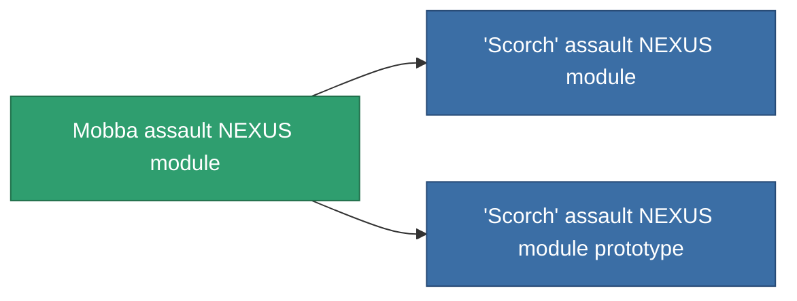

<!-- Generated by tools/generate from the live database (source: entitydefaults definition 2578, aggregatevalues via aggregatefields).
     Do not edit by hand; regenerate instead. -->

# Mobba assault NEXUS module

|  |  |
|---|---|
| Definitie | `def_named2_gang_assist_siege_module` |
| Tier | T3 |
| Levenspunten | 100 |
| Volume | 0.2 |
| Massa | 10 |
| Categorie | Modules / Enhancements |
| Tier line | [Standard assault NEXUS module](/nl/content/items/standard-gang-assist-siege-module/) (T1) → [Myrmidon assault NEXUS module](/nl/content/items/named1-gang-assist-siege-module/) (T2) → **Mobba assault NEXUS module** (T3) → ['Scorch' assault NEXUS module](/nl/content/items/named3-gang-assist-siege-module/) (T4) |
| Opmerking | weapon cycletime 1.0% / ext lvl |

## Statistieken

| Veld | Waarde |
|---|---|
| core_usage | 36 |
| cpu_usage | 88 |
| cycle_time | 10k |
| default_effect_range | 100 |
| effect_weapon_cycle_time_modifier | 0.95 |
| powergrid_usage | 36 |

<!-- production:generated -->
## Productie

**Geproduceerd uit 10 componentën, onderzoekslevel 6** — monteer de componenten om het te bouwen (volledige lijst in [Recepten](/nl/content/recipes/)):

**Bouwtekening:** [Mobba assault NEXUS module CT](/content/items/named2-gang-assist-siege-module-cprg/)

<svg class="prod-card-icon" aria-hidden="true"><use href="#mi-grid"/></svg><a class="prod-card-name" href="/nl/content/items/chollonin/">Chollonin</a>

vereist: <b>250</b>

<svg class="prod-card-icon" aria-hidden="true"><use href="#mi-grid"/></svg><a class="prod-card-name" href="/nl/content/items/espitium/">Espitium</a>

vereist: <b>250</b>

<svg class="prod-card-icon" aria-hidden="true"><use href="#mi-grid"/></svg><a class="prod-card-name" href="/nl/content/items/hydrobenol/">Hydrobenol</a>

vereist: <b>50</b>

<svg class="prod-card-icon" aria-hidden="true"><use href="#mi-panel"/></svg><a class="prod-card-name" href="/nl/content/items/named1-gang-assist-siege-module/">Myrmidon assault NEXUS module</a>

vereist: <b>1</b>

<svg class="prod-card-icon" aria-hidden="true"><use href="#mi-grid"/></svg><a class="prod-card-name" href="/nl/content/items/polynitrocol/">Polynitrocol</a>

vereist: <b>50</b>

<svg class="prod-card-icon" aria-hidden="true"><use href="#mi-crystal"/></svg><a class="prod-card-name" href="/nl/content/items/robotshard-nuimqol-advanced/">Functional nuimqol fragment</a>

vereist: <b>10</b>

<svg class="prod-card-icon" aria-hidden="true"><use href="#mi-crystal"/></svg><a class="prod-card-name" href="/nl/content/items/robotshard-nuimqol-basic/">Damaged nuimqol fragment</a>

vereist: <b>10</b>

<svg class="prod-card-icon" aria-hidden="true"><use href="#mi-crystal"/></svg><a class="prod-card-name" href="/nl/content/items/robotshard-thelodica-advanced/">Functional thelodica fragment</a>

vereist: <b>10</b>

<svg class="prod-card-icon" aria-hidden="true"><use href="#mi-crystal"/></svg><a class="prod-card-name" href="/nl/content/items/robotshard-thelodica-basic/">Damaged thelodica fragment</a>

vereist: <b>10</b>

<svg class="prod-card-icon" aria-hidden="true"><use href="#mi-grid"/></svg><a class="prod-card-name" href="/nl/content/items/titanium/">Titanium</a>

vereist: <b>50</b>

## Gebruikt in productie

**Component van 2 items** — alles dat het in productie gebruikt:

