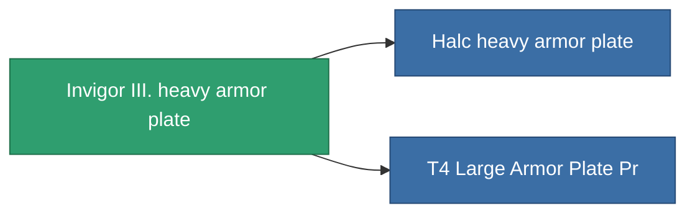

<!-- Generated by tools/generate from the live database (source: entitydefaults definition 691, aggregatevalues via aggregatefields).
     Do not edit by hand; regenerate instead. -->

# Invigor III. heavy armor plate

|  |  |
|---|---|
| Definitie | `def_named2_large_armor_plate` |
| Tier | T3 |
| Levenspunten | 100 |
| Volume | 4 |
| Massa | 9000 |
| Categorie | Modules / Armor |
| Tier line | [Standard large armor plate](/nl/content/items/standard-large-armor-plate/) (T1) → [Vorbol p113 heavy armor plate](/nl/content/items/named1-large-armor-plate/) (T2) → **Invigor III. heavy armor plate** (T3) → [Halc heavy armor plate](/nl/content/items/named3-large-armor-plate/) (T4) |

## Statistieken

| Veld | Waarde |
|---|---|
| armor_max | 4.35k |
| cpu_usage | 60 |
| massiveness | 0.156 |
| powergrid_usage | 1.05k |
| signature_radius | 3 |

<!-- production:generated -->
## Productie

**Geproduceerd uit 7 componentën** — monteer de componenten om het te bouwen (volledige lijst in [Recepten](/nl/content/recipes/)):

**Bouwtekening:** [T3 Large Armor Plate Cprg](/nl/content/items/named2-large-armor-plate-cprg/)

<svg class="prod-card-icon" aria-hidden="true"><use href="#mi-grid"/></svg><a class="prod-card-name" href="/nl/content/items/alligior/">Alligior</a>

vereist: <b>525</b>

<svg class="prod-card-icon" aria-hidden="true"><use href="#mi-tree"/></svg><a class="prod-card-name" href="/nl/content/items/named1-large-armor-plate/">Vorbol p113 heavy armor plate</a>

vereist: <b>1</b>

<svg class="prod-card-icon" aria-hidden="true"><use href="#mi-grid"/></svg><a class="prod-card-name" href="/nl/content/items/plasteosine/">Plasteosine</a>

vereist: <b>525</b>

<svg class="prod-card-icon" aria-hidden="true"><use href="#mi-crystal"/></svg><a class="prod-card-name" href="/nl/content/items/robotshard-common-advanced/">Functional common fragment</a>

vereist: <b>60</b>

<svg class="prod-card-icon" aria-hidden="true"><use href="#mi-crystal"/></svg><a class="prod-card-name" href="/nl/content/items/robotshard-common-basic/">Damaged common fragment</a>

vereist: <b>60</b>

<svg class="prod-card-icon" aria-hidden="true"><use href="#mi-grid"/></svg><a class="prod-card-name" href="/nl/content/items/specimen-sap-item-flux/">Specimen Sap Item Flux</a>

vereist: <b>50</b>

<svg class="prod-card-icon" aria-hidden="true"><use href="#mi-grid"/></svg><a class="prod-card-name" href="/nl/content/items/titanium/">Titanium</a>

vereist: <b>750</b>

## Gebruikt in productie

**Component van 2 items** — alles dat het in productie gebruikt:

