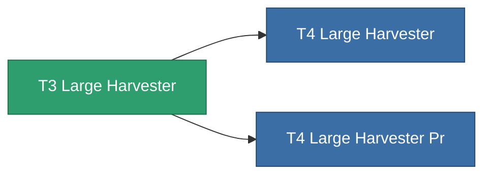

<!-- Generated by tools/generate from the live database (source: entitydefaults definition 8866, aggregatevalues via aggregatefields).
     Do not edit by hand; regenerate instead. -->

# T3 Large Harvester

|  |  |
|---|---|
| Definitie | `def_named2_large_harvester` |
| Tier | T3 |
| Levenspunten | 100 |
| Volume | 2.5 |
| Massa | 1500 |
| Categorie | Modules / Harvesting |
| Tier line | [Standard Large Harvester](/nl/content/items/standard-large-harvester/) (T1) → [T2 Large Harvester](/nl/content/items/named1-large-harvester/) (T2) → **T3 Large Harvester** (T3) → [T4 Large Harvester](/nl/content/items/named3-large-harvester/) (T4) |

## Statistieken

| Veld | Waarde |
|---|---|
| core_usage | 180 |
| cpu_usage | 468 |
| cycle_time | 11k |
| powergrid_usage | 1.44k |

<!-- production:generated -->
## Productie

**Geproduceerd uit 6 componentën** — monteer de componenten om het te bouwen (volledige lijst in [Recepten](/nl/content/recipes/)):

**Bouwtekening:** [T3 Large Harvester Cprg](/nl/content/items/named2-large-harvester-cprg/)

<svg class="prod-card-icon" aria-hidden="true"><use href="#mi-grid"/></svg><a class="prod-card-name" href="/nl/content/items/axicol/">Cryoperine</a>

vereist: <b>400</b>

<svg class="prod-card-icon" aria-hidden="true"><use href="#mi-grid"/></svg><a class="prod-card-name" href="/nl/content/items/espitium/">Espitium</a>

vereist: <b>400</b>

<svg class="prod-card-icon" aria-hidden="true"><use href="#mi-grid"/></svg><a class="prod-card-name" href="/nl/content/items/named1-large-harvester/">T2 Large Harvester</a>

vereist: <b>1</b>

<svg class="prod-card-icon" aria-hidden="true"><use href="#mi-crystal"/></svg><a class="prod-card-name" href="/nl/content/items/robotshard-common-advanced/">Functional common fragment</a>

vereist: <b>80</b>

<svg class="prod-card-icon" aria-hidden="true"><use href="#mi-crystal"/></svg><a class="prod-card-name" href="/nl/content/items/robotshard-common-basic/">Damaged common fragment</a>

vereist: <b>80</b>

<svg class="prod-card-icon" aria-hidden="true"><use href="#mi-grid"/></svg><a class="prod-card-name" href="/nl/content/items/titanium/">Titanium</a>

vereist: <b>2.4k</b>

## Gebruikt in productie

**Component van 2 items** — alles dat het in productie gebruikt:

