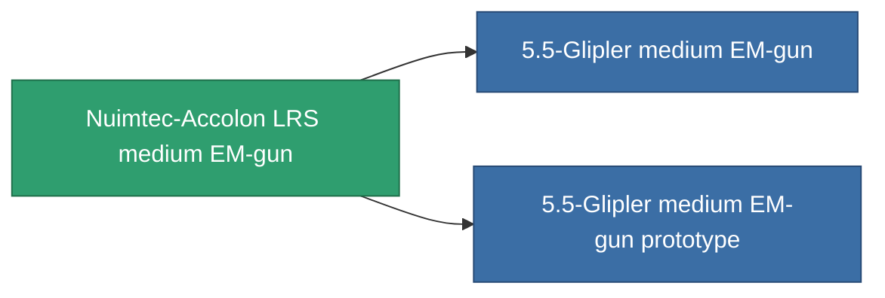

<!-- Generated by tools/generate from the live database (source: entitydefaults definition 1019, aggregatevalues via aggregatefields).
     Do not edit by hand; regenerate instead. -->

# Nuimtec-Accolon LRS medium EM-gun

|  |  |
|---|---|
| Definitie | `def_named2_longrange_medium_railgun` |
| Tier | T3 |
| Levenspunten | 100 |
| Volume | 1 |
| Massa | 650 |
| Categorie | Modules / Weapons |
| Tier line | [Condor-SPP medium EM-gun](/nl/content/items/named1-longrange-medium-railgun/) (T2) → **Nuimtec-Accolon LRS medium EM-gun** (T3) → [5.5-Glipler medium EM-gun](/nl/content/items/named3-longrange-medium-railgun/) (T4) |

## Statistieken

| Veld | Waarde |
|---|---|
| accuracy | 14 |
| core_usage | 25 |
| cpu_usage | 43 |
| cycle_time | 10k |
| damage_modifier | 2.5 |
| falloff | 6 |
| least_optimal | 22 |
| optimal_range | 30 |
| powergrid_usage | 185 |

<!-- production:generated -->
## Productie

**Geproduceerd uit 10 componentën, onderzoekslevel 6** — monteer de componenten om het te bouwen (volledige lijst in [Recepten](/nl/content/recipes/)):

**Bouwtekening:** [Nuimtec-Accolon LRS medium EM-gun CT](/content/items/named2-longrange-medium-railgun-cprg/)

<svg class="prod-card-icon" aria-hidden="true"><use href="#mi-grid"/></svg><a class="prod-card-name" href="/nl/content/items/chollonin/">Chollonin</a>

vereist: <b>50</b>

<svg class="prod-card-icon" aria-hidden="true"><use href="#mi-grid"/></svg><a class="prod-card-name" href="/nl/content/items/espitium/">Espitium</a>

vereist: <b>50</b>

<svg class="prod-card-icon" aria-hidden="true"><use href="#mi-grid"/></svg><a class="prod-card-name" href="/nl/content/items/hydrobenol/">Hydrobenol</a>

vereist: <b>100</b>

<svg class="prod-card-icon" aria-hidden="true"><use href="#mi-grid"/></svg><a class="prod-card-name" href="/nl/content/items/named1-longrange-medium-railgun/">Condor-SPP medium EM-gun</a>

vereist: <b>1</b>

<svg class="prod-card-icon" aria-hidden="true"><use href="#mi-grid"/></svg><a class="prod-card-name" href="/nl/content/items/polynitrocol/">Polynitrocol</a>

vereist: <b>100</b>

<svg class="prod-card-icon" aria-hidden="true"><use href="#mi-crystal"/></svg><a class="prod-card-name" href="/nl/content/items/robotshard-common-advanced/">Functional common fragment</a>

vereist: <b>20</b>

<svg class="prod-card-icon" aria-hidden="true"><use href="#mi-crystal"/></svg><a class="prod-card-name" href="/nl/content/items/robotshard-common-basic/">Damaged common fragment</a>

vereist: <b>20</b>

<svg class="prod-card-icon" aria-hidden="true"><use href="#mi-crystal"/></svg><a class="prod-card-name" href="/nl/content/items/robotshard-nuimqol-advanced/">Functional nuimqol fragment</a>

vereist: <b>20</b>

<svg class="prod-card-icon" aria-hidden="true"><use href="#mi-crystal"/></svg><a class="prod-card-name" href="/nl/content/items/robotshard-nuimqol-basic/">Damaged nuimqol fragment</a>

vereist: <b>20</b>

<svg class="prod-card-icon" aria-hidden="true"><use href="#mi-grid"/></svg><a class="prod-card-name" href="/nl/content/items/titanium/">Titanium</a>

vereist: <b>100</b>

## Gebruikt in productie

**Component van 2 items** — alles dat het in productie gebruikt:

