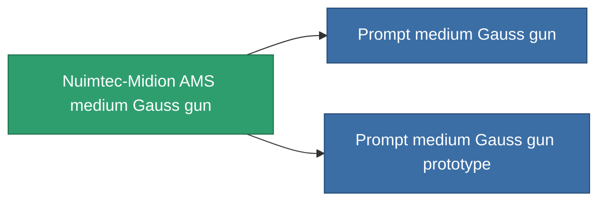

<!-- Generated by tools/generate from the live database (source: entitydefaults definition 862, aggregatevalues via aggregatefields).
     Do not edit by hand; regenerate instead. -->

# Nuimtec-Midion AMS medium Gauss gun

|  |  |
|---|---|
| Definitie | `def_named2_medium_railgun` |
| Tier | T3 |
| Levenspunten | 100 |
| Volume | 1 |
| Massa | 500 |
| Categorie | Modules / Weapons |
| Tier line | [Standard medium Gauss gun](/nl/content/items/standard-medium-railgun/) (T1) → [Iskio-Magnetor medium Gauss gun](/nl/content/items/named1-medium-railgun/) (T2) → **Nuimtec-Midion AMS medium Gauss gun** (T3) → [Prompt medium Gauss gun](/nl/content/items/named3-medium-railgun/) (T4) |

## Statistieken

| Veld | Waarde |
|---|---|
| accuracy | 13.5 |
| core_usage | 15 |
| cpu_usage | 35 |
| cycle_time | 6k |
| damage_modifier | 2 |
| falloff | 6 |
| least_optimal | 13 |
| optimal_range | 16.5 |
| powergrid_usage | 165 |

<!-- production:generated -->
## Productie

**Geproduceerd uit 8 componentën, onderzoekslevel 6** — monteer de componenten om het te bouwen (volledige lijst in [Recepten](/nl/content/recipes/)):

**Bouwtekening:** [Nuimtec-Midion AMS medium Gauss gun CT](/content/items/named2-medium-railgun-cprg/)

<svg class="prod-card-icon" aria-hidden="true"><use href="#mi-grid"/></svg><a class="prod-card-name" href="/nl/content/items/hydrobenol/">Hydrobenol</a>

vereist: <b>100</b>

<svg class="prod-card-icon" aria-hidden="true"><use href="#mi-grid"/></svg><a class="prod-card-name" href="/nl/content/items/named1-medium-railgun/">Iskio-Magnetor medium Gauss gun</a>

vereist: <b>1</b>

<svg class="prod-card-icon" aria-hidden="true"><use href="#mi-grid"/></svg><a class="prod-card-name" href="/nl/content/items/polynitrocol/">Polynitrocol</a>

vereist: <b>100</b>

<svg class="prod-card-icon" aria-hidden="true"><use href="#mi-crystal"/></svg><a class="prod-card-name" href="/nl/content/items/robotshard-common-advanced/">Functional common fragment</a>

vereist: <b>20</b>

<svg class="prod-card-icon" aria-hidden="true"><use href="#mi-crystal"/></svg><a class="prod-card-name" href="/nl/content/items/robotshard-common-basic/">Damaged common fragment</a>

vereist: <b>20</b>

<svg class="prod-card-icon" aria-hidden="true"><use href="#mi-crystal"/></svg><a class="prod-card-name" href="/nl/content/items/robotshard-nuimqol-advanced/">Functional nuimqol fragment</a>

vereist: <b>20</b>

<svg class="prod-card-icon" aria-hidden="true"><use href="#mi-crystal"/></svg><a class="prod-card-name" href="/nl/content/items/robotshard-nuimqol-basic/">Damaged nuimqol fragment</a>

vereist: <b>20</b>

<svg class="prod-card-icon" aria-hidden="true"><use href="#mi-grid"/></svg><a class="prod-card-name" href="/nl/content/items/titanium/">Titanium</a>

vereist: <b>100</b>

## Gebruikt in productie

**Component van 2 items** — alles dat het in productie gebruikt:

