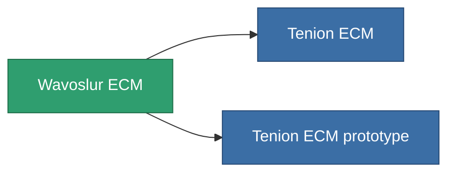

<!-- Generated by tools/generate from the live database (source: entitydefaults definition 790, aggregatevalues via aggregatefields).
     Do not edit by hand; regenerate instead. -->

# Wavoslur ECM

|  |  |
|---|---|
| Definitie | `def_named2_sensor_jammer` |
| Tier | T3 |
| Levenspunten | 100 |
| Volume | 0.5 |
| Massa | 150 |
| Categorie | Modules / Sensors & scanning |
| Tier line | [Standard ECM](/nl/content/items/standard-sensor-jammer/) (T1) → [Occyt-OEW ECM](/nl/content/items/named1-sensor-jammer/) (T2) → **Wavoslur ECM** (T3) → [Tenion ECM](/nl/content/items/named3-sensor-jammer/) (T4) |

## Statistieken

| Veld | Waarde |
|---|---|
| core_usage | 75 |
| cpu_usage | 57 |
| cycle_time | 10k |
| ecm_strength | 32 |
| falloff | 0 |
| optimal_range | 32 |
| powergrid_usage | 26 |

<!-- production:generated -->
## Productie

**Geproduceerd uit 10 componentën, onderzoekslevel 5** — monteer de componenten om het te bouwen (volledige lijst in [Recepten](/nl/content/recipes/)):

**Bouwtekening:** [Wavoslur ECM CT](/content/items/named2-sensor-jammer-cprg/)

<svg class="prod-card-icon" aria-hidden="true"><use href="#mi-grid"/></svg><a class="prod-card-name" href="/nl/content/items/chollonin/">Chollonin</a>

vereist: <b>100</b>

<svg class="prod-card-icon" aria-hidden="true"><use href="#mi-grid"/></svg><a class="prod-card-name" href="/nl/content/items/espitium/">Espitium</a>

vereist: <b>100</b>

<svg class="prod-card-icon" aria-hidden="true"><use href="#mi-grid"/></svg><a class="prod-card-name" href="/nl/content/items/hydrobenol/">Hydrobenol</a>

vereist: <b>50</b>

<svg class="prod-card-icon" aria-hidden="true"><use href="#mi-grid"/></svg><a class="prod-card-name" href="/nl/content/items/named1-sensor-jammer/">Occyt-OEW ECM</a>

vereist: <b>1</b>

<svg class="prod-card-icon" aria-hidden="true"><use href="#mi-grid"/></svg><a class="prod-card-name" href="/nl/content/items/polynitrocol/">Polynitrocol</a>

vereist: <b>50</b>

<svg class="prod-card-icon" aria-hidden="true"><use href="#mi-crystal"/></svg><a class="prod-card-name" href="/nl/content/items/robotshard-common-advanced/">Functional common fragment</a>

vereist: <b>10</b>

<svg class="prod-card-icon" aria-hidden="true"><use href="#mi-crystal"/></svg><a class="prod-card-name" href="/nl/content/items/robotshard-common-basic/">Damaged common fragment</a>

vereist: <b>10</b>

<svg class="prod-card-icon" aria-hidden="true"><use href="#mi-crystal"/></svg><a class="prod-card-name" href="/nl/content/items/robotshard-nuimqol-advanced/">Functional nuimqol fragment</a>

vereist: <b>10</b>

<svg class="prod-card-icon" aria-hidden="true"><use href="#mi-crystal"/></svg><a class="prod-card-name" href="/nl/content/items/robotshard-nuimqol-basic/">Damaged nuimqol fragment</a>

vereist: <b>10</b>

<svg class="prod-card-icon" aria-hidden="true"><use href="#mi-grid"/></svg><a class="prod-card-name" href="/nl/content/items/titanium/">Titanium</a>

vereist: <b>50</b>

## Gebruikt in productie

**Component van 2 items** — alles dat het in productie gebruikt:

