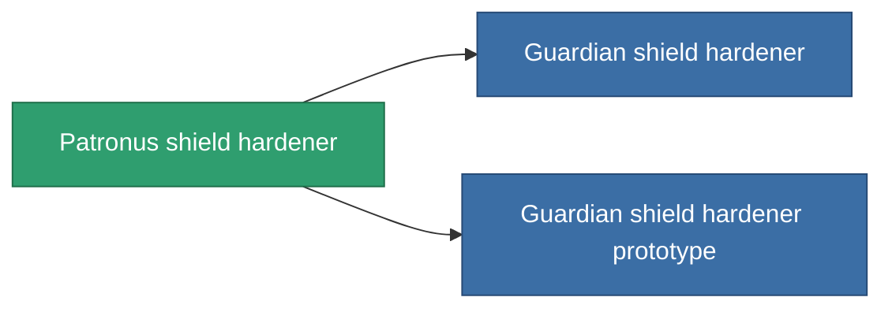

<!-- Generated by tools/generate from the live database (source: entitydefaults definition 733, aggregatevalues via aggregatefields).
     Do not edit by hand; regenerate instead. -->

# Patronus shield hardener

|  |  |
|---|---|
| Definitie | `def_named2_shield_hardener` |
| Tier | T3 |
| Levenspunten | 100 |
| Volume | 0.5 |
| Massa | 300 |
| Categorie | Modules / Shield |
| Tier line | [Standard shield hardener](/nl/content/items/standard-shield-hardener/) (T1) → [Bund shield hardener](/nl/content/items/named1-shield-hardener/) (T2) → **Patronus shield hardener** (T3) → [Guardian shield hardener](/nl/content/items/named3-shield-hardener/) (T4) |
| Opmerking | ettol a modultol tud jobban mudkodni a pajzs = kevesebb lesz a core csokkenes |

## Statistieken

| Veld | Waarde |
|---|---|
| cpu_usage | 50 |
| powergrid_usage | 20 |
| shield_absorbtion_modifier | 1.25 |

<!-- production:generated -->
## Productie

**Geproduceerd uit 10 componentën, onderzoekslevel 5** — monteer de componenten om het te bouwen (volledige lijst in [Recepten](/nl/content/recipes/)):

**Bouwtekening:** [Patronus shield hardener CT](/content/items/named2-shield-hardener-cprg/)

<svg class="prod-card-icon" aria-hidden="true"><use href="#mi-grid"/></svg><a class="prod-card-name" href="/nl/content/items/alligior/">Alligior</a>

vereist: <b>150</b>

<svg class="prod-card-icon" aria-hidden="true"><use href="#mi-grid"/></svg><a class="prod-card-name" href="/nl/content/items/espitium/">Espitium</a>

vereist: <b>200</b>

<svg class="prod-card-icon" aria-hidden="true"><use href="#mi-grid"/></svg><a class="prod-card-name" href="/nl/content/items/isopropentol/">Isopropentol</a>

vereist: <b>150</b>

<svg class="prod-card-icon" aria-hidden="true"><use href="#mi-tree"/></svg><a class="prod-card-name" href="/nl/content/items/named1-shield-hardener/">Bund shield hardener</a>

vereist: <b>1</b>

<svg class="prod-card-icon" aria-hidden="true"><use href="#mi-crystal"/></svg><a class="prod-card-name" href="/nl/content/items/robotshard-common-advanced/">Functional common fragment</a>

vereist: <b>10</b>

<svg class="prod-card-icon" aria-hidden="true"><use href="#mi-crystal"/></svg><a class="prod-card-name" href="/nl/content/items/robotshard-common-basic/">Damaged common fragment</a>

vereist: <b>10</b>

<svg class="prod-card-icon" aria-hidden="true"><use href="#mi-crystal"/></svg><a class="prod-card-name" href="/nl/content/items/robotshard-pelistal-advanced/">Functional pelistal fragment</a>

vereist: <b>10</b>

<svg class="prod-card-icon" aria-hidden="true"><use href="#mi-crystal"/></svg><a class="prod-card-name" href="/nl/content/items/robotshard-pelistal-basic/">Damaged pelistal fragment</a>

vereist: <b>10</b>

<svg class="prod-card-icon" aria-hidden="true"><use href="#mi-grid"/></svg><a class="prod-card-name" href="/nl/content/items/titanium/">Titanium</a>

vereist: <b>50</b>

<svg class="prod-card-icon" aria-hidden="true"><use href="#mi-grid"/></svg><a class="prod-card-name" href="/nl/content/items/vitricyl/">Vitricyl</a>

vereist: <b>200</b>

## Gebruikt in productie

**Component van 2 items** — alles dat het in productie gebruikt:

