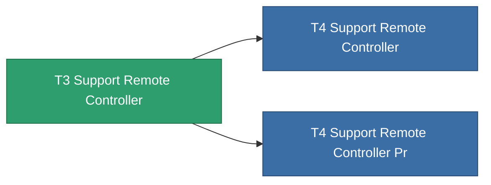

<!-- Generated by tools/generate from the live database (source: entitydefaults definition 8585, aggregatevalues via aggregatefields).
     Do not edit by hand; regenerate instead. -->

# T3 Support Remote Controller

|  |  |
|---|---|
| Definitie | `def_named2_support_remote_controller` |
| Tier | T3 |
| Levenspunten | 100 |
| Volume | 1 |
| Massa | 1 |
| Categorie | Modules / Remote control |
| Tier line | [Standard Support Remote Controller](/nl/content/items/standard-support-remote-controller/) (T1) → [T2 Support Remote Controller](/nl/content/items/named1-support-remote-controller/) (T2) → **T3 Support Remote Controller** (T3) → [T4 Support Remote Controller](/nl/content/items/named3-support-remote-controller/) (T4) |

## Statistieken

| Veld | Waarde |
|---|---|
| core_usage | 165 |
| cpu_usage | 67 |
| cycle_time | 7.5k |
| drone_amplification_armor_max_modifier | 1 |
| drone_amplification_core_max_modifier | 1 |
| drone_amplification_core_recharge_time_modifier | 1 |
| drone_amplification_locking_time_modifier | 1 |
| drone_amplification_reactor_radiation_modifier | 1 |
| drone_amplification_remote_repair_amount_modifier | 1 |
| drone_amplification_remote_repair_cycle_time_modifier | 1 |
| drone_amplification_speed_max_modifier | 1 |
| powergrid_usage | 67 |
| remote_control_bandwidth_max | 0 |
| remote_control_lifetime | 240k |
| remote_control_operational_range | 25 |

<!-- production:generated -->
## Productie

**Geproduceerd uit 8 componentën** — monteer de componenten om het te bouwen (volledige lijst in [Recepten](/nl/content/recipes/)):

**Bouwtekening:** [T3 Support Remote Controller Cprg](/content/items/named2-support-remote-controller-cprg/)

<svg class="prod-card-icon" aria-hidden="true"><use href="#mi-grid"/></svg><a class="prod-card-name" href="/nl/content/items/axicol/">Cryoperine</a>

vereist: <b>250</b>

<svg class="prod-card-icon" aria-hidden="true"><use href="#mi-grid"/></svg><a class="prod-card-name" href="/nl/content/items/axicoline/">Axicoline</a>

vereist: <b>100</b>

<svg class="prod-card-icon" aria-hidden="true"><use href="#mi-grid"/></svg><a class="prod-card-name" href="/nl/content/items/espitium/">Espitium</a>

vereist: <b>175</b>

<svg class="prod-card-icon" aria-hidden="true"><use href="#mi-grid"/></svg><a class="prod-card-name" href="/nl/content/items/hydrobenol/">Hydrobenol</a>

vereist: <b>50</b>

<svg class="prod-card-icon" aria-hidden="true"><use href="#mi-grid"/></svg><a class="prod-card-name" href="/nl/content/items/named1-support-remote-controller/">T2 Support Remote Controller</a>

vereist: <b>1</b>

<svg class="prod-card-icon" aria-hidden="true"><use href="#mi-crystal"/></svg><a class="prod-card-name" href="/nl/content/items/robotshard-common-advanced/">Functional common fragment</a>

vereist: <b>20</b>

<svg class="prod-card-icon" aria-hidden="true"><use href="#mi-crystal"/></svg><a class="prod-card-name" href="/nl/content/items/robotshard-common-basic/">Damaged common fragment</a>

vereist: <b>20</b>

<svg class="prod-card-icon" aria-hidden="true"><use href="#mi-grid"/></svg><a class="prod-card-name" href="/nl/content/items/titanium/">Titanium</a>

vereist: <b>50</b>

## Gebruikt in productie

**Component van 2 items** — alles dat het in productie gebruikt:

