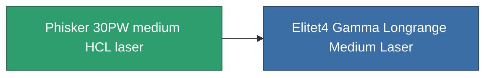

<!-- Generated by tools/generate from the live database (source: entitydefaults definition 1026, aggregatevalues via aggregatefields).
     Do not edit by hand; regenerate instead. -->

# Phisker 30PW medium HCL laser

|  |  |
|---|---|
| Definitie | `def_named3_longrange_medium_laser` |
| Tier | T4 |
| Levenspunten | 100 |
| Volume | 1 |
| Massa | 715 |
| Categorie | Modules / Weapons |
| Tier line | [Tertzer medium HCL laser](/nl/content/items/named1-longrange-medium-laser/) (T2) → [Thelotec-Iocle I. medium HCL laser](/nl/content/items/named2-longrange-medium-laser/) (T3) → **Phisker 30PW medium HCL laser** (T4) |

## Statistieken

| Veld | Waarde |
|---|---|
| accuracy | 12 |
| core_usage | 24 |
| cpu_usage | 35 |
| cycle_time | 6k |
| damage_modifier | 1.3 |
| falloff | 10 |
| least_optimal | 12 |
| optimal_range | 37.5 |
| powergrid_usage | 250 |

<!-- production:generated -->
## Productie

**Geproduceerd uit 12 componentën, onderzoekslevel 7** — monteer de componenten om het te bouwen (volledige lijst in [Recepten](/nl/content/recipes/)):

**Bouwtekening:** [Phisker 30PW medium HCL laser CT](/nl/content/items/named3-longrange-medium-laser-cprg/)

<svg class="prod-card-icon" aria-hidden="true"><use href="#mi-grid"/></svg><a class="prod-card-name" href="/nl/content/items/espitium/">Espitium</a>

vereist: <b>100</b>

<svg class="prod-card-icon" aria-hidden="true"><use href="#mi-grid"/></svg><a class="prod-card-name" href="/nl/content/items/hydrobenol/">Hydrobenol</a>

vereist: <b>200</b>

<svg class="prod-card-icon" aria-hidden="true"><use href="#mi-robots"/></svg><a class="prod-card-name" href="/nl/content/items/named2-longrange-medium-laser/">Thelotec-Iocle I. medium HCL laser</a>

vereist: <b>1</b>

<svg class="prod-card-icon" aria-hidden="true"><use href="#mi-grid"/></svg><a class="prod-card-name" href="/nl/content/items/polynucleit/">Polynucleit</a>

vereist: <b>200</b>

<svg class="prod-card-icon" aria-hidden="true"><use href="#mi-grid"/></svg><a class="prod-card-name" href="/nl/content/items/prilumium/">Prilumium</a>

vereist: <b>100</b>

<svg class="prod-card-icon" aria-hidden="true"><use href="#mi-crystal"/></svg><a class="prod-card-name" href="/nl/content/items/robotshard-common-advanced/">Functional common fragment</a>

vereist: <b>30</b>

<svg class="prod-card-icon" aria-hidden="true"><use href="#mi-crystal"/></svg><a class="prod-card-name" href="/nl/content/items/robotshard-common-basic/">Damaged common fragment</a>

vereist: <b>15</b>

<svg class="prod-card-icon" aria-hidden="true"><use href="#mi-crystal"/></svg><a class="prod-card-name" href="/nl/content/items/robotshard-common-expert/">Perfect common fragment</a>

vereist: <b>45</b>

<svg class="prod-card-icon" aria-hidden="true"><use href="#mi-crystal"/></svg><a class="prod-card-name" href="/nl/content/items/robotshard-thelodica-advanced/">Functional thelodica fragment</a>

vereist: <b>30</b>

<svg class="prod-card-icon" aria-hidden="true"><use href="#mi-crystal"/></svg><a class="prod-card-name" href="/nl/content/items/robotshard-thelodica-basic/">Damaged thelodica fragment</a>

vereist: <b>15</b>

<svg class="prod-card-icon" aria-hidden="true"><use href="#mi-crystal"/></svg><a class="prod-card-name" href="/nl/content/items/robotshard-thelodica-expert/">Perfect thelodica fragment</a>

vereist: <b>45</b>

<svg class="prod-card-icon" aria-hidden="true"><use href="#mi-grid"/></svg><a class="prod-card-name" href="/nl/content/items/unimetal/">Briochit</a>

vereist: <b>200</b>

## Gebruikt in productie

**Component van 1 items** — alles dat het in productie gebruikt:

