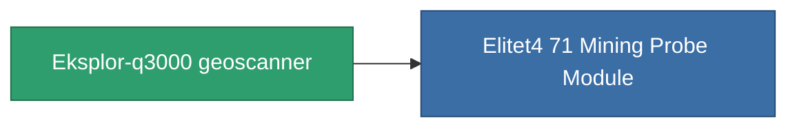

<!-- Generated by tools/generate from the live database (source: entitydefaults definition 782, aggregatevalues via aggregatefields).
     Do not edit by hand; regenerate instead. -->

# Eksplor-q3000 geoscanner

|  |  |
|---|---|
| Definitie | `def_named3_mining_probe_module` |
| Tier | T4 |
| Levenspunten | 100 |
| Volume | 1 |
| Massa | 200 |
| Categorie | Modules / Enhancements |
| Tier line | [Standard geoscanner](/nl/content/items/standard-mining-probe-module/) (T1) → [Ovostec-Chisomel geoscanner](/nl/content/items/named1-mining-probe-module/) (T2) → [Syverz geoscanner](/nl/content/items/named2-mining-probe-module/) (T3) → **Eksplor-q3000 geoscanner** (T4) |

## Statistieken

| Veld | Waarde |
|---|---|
| core_usage | 90 |
| cpu_usage | 60 |
| cycle_time | 10k |
| mining_probe_accuracy | 0.7 |
| powergrid_usage | 53 |

<!-- production:generated -->
## Productie

**Geproduceerd uit 8 componentën, onderzoekslevel 4** — monteer de componenten om het te bouwen (volledige lijst in [Recepten](/nl/content/recipes/)):

**Bouwtekening:** [Eksplor-q3000 geoscanner CT](/nl/content/items/named3-mining-probe-module-cprg/)

<svg class="prod-card-icon" aria-hidden="true"><use href="#mi-grid"/></svg><a class="prod-card-name" href="/nl/content/items/axicol/">Cryoperine</a>

vereist: <b>350</b>

<svg class="prod-card-icon" aria-hidden="true"><use href="#mi-grid"/></svg><a class="prod-card-name" href="/nl/content/items/espitium/">Espitium</a>

vereist: <b>350</b>

<svg class="prod-card-icon" aria-hidden="true"><use href="#mi-grid"/></svg><a class="prod-card-name" href="/nl/content/items/named2-mining-probe-module/">Syverz geoscanner</a>

vereist: <b>1</b>

<svg class="prod-card-icon" aria-hidden="true"><use href="#mi-crystal"/></svg><a class="prod-card-name" href="/nl/content/items/robotshard-common-advanced/">Functional common fragment</a>

vereist: <b>30</b>

<svg class="prod-card-icon" aria-hidden="true"><use href="#mi-crystal"/></svg><a class="prod-card-name" href="/nl/content/items/robotshard-common-basic/">Damaged common fragment</a>

vereist: <b>15</b>

<svg class="prod-card-icon" aria-hidden="true"><use href="#mi-crystal"/></svg><a class="prod-card-name" href="/nl/content/items/robotshard-common-expert/">Perfect common fragment</a>

vereist: <b>45</b>

<svg class="prod-card-icon" aria-hidden="true"><use href="#mi-grid"/></svg><a class="prod-card-name" href="/nl/content/items/titanium/">Titanium</a>

vereist: <b>50</b>

<svg class="prod-card-icon" aria-hidden="true"><use href="#mi-grid"/></svg><a class="prod-card-name" href="/nl/content/items/unimetal/">Briochit</a>

vereist: <b>50</b>

## Gebruikt in productie

**Component van 1 items** — alles dat het in productie gebruikt:

