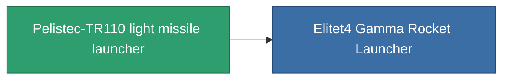

<!-- Generated by tools/generate from the live database (source: entitydefaults definition 851, aggregatevalues via aggregatefields).
     Do not edit by hand; regenerate instead. -->

# Pelistec-TR110 light missile launcher

|  |  |
|---|---|
| Definitie | `def_named3_rocket_launcher` |
| Tier | T4 |
| Levenspunten | 100 |
| Volume | 1 |
| Massa | 275 |
| Categorie | Modules / Weapons |
| Tier line | [Standard light missile launcher](/nl/content/items/standard-rocket-launcher/) (T1) → [Pelistec-Horosol DBM light missile launcher](/nl/content/items/named1-rocket-launcher/) (T2) → [Morteq light missile launcher](/nl/content/items/named2-rocket-launcher/) (T3) → **Pelistec-TR110 light missile launcher** (T4) |

## Statistieken

| Veld | Waarde |
|---|---|
| accuracy | 1 |
| core_usage | 1 |
| cpu_usage | 34 |
| cycle_time | 6.5k |
| damage_modifier | 1 |
| module_missile_range_modifier | 1.2 |
| powergrid_usage | 29 |

<!-- production:generated -->
## Productie

**Geproduceerd uit 10 componentën, onderzoekslevel 5** — monteer de componenten om het te bouwen (volledige lijst in [Recepten](/nl/content/recipes/)):

**Bouwtekening:** [Pelistec-TR110 light missile launcher CT](/nl/content/items/named3-rocket-launcher-cprg/)

<svg class="prod-card-icon" aria-hidden="true"><use href="#mi-grid"/></svg><a class="prod-card-name" href="/nl/content/items/hydrobenol/">Hydrobenol</a>

vereist: <b>100</b>

<svg class="prod-card-icon" aria-hidden="true"><use href="#mi-star"/></svg><a class="prod-card-name" href="/nl/content/items/named2-rocket-launcher/">Morteq light missile launcher</a>

vereist: <b>1</b>

<svg class="prod-card-icon" aria-hidden="true"><use href="#mi-grid"/></svg><a class="prod-card-name" href="/nl/content/items/phlobotil/">Phlobotil</a>

vereist: <b>100</b>

<svg class="prod-card-icon" aria-hidden="true"><use href="#mi-crystal"/></svg><a class="prod-card-name" href="/nl/content/items/robotshard-common-advanced/">Functional common fragment</a>

vereist: <b>15</b>

<svg class="prod-card-icon" aria-hidden="true"><use href="#mi-crystal"/></svg><a class="prod-card-name" href="/nl/content/items/robotshard-common-basic/">Damaged common fragment</a>

vereist: <b>7</b>

<svg class="prod-card-icon" aria-hidden="true"><use href="#mi-crystal"/></svg><a class="prod-card-name" href="/nl/content/items/robotshard-common-expert/">Perfect common fragment</a>

vereist: <b>22</b>

<svg class="prod-card-icon" aria-hidden="true"><use href="#mi-crystal"/></svg><a class="prod-card-name" href="/nl/content/items/robotshard-pelistal-advanced/">Functional pelistal fragment</a>

vereist: <b>15</b>

<svg class="prod-card-icon" aria-hidden="true"><use href="#mi-crystal"/></svg><a class="prod-card-name" href="/nl/content/items/robotshard-pelistal-basic/">Damaged pelistal fragment</a>

vereist: <b>7</b>

<svg class="prod-card-icon" aria-hidden="true"><use href="#mi-crystal"/></svg><a class="prod-card-name" href="/nl/content/items/robotshard-pelistal-expert/">Perfect pelistal fragment</a>

vereist: <b>22</b>

<svg class="prod-card-icon" aria-hidden="true"><use href="#mi-grid"/></svg><a class="prod-card-name" href="/nl/content/items/unimetal/">Briochit</a>

vereist: <b>100</b>

## Gebruikt in productie

**Component van 1 items** — alles dat het in productie gebruikt:

