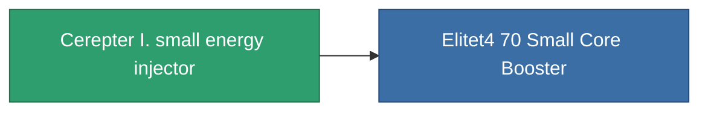

<!-- Generated by tools/generate from the live database (source: entitydefaults definition 824, aggregatevalues via aggregatefields).
     Do not edit by hand; regenerate instead. -->

# Cerepter I. small energy injector

|  |  |
|---|---|
| Definitie | `def_named3_small_core_booster` |
| Tier | T4 |
| Levenspunten | 100 |
| Volume | 0.5 |
| Massa | 100 |
| Categorie | Modules / Enhancements |
| Tier line | [Standard small energy injector](/nl/content/items/standard-small-core-booster/) (T1) → [CC25-Veo small energy injector](/nl/content/items/named1-small-core-booster/) (T2) → [Joffret-Refiller small energy injector](/nl/content/items/named2-small-core-booster/) (T3) → **Cerepter I. small energy injector** (T4) |

## Statistieken

| Veld | Waarde |
|---|---|
| core_usage | 0 |
| cpu_usage | 22 |
| cycle_time | 17k |
| powergrid_usage | 60 |

<!-- production:generated -->
## Productie

**Geproduceerd uit 8 componentën, onderzoekslevel 5** — monteer de componenten om het te bouwen (volledige lijst in [Recepten](/nl/content/recipes/)):

**Bouwtekening:** [Cerepter I. small energy injector CT](/content/items/named3-small-core-booster-cprg/)

<svg class="prod-card-icon" aria-hidden="true"><use href="#mi-grid"/></svg><a class="prod-card-name" href="/nl/content/items/axicol/">Cryoperine</a>

vereist: <b>100</b>

<svg class="prod-card-icon" aria-hidden="true"><use href="#mi-grid"/></svg><a class="prod-card-name" href="/nl/content/items/espitium/">Espitium</a>

vereist: <b>100</b>

<svg class="prod-card-icon" aria-hidden="true"><use href="#mi-grid"/></svg><a class="prod-card-name" href="/nl/content/items/named2-small-core-booster/">Joffret-Refiller small energy injector</a>

vereist: <b>1</b>

<svg class="prod-card-icon" aria-hidden="true"><use href="#mi-crystal"/></svg><a class="prod-card-name" href="/nl/content/items/robotshard-common-advanced/">Functional common fragment</a>

vereist: <b>30</b>

<svg class="prod-card-icon" aria-hidden="true"><use href="#mi-crystal"/></svg><a class="prod-card-name" href="/nl/content/items/robotshard-common-basic/">Damaged common fragment</a>

vereist: <b>15</b>

<svg class="prod-card-icon" aria-hidden="true"><use href="#mi-crystal"/></svg><a class="prod-card-name" href="/nl/content/items/robotshard-common-expert/">Perfect common fragment</a>

vereist: <b>45</b>

<svg class="prod-card-icon" aria-hidden="true"><use href="#mi-grid"/></svg><a class="prod-card-name" href="/nl/content/items/titanium/">Titanium</a>

vereist: <b>100</b>

<svg class="prod-card-icon" aria-hidden="true"><use href="#mi-grid"/></svg><a class="prod-card-name" href="/nl/content/items/unimetal/">Briochit</a>

vereist: <b>100</b>

## Gebruikt in productie

**Component van 1 items** — alles dat het in productie gebruikt:

