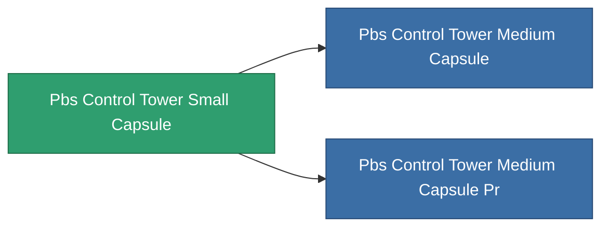

<!-- Generated by tools/generate from the live database (source: entitydefaults definition 4700, aggregatevalues via aggregatefields).
     Do not edit by hand; regenerate instead. -->

# Pbs Control Tower Small Capsule

|  |  |
|---|---|
| Definitie | `def_pbs_control_tower_small_capsule` |
| Tier | T1 |
| Levenspunten | 100 |
| Volume | 10 |
| Massa | 10000 |
| Categorie | Special & other / Miscellaneous |

## Statistieken

| Veld | Waarde |
|---|---|
| armor_max | 50k |
| resist_chemical | 30 |
| resist_explosive | 30 |
| resist_kinetic | 30 |
| resist_thermal | 30 |
| signature_radius | 20 |
| stealth_strength | 50 |

<!-- production:generated -->
## Productie

**Geproduceerd uit 4 componentën** — monteer de componenten om het te bouwen (volledige lijst in [Recepten](/nl/content/recipes/)):

**Bouwtekening:** [Standard command relay foundation CT](/content/items/pbs-control-tower-small-capsule-cprg/)

<svg class="prod-card-icon" aria-hidden="true"><use href="#mi-grid"/></svg><a class="prod-card-name" href="/nl/content/items/axicol/">Cryoperine</a>

vereist: <b>500</b>

<svg class="prod-card-icon" aria-hidden="true"><use href="#mi-grid"/></svg><a class="prod-card-name" href="/nl/content/items/espitium/">Espitium</a>

vereist: <b>500</b>

<svg class="prod-card-icon" aria-hidden="true"><use href="#mi-grid"/></svg><a class="prod-card-name" href="/nl/content/items/titanium/">Titanium</a>

vereist: <b>500</b>

<svg class="prod-card-icon" aria-hidden="true"><use href="#mi-grid"/></svg><a class="prod-card-name" href="/nl/content/items/unimetal/">Briochit</a>

vereist: <b>500</b>

## Gebruikt in productie

**Component van 2 items** — alles dat het in productie gebruikt:

