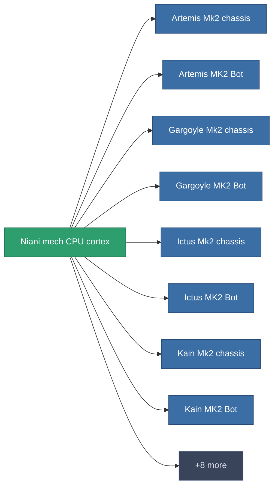

<!-- Generated by tools/generate from the live database (source: entitydefaults definition 2945, aggregatevalues via aggregatefields).
     Do not edit by hand; regenerate instead. -->

# Niani mech CPU cortex

|  |  |
|---|---|
| Definitie | `def_reactore_core_mech` |
| Tier | – |
| Levenspunten | 100 |
| Volume | 1.5 |
| Massa | 2000 |
| Categorie | Materials |

_Geen statistieken — dit item draagt geen geaggregeerde waarden._

<!-- production:generated -->
## Gebruikt in productie

**Component van 16 items** — een voorbeeld van wat ermee geproduceerd kan worden (volledige lijst in [Recepten](/nl/content/recipes/)).

