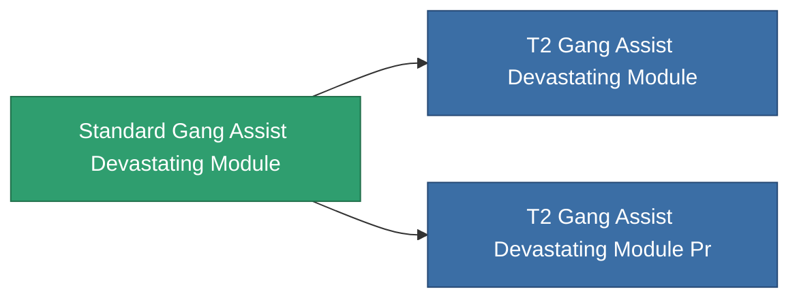

<!-- Generated by tools/generate from the live database (source: entitydefaults definition 2556, aggregatevalues via aggregatefields).
     Do not edit by hand; regenerate instead. -->

# Standard Gang Assist Devastating Module

|  |  |
|---|---|
| Definitie | `def_standard_gang_assist_devastating_module` |
| Tier | T1 |
| Levenspunten | 100 |
| Volume | 0.2 |
| Massa | 50 |
| Categorie | Modules / Enhancements |
| Tier line | **Standard Gang Assist Devastating Module** (T1) → [T2 Gang Assist Devastating Module](/nl/content/items/named1-gang-assist-devastating-module/) (T2) → [T3 Gang Assist Devastating Module](/nl/content/items/named2-gang-assist-devastating-module/) (T3) → [T4 Gang Assist Devastating Module](/nl/content/items/named3-gang-assist-devastating-module/) (T4) |
| Opmerking | devastating chancet novel |

## Statistieken

| Veld | Waarde |
|---|---|
| core_usage | 35 |
| cpu_usage | 85 |
| cycle_time | 10k |
| default_effect_range | 100 |
| effect_devastate_resilience_modifier | 1.02 |
| powergrid_usage | 35 |

<!-- production:generated -->
## Gebruikt in productie

**Component van 2 items** — alles dat het in productie gebruikt:

