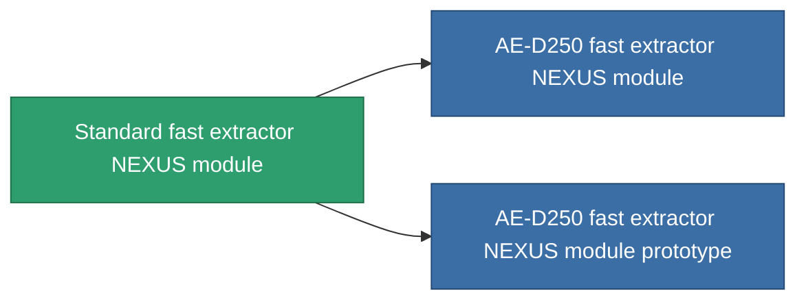

<!-- Generated by tools/generate from the live database (source: entitydefaults definition 2558, aggregatevalues via aggregatefields).
     Do not edit by hand; regenerate instead. -->

# Standard fast extractor NEXUS module

|  |  |
|---|---|
| Definitie | `def_standard_gang_assist_fast_extraction_module` |
| Tier | T1 |
| Levenspunten | 100 |
| Volume | 0.2 |
| Massa | 50 |
| Categorie | Modules / Enhancements |
| Tier line | **Standard fast extractor NEXUS module** (T1) → [AE-D250 fast extractor NEXUS module](/nl/content/items/named1-gang-assist-fast-extraction-module/) (T2) → [Matriot-II fast extractor NEXUS module](/nl/content/items/named2-gang-assist-fast-extraction-module/) (T3) → [Matriot-IV fast extractor NEXUS module](/nl/content/items/named3-gang-assist-fast-extraction-module/) (T4) |
| Opmerking | gathering cycletimet csokkent |

## Statistieken

| Veld | Waarde |
|---|---|
| core_usage | 35 |
| cpu_usage | 85 |
| cycle_time | 10k |
| default_effect_range | 100 |
| effect_gathering_cycle_time_modifier | 0.98 |
| powergrid_usage | 35 |

<!-- production:generated -->
## Productie

**Geproduceerd uit 3 componentën, onderzoekslevel 4** — monteer de componenten om het te bouwen (volledige lijst in [Recepten](/nl/content/recipes/)):

**Bouwtekening:** [Standard fast extractor NEXUS module CT](/content/items/standard-gang-assist-fast-extraction-module-cprg/)

<svg class="prod-card-icon" aria-hidden="true"><use href="#mi-grid"/></svg><a class="prod-card-name" href="/nl/content/items/axicol/">Cryoperine</a>

vereist: <b>500</b>

<svg class="prod-card-icon" aria-hidden="true"><use href="#mi-grid"/></svg><a class="prod-card-name" href="/nl/content/items/plasteosine/">Plasteosine</a>

vereist: <b>50</b>

<svg class="prod-card-icon" aria-hidden="true"><use href="#mi-grid"/></svg><a class="prod-card-name" href="/nl/content/items/titanium/">Titanium</a>

vereist: <b>50</b>

## Gebruikt in productie

**Component van 2 items** — alles dat het in productie gebruikt:

