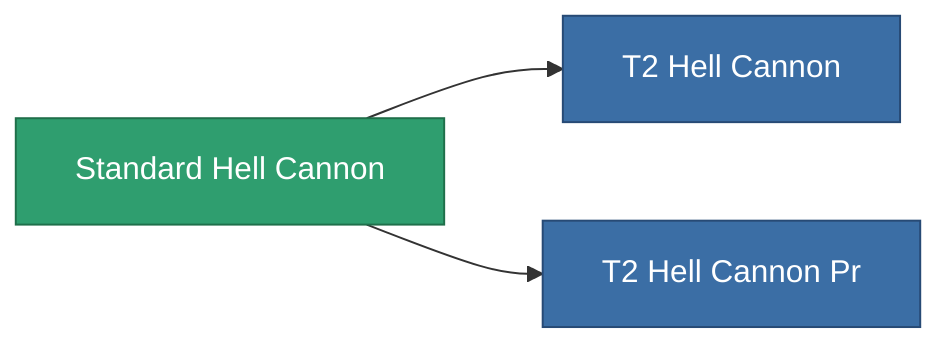

<!-- Generated by tools/generate from the live database (source: entitydefaults definition 62, aggregatevalues via aggregatefields).
     Do not edit by hand; regenerate instead. -->

# Standard Hell Cannon

|  |  |
|---|---|
| Definitie | `def_standard_hell_cannon` |
| Tier | T1 |
| Levenspunten | 100 |
| Volume | 1.8 |
| Massa | 1100 |
| Categorie | Modules / Weapons |
| Tier line | **Standard Hell Cannon** (T1) → [T2 Hell Cannon](/nl/content/items/named1-hell-cannon/) (T2) → [T3 Hell Cannon](/nl/content/items/named2-hell-cannon/) (T3) → [T4 Hell Cannon](/nl/content/items/named3-hell-cannon/) (T4) |

## Statistieken

| Veld | Waarde |
|---|---|
| accuracy | 44 |
| core_usage | 2 |
| cpu_usage | 55 |
| cycle_time | 8k |
| damage_modifier | 2.2 |
| falloff | 20 |
| optimal_range | 15 |
| powergrid_usage | 195 |

<!-- production:generated -->
## Productie

**Geproduceerd uit 5 componentën** — monteer de componenten om het te bouwen (volledige lijst in [Recepten](/nl/content/recipes/)):

**Bouwtekening:** [Standard Hell Cannon Cprg](/content/items/standard-hell-cannon-cprg/)

<svg class="prod-card-icon" aria-hidden="true"><use href="#mi-grid"/></svg><a class="prod-card-name" href="/nl/content/items/alligior/">Alligior</a>

vereist: <b>100</b>

<svg class="prod-card-icon" aria-hidden="true"><use href="#mi-grid"/></svg><a class="prod-card-name" href="/nl/content/items/biotichrin/">Biotichrin</a>

vereist: <b>100</b>

<svg class="prod-card-icon" aria-hidden="true"><use href="#mi-grid"/></svg><a class="prod-card-name" href="/nl/content/items/espitium/">Espitium</a>

vereist: <b>50</b>

<svg class="prod-card-icon" aria-hidden="true"><use href="#mi-grid"/></svg><a class="prod-card-name" href="/nl/content/items/specimen-sap-item-flux/">Specimen Sap Item Flux</a>

vereist: <b>10</b>

<svg class="prod-card-icon" aria-hidden="true"><use href="#mi-grid"/></svg><a class="prod-card-name" href="/nl/content/items/titanium/">Titanium</a>

vereist: <b>100</b>

## Gebruikt in productie

**Component van 2 items** — alles dat het in productie gebruikt:

