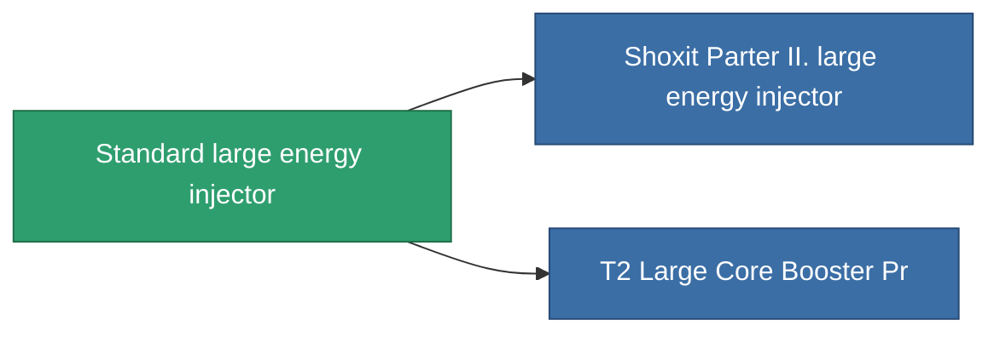

<!-- Generated by tools/generate from the live database (source: entitydefaults definition 650, aggregatevalues via aggregatefields).
     Do not edit by hand; regenerate instead. -->

# Standard large energy injector

|  |  |
|---|---|
| Definitie | `def_standard_large_core_booster` |
| Tier | T1 |
| Levenspunten | 100 |
| Volume | 2 |
| Massa | 1600 |
| Categorie | Modules / Enhancements |
| Tier line | **Standard large energy injector** (T1) → [Shoxit Parter II. large energy injector](/nl/content/items/named1-large-core-booster/) (T2) → [CC90-Tensio large energy injector](/nl/content/items/named2-large-core-booster/) (T3) → [Rymur DTTO large energy injector](/nl/content/items/named3-large-core-booster/) (T4) |

## Statistieken

| Veld | Waarde |
|---|---|
| core_usage | 0 |
| cpu_usage | 375 |
| cycle_time | 6.05k |
| powergrid_usage | 1.25k |

<!-- production:generated -->
## Productie

**Geproduceerd uit 3 componentën** — monteer de componenten om het te bouwen (volledige lijst in [Recepten](/nl/content/recipes/)):

**Bouwtekening:** [Standard Large Core Booster Cprg](/content/items/standard-large-core-booster-cprg/)

<svg class="prod-card-icon" aria-hidden="true"><use href="#mi-grid"/></svg><a class="prod-card-name" href="/nl/content/items/axicol/">Cryoperine</a>

vereist: <b>600</b>

<svg class="prod-card-icon" aria-hidden="true"><use href="#mi-grid"/></svg><a class="prod-card-name" href="/nl/content/items/specimen-sap-item-flux/">Specimen Sap Item Flux</a>

vereist: <b>5</b>

<svg class="prod-card-icon" aria-hidden="true"><use href="#mi-grid"/></svg><a class="prod-card-name" href="/nl/content/items/titanium/">Titanium</a>

vereist: <b>300</b>

## Gebruikt in productie

**Component van 2 items** — alles dat het in productie gebruikt:

